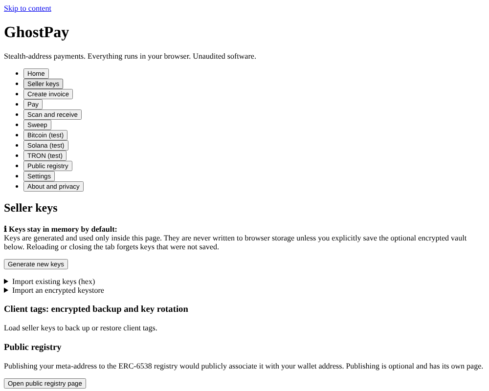
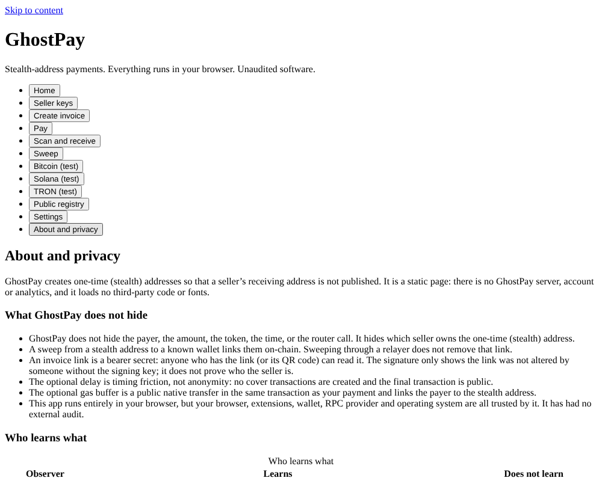

# GhostPay

Experimental **software artwork** exploring client-side invoices and stealth-address payments. The functional descriptions, development status, risks, licensing and acceptance gates below remain applicable.

GhostPay is an open-source project for client-side invoice creation and stealth-address payments on EVM networks. A seller publishes one stealth meta-address; every payment goes to a fresh one-time address that only the seller can find and spend from.

The goal is to reduce address reuse and limit routine exposure of invoice details. Blockchain transactions and much of their metadata remain public, so GhostPay does **not** claim anonymity or unlinkability. See [what it does not hide](docs/user/privacy-limits.md).

## Status (read this first)

**Current active development scope (November 2026): static GitHub Pages browser client only.** The latest
independently owned, unmerged Pages candidate is **[draft PR #137](https://github.com/djshellshoxxx/GhostPay/pull/137)**
at exact source `ac08062ec540d429a0bfb24f3aab042be5d212eb`. Its hosted [application CI](https://github.com/djshellshoxxx/GhostPay/actions/runs/43316935399)
passed 24/24 jobs, and [Pages artifact/browser acceptance](https://github.com/djshellshoxxx/GhostPay/actions/runs/43316935362)
passed against local Anvil. These are pre-release test results **only**; PR #137 is not merged, the site is not
published, and these checks do not constitute independent audit or public-testnet qualification.

The isolated [Pages release-verifier correction #138](https://github.com/djshellshoxxx/GhostPay/pull/138)
was separately qualified by [application CI](https://github.com/djshellshoxxx/GhostPay/actions/runs/43361570866)
and [Pages acceptance](https://github.com/djshellshoxxx/GhostPay/actions/runs/43361570930), but is **draft and not integrated**
into #137. The [Pages RPC-status regression/correction #141](https://github.com/djshellshoxxx/GhostPay/pull/141)
confirmed an expected failing test at [test-only head](https://github.com/djshellshoxxx/GhostPay/actions/runs/43367179500).
Its corrected head `68aca93bc19e4c9d91fa37212d9b8c502b4ce884` passed
[application CI (24/24)](https://github.com/djshellshoxxx/GhostPay/actions/runs/43374154941),
[Pages qualification](https://github.com/djshellshoxxx/GhostPay/actions/runs/43374154915) and
[beta acceptance](https://github.com/djshellshoxxx/GhostPay/actions/runs/43374155075);
it is still draft and unintegrated. The isolated [Pages post-deploy smoke correction #142](https://github.com/djshellshoxxx/GhostPay/pull/142)
at tested source `83fec506a11d6eada06a2d046f74769a7c7f6b63` strengthens same-origin
project-subpath containment. Its [application CI](https://github.com/djshellshoxxx/GhostPay/actions/runs/43380983039)
passed 24/24 jobs, and [Pages build/browser qualification](https://github.com/djshellshoxxx/GhostPay/actions/runs/43380982983)
passed both applicable jobs. The live post-deployment smoke, deployment and release jobs were
**skipped**. The draft is still unintegrated; these infrastructure checks do not establish a deployed-client
vulnerability, a successful live smoke test or authorization to publish.

A separate [combined Pages qualification draft #143](https://github.com/djshellshoxxx/GhostPay/pull/143)
now stages **exactly the seven tested source/test files** from #138, #141 and #142 on an isolated branch
based on #137, with handoff only as its eighth changed path. Head `b5e77c50ae33a99683e67406393d53e79d4f8e99`
is **draft, unmerged and not deployed**. Its fresh [application CI](https://github.com/djshellshoxxx/GhostPay/actions/runs/43403545664),
[Pages qualification](https://github.com/djshellshoxxx/GhostPay/actions/runs/43403547522) and
[beta acceptance](https://github.com/djshellshoxxx/GhostPay/actions/runs/43403545627) were pending or in progress
at this source-pinned check. The owner’s separate backup-verification and device-sleep fixes remain outstanding,
and even a successful #143 CI result would not qualify their eventual combined integration.

The earlier [combined beta PR #135](https://github.com/djshellshoxxx/GhostPay/pull/135)
and its [source-pinned handoff](docs/handoffs/BETA_CANDIDATE_LATEST.md) remain preserved as **historical,
unmerged, non-Pages development**. CLI, server, relayer, native apps and other non-Pages release variants are **paused**;
they must not be described as part of the active static-site beta. The 18 privacy proposals in PR #99 remain
**future-only**. See [Pages release scope and limitations](docs/pages/README.md) and the version-controlled
[Pages qualification matrix](docs/wiki/Verification-and-Release-Gates.md).

The inherited [SonarCloud rating D report](https://github.com/djshellshoxxx/GhostPay/runs/128302927200)
remains unresolved without accepted exact-head Security Rating A evidence. Release also requires ADR-0029 owner
approval, a dedicated hosting origin, signed testnet manifests, an externally qualified testnet deployment,
independent security review, provenance and separate explicit owner publication authorization. No real funds.

Review the [product handoff](docs/handoffs/PRODUCT_COMPLETION_HANDOFF.md),
[CLI handoff](docs/handoffs/CLI_COMPLETION_HANDOFF.md),
[completion gates](docs/audits/08-completion-gates.md), and version-controlled
[User Guide](docs/wiki/User-Guide.md) / [Developer Guide](docs/wiki/Developer-Guide.md).
The older test counts below are historical snapshots only.

| Question | Honest answer |
|---|---|
| Is it audited? | **No.** Only self-run and AI-assisted reviews exist ([`docs/audits/`](docs/audits/)). There is no independent third-party audit. |
| Are public-chain deployments qualified? | **No.** Local test deployments exist only as fixtures; [`deployments/`](deployments/) holds no qualified public deployment. Without an accepted manifest the web app disables ordinary payment. |
| Which chains are enabled in code? | Seven testnets are enabled in [`chains.ts`](packages/chain-adapters/src/config/chains.ts): Ethereum, Base, OP and Arbitrum Sepolia, Polygon Amoy, BNB Smart Chain Testnet and Avalanche Fuji. Mainnets remain disabled. |
| What execution evidence exists? | Unit tests, local Anvil integrations and hosted Chromium journeys are recorded in the handoffs. They do not qualify real wallets, funded public-chain operations, Safari or physical devices. |
| Is production hosting qualified? | **No.** A Pages prototype is documented, but no qualified production host is recorded. See [Hosting](#hosting). |
| Can I use it with real money? | **No.** Do not. Contracts are immutable once deployed and the audit round has open findings. |

Open work is tracked in the audits: [completeness audit](docs/audits/01-completeness-audit.md) (gap list G-01..G-33), [contracts review](docs/audits/02-security-review-contracts.md), [client and relayer review](docs/audits/03-security-review-client-relayer.md) and [design analysis](docs/audits/04-independent-design-analysis.md). Several fixes are being applied by other contributors while this README is written; where a document describes a change that may not have landed yet it says so.

## Screenshots

Captured from the Vite dev server (`npm run dev --workspace @ghostpay/web`) on a clean checkout, with no deployment manifest loaded, so payment is disabled. The app currently ships with minimal, largely unstyled markup.

| Seller keys (keys stay in memory by default) | About and privacy (who learns what) |
|---|---|
|  |  |

## Package map

| Path | What it is |
|---|---|
| `packages/contracts` | Foundry project: `GhostPayRouter` (checkout, 25 bps fee, ERC-5564 announcement), `GhostPaySweepRelayer` (gas-sponsored sweep via EIP-712 + ERC-2612 permit), `PolicyAccount` and `PolicyAccountFactory` (experimental; see [ADR-0014](docs/adr/ADR-LOG.md)), and `GhostPayPolicyRouter` (see below). No owner, proxy, pause or admin. Not deployed. |
| `packages/core-crypto` | Scheme-1 stealth key derivation, view-tag check, metadata builders, non-serialisable secrets. |
| `packages/invoice-schema` | Invoice schema, strict parser, signing, AES-GCM envelope, `#gpi=v1.` link format. |
| `packages/chain-adapters` | Chain and token allowlists, fee maths, deployment-manifest validation, RPC, log scanning, router and sweep builders, quote reading. |
| `packages/btc-silent-payments` | BIP-352 Silent Payments: keys, addresses, sender derivation, scanning, spend-key derivation, Bitcoin `ChainAdapter`, and signed PSBT/raw-tx sweeps (`buildSpendTransaction`, software keys only). Used by the web app's Bitcoin view. Official vectors pass; mainnet stays disabled. |
| `packages/policy-scheme` | Client side of the policy-account scheme `0x47500002` (policy hash, limits tree, scheme-2 meta-address, derivation, EIP-712 and calldata). Used by the web app's disabled experimental testnet feature; not ordinary invoices or the relayer. See [ADR-0027](docs/adr/ADR-0027-policy-end-to-end-gates.md). |
| `packages/relayer-guard` | Relayer abuse controls: circuit breaker, trusted-proxy client IP, token-bucket limiter, loss budget, and a challenge module (HMAC question challenge; raises bot cost only). The relayer uses the guard controls; challenge storage is optional and is not proof of identity. |
| `packages/secret-box` | Closure-held secret bytes with scoped wiping (guardrail, not a security boundary). Used for web session secret handling. |
| `packages/tx-review` | Pre-sign decoder and reviewer for transactions and EIP-712 payloads. Used by web sweep transaction review. |
| `packages/address-safety` | Address and display-text safety checks (strict parse, lookalikes, fingerprints, payee trust, text sanitising). Used by web sweep and display-text flows. |
| `packages/ops-monitor` | Operator-run, read-only chain-side probes (manifest drift, fee-recipient health, release integrity, hot key, announcement rate, RPC disagreement). **Not wired in anywhere; never run against a live network.** |
| `apps/web` | React 19 + Vite static app: seller keys, invoice creation, pay, scan, sweep, receipt verification, public device pairing, local reconciliation, backups and settings. Full and lean builds intentionally expose different optional features; see the [product guide](docs/user/product-guide.md). |
| `apps/relayer` | Node gas-sponsorship relay service for sweeps (stateless quotes, simulation, budgets, circuit breaker). |
| `deployments/` | Manifest schema and format notes. No real manifests yet. See [`docs/DEPLOYMENT_MANIFEST.md`](docs/DEPLOYMENT_MANIFEST.md). |
| `test-vectors/` | Pinned scheme-1 vectors and their provenance. |
| `scripts/`, `.github/workflows/` | Release build, verification and CI scripts (being added; see [`docs/operators/release-and-verify.md`](docs/operators/release-and-verify.md)). |
| `docs/` | Specifications, ADRs, threat model, audits, user guides, operator runbooks, feature reviews. |

**Further workspaces** (all pre-audit; most are testnet proofs of concept or pure-logic libraries; each has a README with its own limits). The list above is not exhaustive: `ls packages` is authoritative.

- Product and CLI: `packages/cli` (`ghostpay` binary: invoices, webhooks, schedules, splits, batch payouts, exports, sandbox, doctor; offline by default), `sdk`, `plugin-api`, `payment-uri`, `qr-exchange`, `i18n`, `donation`, `sandbox`.
- Merchant: `merchant-billing`, `merchant-hooks`, `merchant-ledger`, `merchant-multisig`.
- Other chains: `btc-family`, `btc-payjoin`, `chain-evm-extra` (config-only manifests), `chain-solana` / `solana-stealth`, `chain-tron` / `tron-adapter`.
- Privacy options (testnet PoC): `amount-blur`, `hops`, `hygiene`, `metadata-hardening`, `payer-sponsor`, `payer-hiding-contracts`, `privacy-pipeline`, `privacy-profiles`, `confidential-amounts`, `confidential-contracts`, `external-pools*`, `pool-*` (shielded pool; the circuits use an INSECURE DEV CEREMONY; `pool-prover` and `pool-circuits` are GPL-3.0 toolchain packages, licence is an open owner decision), `net-transport`, `net-harness`, `pir-two-server`, `scan-source`.
- Usability logic (pure, no UI): the `ux-*` packages.

Several of these (for example `cli`, `payment-uri`, `qr-exchange`) are built by `npm run build:libs`; `apps/web` imports only the packages named below.

Workspace wiring is checked by `@ghostpay/*` imports. The web app uses `chain-adapters`, `core-crypto`, `invoice-schema`, `btc-silent-payments`, `secret-box`, `tx-review`, and `address-safety`; the relayer uses `chain-adapters` and `relayer-guard`. Other packages remain standalone unless their package-specific documentation says otherwise.

Each package has its own README and a `DEVIATIONS.md` listing where the code differs from the specs. Where a README and the code disagree, the code wins and the discrepancy is a bug in the README.

## Build and test

Requirements: Node >= 22 (`engines` in `package.json`; CI uses 22), Foundry 1.8.5 for the contracts.

```bash
npm ci --ignore-scripts      # install exactly what package-lock.json says, run no install scripts (the CI form)
npm run build:libs           # REQUIRED before typecheck/test/build: workspaces resolve each other through dist/
npm run typecheck
npm run lint
npm test                     # vitest with coverage thresholds in every workspace that has a test script
npm run build --workspace @ghostpay/web    # also runs the bundle scan (scripts/scan-bundle.mjs)
npm run test:e2e --workspace @ghostpay/web # Playwright; needs a Chromium build (not run by `npm test`)
npm run ci:scan-secrets      # scripts/scan-secrets.sh
npm run ci:check-actions     # scripts/check-actions-pinned.sh
npm run release:build        # scripts/release-build.sh
npm run release:repro        # scripts/repro-check.sh
```

CI ([`.github/workflows/ci.yml`](.github/workflows/ci.yml)) runs these jobs; docs-only pull requests (only `docs/` or `*.md` changed) skip the heavy ones:

- `ts-typecheck` (`npm run typecheck`), `ts-lint` (`npm run lint`) and `ts-check` (`npm run build`, the build-profile and example guard tests, `node scripts/i18n/check.mjs`, `npm audit --omit=dev --audit-level=high`) run in parallel.
- `ts-test` (matrix `core-crypto`, `btc-silent-payments`, `web`, `rest`): `npm test` per workspace; `rest` is every other workspace except `apps/relayer`.
- `ts-test-relayer`: `forge build` in `packages/contracts`, then `npm test -w apps/relayer` with `REQUIRE_ANVIL=1` (anvil e2e).
- `e2e`: `npx playwright install --with-deps chromium`, then `npm run test:e2e --workspace @ghostpay/web`.
- `contracts-test` (`forge build --sizes`, `forge test`), `contracts-coverage` (`forge coverage --ir-minimum --report summary --report lcov --report-file lcov.info`), `contracts-static` (`forge fmt --check`, `bash scripts/check-natspec.sh`, `forge snapshot --check`), `contracts-slither` (slither 0.11.6, solc 0.8.28, `--fail-medium`).
- `secrets-and-egress`: `scripts/scan-secrets.sh`, `scripts/check-actions-pinned.sh`, `scripts/check-tx-origin.sh`.
- Required-check gates: `typescript` (needs `ts-typecheck`, `ts-lint`, `ts-check`, `ts-test`, `ts-test-relayer`) and `contracts` (needs the four contracts jobs). `e2e` is not part of either gate.

The commands above describe the available gates. Executed checks, source revisions and unavailable
checks for this assignment are recorded in the [product completion ledger](docs/handoffs/PRODUCT_COMPLETION_HANDOFF.md).
Do not interpret a listed command as a passing result. The following October results are retained as
historical evidence; their earlier failures and skips do not establish the current branch's status.

Re-checked 2026-11-11 (Node 22.22.0, sandbox without Foundry or internet): `npm ci --ignore-scripts` and `npm run build:libs` succeed and the apps/web dev server serves the app. A full `npm test` was not completed: it stops at `@ghostpay/confidential-contracts` (`hardhat test` needs to download a Solidity compiler, which the sandbox could not reach) and later workspaces, including `apps/web`, did not finish within the time cap. Every workspace that ran before that point passed. The older snapshot below predates many added packages.

Verified on a clean checkout of an earlier `HEAD` on 2026-10-21 (Node 22.22.0, npm 10.9.4): `npm ci --ignore-scripts`, `npm run build:libs` and `npm test` succeed. Test counts at that time: btc-silent-payments 286, chain-adapters 216, core-crypto 54, invoice-schema 174, relayer 192 passed + 1 skipped, web 320. The skipped relayer test is the anvil end-to-end test; it skips when `anvil` or `packages/contracts/out` is missing (set `ANVIL_BIN`, run `forge build` first). The newer [`docs/remote/STATUS.md`](docs/remote/STATUS.md) records per-package counts and coverage from the latest local run (2026-10-21: e.g. btc-silent-payments 299, policy-scheme 60, relayer 193, forge 377 tests in 23 suites) and its failures (one `forge coverage --ir-minimum` test fails). Counts change as work lands; treat them as a snapshot, not a guarantee. Note: CI sets `REQUIRE_ANVIL=1` for the relayer, but `apps/relayer/src/e2e.anvil.test.ts` does not read it yet (only `packages/policy-scheme` does), so that e2e can still skip silently there.

Contracts (from `packages/contracts`):

```bash
forge build
forge fmt --check
forge test                                  # default profile: 10 000 fuzz runs, invariants 256 x 50
FOUNDRY_PROFILE=dev forge test              # quick loop
bash scripts/check-natspec.sh
```

`packages/contracts/foundry.toml` pins portable `solc_version = "0.8.28"`. For offline development,
use the same compiler in Foundry's cache or set `FOUNDRY_SOLC` to its local path; no configuration edit
is needed. Run the complete test suite, including the adversarial cases under `test/audit/`.

Forge result when this README was first written: 231 tests passed without `test/audit/`, plus 43 audit PoC tests. [`docs/remote/STATUS.md`](docs/remote/STATUS.md) (2026-10-21 run) records 377 passing in 23 suites, `forge fmt --check` and `forge snapshot --check` passing, and one test failing only under `forge coverage --ir-minimum`.

This product work does not establish public-chain acceptance, Firefox/Safari coverage or physical-wallet
qualification. Echidna and mutation results below belong to their linked local-run reports.

### GhostPayPolicyRouter

`packages/contracts/src/GhostPayPolicyRouter.sol` is the scheme-2 checkout router. Like `GhostPayRouter` it takes the 25 bps floor fee, forwards the net amount and emits an ERC-5564 announcement with the 57-byte metadata, but it only pays policy accounts: the caller passes `(owner, policyHash)` and the router requires `stealth == FACTORY.predictAddress(owner, policyHash)`. The announcement uses scheme id `0x47500002` (this addresses audit finding M-02 for the router path). Entry points: `payERC20`, `payERC20WithPermit`, `payNative`, `payERC20WithBuffer`; announcer, fee recipient and factory are immutable; no owner, pause or upgrade path. Deploy script: `packages/contracts/script/DeployPolicyRouter.s.sol`; client calldata in `packages/policy-scheme/src/router.ts`. It is not deployed and not enabled in the app or relayer (ADR-0014 gates still apply).

### Echidna and mutation testing (local runs only)

- Echidna harnesses: `packages/contracts/test/echidna/Echidna{Router,Sweep,Policy}.sol` with shared config `packages/contracts/echidna.yaml` (property mode, 300 000 calls each). Results and limits: [`docs/remote/contracts-assurance.md`](docs/remote/contracts-assurance.md). `echidna_canary_*` properties are expected to fail by design.
- Mutation testing (gambit, 582 mutants over the five contracts): 565 killed before new tests, 573/577 (99.3 %) after adding `packages/contracts/test/mutation_local/` (4 files); the 4 survivors were triaged as equivalent mutants. Details and limits (dev-profile fuzz runs): [`docs/remote/mutation-results-local.md`](docs/remote/mutation-results-local.md).
- Neither is in CI. These are the authors' local results, not independently reproduced, and not an audit.

### BTC spending

`@ghostpay/btc-silent-payments` powers the web app's Bitcoin view. It can sweep detected Silent Payment outputs: `buildSpendTransaction` derives the BIP-352 spend key per output, builds and signs a key-path PSBT/raw transaction (software keys only; hardware wallets out of scope) and self-verifies the signatures. It is verified against the official BIP-352 vectors and noble schnorr, not against Bitcoin Core or a network; mainnet remains disabled.

### Pages prototype

A prototype static build of `apps/web` is published from an orphan `gh-pages` branch (procedure, CSP limits, theme overlay): [`docs/remote/pages-prototype.md`](docs/remote/pages-prototype.md). Payments stay disabled there (no deployment manifest); it is not a hardened production host and does not change the [Hosting](#hosting) position.

## Documentation

Start with these, in order:

0. [Documentation index](docs/INDEX.md) and [remote-extensions check status](docs/remote/STATUS.md)
1. [Spec review and corrections](docs/SPEC_REVIEW.md) (resolves conflicts between the older documents; read first)
2. [Fee schedule and revenue architecture](docs/FEE_SCHEDULE.md)
3. [Contracts specification](docs/CONTRACTS_SPEC.md), [Web app and relayer specification](docs/APP_AND_RELAYER_SPEC.md), [Multi-chain specification](docs/MULTICHAIN_SPEC.md)
4. [Architecture decision records](docs/adr/ADR-LOG.md) (ADR-0011..0015 cover chains/tokens, quotes, fees, policy accounts, hosting)
5. [Threat model](docs/threat-model/THREAT_MODEL.md) and [Security policy](SECURITY.md)
6. [Deployment manifest](docs/DEPLOYMENT_MANIFEST.md) and [third-party register](THIRD_PARTY.md)

For users (plain language): the [product guide](docs/user/product-guide.md), [merchant setup](docs/guides/getting-started-merchants.md), [technology attribution](docs/user/technology-attribution.md), and [user-guide index](docs/user/README.md). The built website includes local Help and Privacy pages. For operators: [docs/operators/](docs/operators/) (relayer runbook, deployment runbook, mirror hosting, local scanner and RPC, chain-enablement checklist, release and verification). Per-feature security reviews: [docs/reviews/](docs/reviews/).

Older, broader planning documents (partly superseded; stale parts are annotated in place):

- [Post-Launch Feature Expansion and Advanced Security Roadmap](docs/POST_LAUNCH_FEATURES_SECURITY_ROADMAP.md)
- [Security, QA, DevOps, and Feature Expansion Playbook](docs/SECURITY_QA_DEVOPS_PLAYBOOK.md)
- [Developer Specification and Execution Blueprint](docs/DEVELOPER_SPECIFICATION.md)
- [Master Blueprint](docs/MASTER_BLUEPRINT.md)

Standards:

- [EIP-5564: Stealth Addresses](https://eips.ethereum.org/EIPS/eip-5564)
- [EIP-6538: Stealth Meta-Address Registry](https://eips.ethereum.org/EIPS/eip-6538)
- [ERC-4337: Account Abstraction](https://eips.ethereum.org/EIPS/eip-4337)

## Fees (summary)

Full text: [docs/FEE_SCHEDULE.md](docs/FEE_SCHEDULE.md) and the user-facing [fees guide](docs/user/fees.md).

- **Checkout fee: 0.25 % (25 bps), rounded down**, charged by `GhostPayRouter` on payments routed through it. Payments below 400 base units pay no fee. The fee recipient and rate are immutable per deployment and are shown in the app from the deployment manifest.
- **Paying the stealth address directly costs no GhostPay fee.** The fee is only enforceable where funds pass through GhostPay's contract; a payer can bypass it and forks of the client can remove it. This is by design and disclosed.
- **Gas-sponsored sweep:** a relayer fee of `max(gas cost x 1.10, 50 bps)`, capped at 300 bps, taken from the swept token amount and fixed inside the seller's signature. Policy-account creation has a flat fee (contracts only; no UI).
- The owner's wallet is never hard-coded in source. The fee recipient address is a deployment-time value that the owner still has to decide (SPEC_REVIEW section D).

## Security limitations (summary)

Full text: [privacy limits](docs/user/privacy-limits.md) and the [threat model](docs/threat-model/THREAT_MODEL.md).

- Pre-audit software. Nothing here is a guarantee.
- Payer, amount, token, timing and the use of the GhostPay router are public on-chain.
- **A sweep can undo the privacy:** the payer knows the stealth address, so the payer (and anyone) can follow the funds to your destination wallet. Use a fresh destination. A relayer sees owner, destination, amount and timing. Gasless is not unlinkable (audit D1, D8).
- An invoice link is a bearer secret: anyone with it can read the invoice. Browsers may keep the link in their history database even though the app clears the address bar (audit S3-03).
- A compromised frontend can steal keys. The ordinary payment path checks manifest signatures against bundled release keys and verifies deployment readback. Real release trust roots and deployment evidence remain prerequisites. The in-app release-hash widget cannot detect a tampered host.
- Announcement discovery is separate from verified payment evidence. Unverified payer-supplied metadata, imported history and seller-signed receipts must not establish payment. The disabled scheme-2 flow has its own remaining acceptance gates.
- The fee recipient is immutable: if it is blacklisted by a token issuer or cannot receive ETH, checkout for that asset stops until a new router is deployed (audit D5 / contracts M-01).
- Fiat-priced invoices are disabled in practice: no oracle feed addresses are configured (ADR-0012).
- Policy accounts (scheme `0x47500002`) have an experimental testnet client behind a disabled feature flag. The complete supported flow and lost-key recovery remain unqualified; see [ADR-0027](docs/adr/ADR-0027-policy-end-to-end-gates.md).

## Hosting

**Hosting is intentionally not configured yet.** There is no deployment target, domain, `ghostpay.eth` record, IPFS pin, Tor mirror or Pages setup, and the release workflow deliberately stops at a draft release. See [ADR-0015](docs/adr/ADR-LOG.md) for the gating decision.

What must happen first:

1. **Deployment manifests exist and are verified:** contracts deployed on a testnet with a throw-away recipient, then a reviewed manifest, bytecode hashes read back from the chain, and the manifest compiled into the hashed bundle (see [DEPLOYMENT_MANIFEST.md](docs/DEPLOYMENT_MANIFEST.md); implementation in progress).
2. **Fee recipient decided by the owner:** a hardware wallet or multisig that accepts ETH and is unlikely to be blacklisted ([deployment runbook](docs/operators/deployment-runbook.md)).
3. **Signed releases:** signed tag, `SHA256SUMS`, SBOM, reproducible build, and a verification procedure users can follow from a separate machine ([release and verify](docs/operators/release-and-verify.md)). The fingerprint of the signing key has not been published.
4. **Legal review and terms:** the fee model, sanctions and compliance position (ADR-0006), a terms page and a privacy notice for any hosted frontend or relayer. This is an owner action and has not happened.
5. **A host with header control** (Cloudflare Pages `_headers`) as the primary target; GitHub Pages only as a degraded mirror ([mirror hosting](docs/operators/mirror-hosting.md)).

## Licence

No licence has been chosen. All packages are marked `UNLICENSED`; this is an open owner decision (SPEC_REVIEW section D). Third-party licences are listed in [THIRD_PARTY.md](THIRD_PARTY.md).
