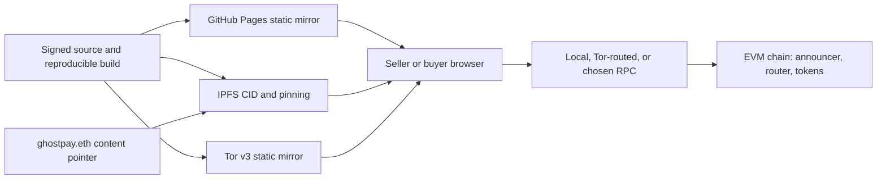

# GhostPay Developer Specification and Execution Blueprint

**Status:** Developer-ready design baseline; not an implementation or security audit.  
**Research checked:** 2026-10-21. Review linked standards and upstream releases again before pinning dependencies or deploying.

## Scope and non-goals

GhostPay is a client-first EVM invoice and stealth-payment application. This specification defines separable packages, protocol interfaces, data formats, threat boundaries, and staged build gates.

It does **not** promise absolute anonymity, confidential on-chain amounts, or that a relayer can make a public stealth-address sweep unlinkable. EIP-5564 hides the recipient relationship at the address layer when used correctly; transfers, senders, amounts, timestamps, contract calls, and transaction graphs remain public. ERC-4337 provides account abstraction and gas sponsorship, not a mixer or anonymity set.

### Security invariants

1. Spending keys, viewing keys, plaintext invoice data, invoice decryption keys, and seeds remain in the browser process and must never be sent to RPC, relay, analytics, logging, crash-reporting, or hosting endpoints.
2. RPC requests contain only public chain query/transaction data. Scanning queries must not include viewing keys.
3. The UI displays and requires wallet confirmation of the exact chain, token, stealth destination, amount, fee, and contract call.
4. Every invoice payload is versioned, size-limited, authenticated where applicable, parsed as data (never HTML), and fails closed on malformed input.
5. Cryptographic derivation follows the selected EIP-5564 scheme exactly and passes published vectors and independent differential tests.
6. Any hosted RPC, bundler, paymaster, oracle, relay, pinning provider, or web host is an observable third party and is optional where practical.
7. No mainnet funds until contracts and client release artifacts receive independent review.

---

# Section 1: Detailed technical specifications by module

## System/package boundaries

Use a TypeScript workspace (pnpm or npm workspaces) with isolated packages. Modules may consume public key material and public transaction data across boundaries; secret-bearing values use explicit in-memory types and must not be serialized to telemetry.

```text
packages/
  core-crypto/       @ghostpay/core-crypto
  invoice-schema/    @ghostpay/invoice-schema
  chain-adapters/    @ghostpay/chain-adapters
  relayer-adapter/  @ghostpay/relayer-adapter
  contracts/         @ghostpay/contracts
apps/
  ui/                @ghostpay/ui
  indexer/           optional, non-authoritative public-log cache
```

- **core-crypto:** EIP-5564 scheme 1 key validation, derivation, scan check, stealth private key computation, serialization, test vectors.
- **invoice-schema:** canonical typed invoice schema, parser/serializer, encryption envelope, signature verification; no UI or RPC dependencies.
- **chain-adapters:** chain IDs, token metadata, announcer/router ABIs, quote adapters, log pagination, finality policy.
- **contracts:** Solidity contracts, deployment scripts, invariant/fuzz tests, verified ABI exports.
- **relayer-adapter:** client protocol for optional token-authorized sweep requests; no secret keys, viewing keys, or raw invoice details.
- **ui:** seller and payer flows, browser wallet integration, local persistence controls, Web Worker orchestration.
- **indexer:** optional cache for public announcement logs. It must never receive a viewing key or claim to be trustless; clients independently verify all matches.

### Dependency policy

- TypeScript strict mode, ESM, locked package manager and lockfile, reproducible builds.
- Pin reviewed versions of `@noble/curves`, `@noble/hashes`, `@noble/ciphers`, `viem` (or ethers), and Solidity dependencies. Review release notes, advisories, source provenance, and lockfile diffs on each upgrade.
- The Noble project describes its curve packages as audited and cross-tested; that is useful evidence, not a guarantee that every version/API use is safe. Import only explicit subpaths, minimize dependency surface, and use test vectors. See the [upstream repository and security policy](https://github.com/paulmillr/noble-curves).
- Use Web Crypto `crypto.getRandomValues` for ephemeral private key entropy and AES-GCM nonces. Never use `Math.random()`.
- Do not include analytics, advertising, remote fonts, third-party scripts, or error-reporting SDKs in the secret-handling page.
- HTML uses semantic HTML5, React renders text nodes by default, and untrusted invoice data is never passed to `dangerouslySetInnerHTML`.

---

## Module A: `@ghostpay/contracts` — Solidity

### Contract separation

Do not replace or alter the standard EIP-5564 singleton announcer. EIP-5564 specifies `Announcement(schemeId indexed, stealthAddress indexed, caller indexed, ephemeralPubKey, metadata)`; the view tag is the **first byte of metadata**, not a separate indexed argument. Use the canonical announcer at the address specified in EIP-5564 when deployed and verified on the target network. A GhostPay payment router is optional and separate.

A 0.25% fee is enforceable only when payment uses a wrapper/router (or equivalent token authorization); a direct transfer to a stealth address bypasses the protocol fee. A fee recipient and the split are public. Immutable code improves reviewability but makes mistakes permanent.

### Interfaces and implementation skeleton

The following illustrates the boundary and checks; it is intentionally incomplete and must be completed, compiled, audited, and fuzzed before deployment.

```solidity
// SPDX-License-Identifier: MIT
pragma solidity ^0.8.24;

interface IERC5564Announcer {
    event Announcement(
        uint256 indexed schemeId,
        address indexed stealthAddress,
        address indexed caller,
        bytes ephemeralPubKey,
        bytes metadata
    );

    function announce(
        uint256 schemeId,
        address stealthAddress,
        bytes calldata ephemeralPubKey,
        bytes calldata metadata
    ) external;
}

interface IERC20Minimal {
    function transferFrom(address from, address to, uint256 amount)
        external returns (bool);
}

interface IERC20MetadataMinimal {
    function decimals() external view returns (uint8);
}

/// @dev Production code must use a reviewed SafeERC20/ReentrancyGuard implementation
/// pinned to a known OpenZeppelin release; this excerpt shows the protocol boundary.
contract GhostPayPaymentRouter {
    error InvalidConfiguration();
    error InvalidPayment();
    error InvalidMetadata();
    error TransferFailed();

    uint256 public constant FEE_BPS = 25; // 25 / 10_000 = 0.25%
    uint256 private constant BPS_DENOMINATOR = 10_000;

    IERC5564Announcer public immutable announcer;
    address public immutable feeRecipient;
    uint256 public immutable schemeId;

    event GhostPaySettled(
        bytes32 indexed invoiceId,
        address indexed payer,
        address indexed stealthAddress,
        address token,
        uint256 grossAmount,
        uint256 feeAmount,
        uint256 netAmount
    );

    constructor(
        IERC5564Announcer announcer_,
        address feeRecipient_,
        uint256 schemeId_
    ) {
        if (address(announcer_) == address(0) ||
            feeRecipient_ == address(0) ||
            schemeId_ != 1) revert InvalidConfiguration();

        announcer = announcer_;
        feeRecipient = feeRecipient_;
        schemeId = schemeId_;
    }

    function payERC20(
        bytes32 invoiceId,
        IERC20Minimal token,
        address stealthAddress,
        uint256 grossAmount,
        bytes calldata ephemeralPubKey,
        bytes calldata metadata
    ) external /* nonReentrant */ {
        if (address(token) == address(0) ||
            stealthAddress == address(0) ||
            grossAmount == 0) revert InvalidPayment();

        // EIP-5564 scheme 1: metadata[0] is the one-byte view tag.
        if (metadata.length < 1) revert InvalidMetadata();

        uint256 fee = grossAmount * FEE_BPS / BPS_DENOMINATOR;
        uint256 net = grossAmount - fee;
        if (net == 0) revert InvalidPayment();

        // Complete with OpenZeppelin SafeERC20; reject fee-on-transfer,
        // rebasing, callback, or otherwise unsupported tokens unless separately tested.
        if (fee != 0 && !token.transferFrom(msg.sender, feeRecipient, fee)) {
            revert TransferFailed();
        }
        if (!token.transferFrom(msg.sender, stealthAddress, net)) {
            revert TransferFailed();
        }

        // Announcement caller is this router. Indexers must account for that.
        announcer.announce(schemeId, stealthAddress, ephemeralPubKey, metadata);

        emit GhostPaySettled(
            invoiceId, msg.sender, stealthAddress, address(token),
            grossAmount, fee, net
        );
    }
}
```

**Required production changes:** use OpenZeppelin `SafeERC20` and `ReentrancyGuard`; check arithmetic/fee rounding; constrain or document token behavior; prevent invoice replay if invoices are single-use; validate expiry and chain context; ensure metadata contains the correct EIP-5564 token transfer selector, token address, amount, and view tag; add a non-custodial permit path only after separate review; test reentrant and malicious ERC-20s; and test rollback atomicity when announce fails. Do not treat the event's `invoiceId` as private. Consider whether an invoice identifier should be omitted from chain logs to avoid a direct correlation.

### Event behavior and gas

- Preserve the standard EIP-5564 ABI and event exactly. Do not add a new indexed view-tag event field and call it standard. The standard event indexes scheme ID, stealth address, and announcer caller; the one-byte view tag is `metadata[0]`.
- A custom GhostPay settlement event is optional and costs additional gas while creating a recognizable payment pattern. Decide whether the UI needs it; do not index invoice IDs that reveal commercial data.
- The standard event's indexed stealth address is publicly visible. The privacy property comes from the recipient address being fresh and difficult to associate, not from log confidentiality.
- Do not add the amount to metadata unless the corresponding transfer is actually executed atomically and the metadata format is correct.
- If the fee split is used, the router is a clear protocol fingerprint. Allow direct payment only if accepting no enforceable GhostPay fee is intended.

### ERC-4337 and gasless ERC-20 sweeping

A standard EIP-5564 scheme 1 stealth destination is an EOA address derived from the stealth public key. It is not automatically an ERC-4337 smart account. A plain EOA holding ERC-20 tokens cannot make a UserOperation or transfer tokens without some authorization/execution mechanism.

First prototype a **token-authorized relayer** only for supported standards such as ERC-2612 permit or EIP-3009 transfer authorization. The stealth key signs an asset-specific, nonce-bound, deadline-bound authorization locally; a relayer submits it and pays gas. This avoids sending ETH to the stealth address, but the token authorization, sender, destination, and resulting transfer are public. The relayer sees the signed request and may correlate it. Not a ZK unlinkability mechanism.

An ERC-4337 alternative requires an account model compatible with the EntryPoint: e.g. a separate smart-account scheme/control address, counterfactual account design, or carefully evaluated EIP-7702 flow on a supported network. This changes the standard scheme/address model or adds chain-specific assumptions. Specify it as a future scheme/ADR; never imply ERC-4337 can directly sweep any standard EIP-5564 EOA.

Paymaster requirements:

- Pin the EntryPoint version and chain deployment; follow current ERC-4337 and ERC-7562 validation rules.
- Sponsor only a narrowly defined call target, function selector, token, maximum amount/gas, deadline, nonce, and paymaster quote signed by a key held outside the contract.
- Bind authorization to `chainId`, EntryPoint, sender, nonce, callData hash, fee cap, validity window, and quote ID to prevent cross-chain replay and request mutation.
- Keep `validatePaymasterUserOp` deterministic and within bundler validation constraints. Avoid unbounded loops, arbitrary external calls, and mutable validation state. Keep a deposit ceiling and alerting.
- Simulate the complete UserOperation before sponsorship. Apply per-sender, per-token, per-block, and global quotas; reject expired or duplicated authorizations.
- Design `postOp` to be bounded and failure-safe; test reverted execution and gas-cost edge cases. Maintain stake/deposit requirements for supported EntryPoint deployments.
- Assume bundler/paymaster endpoints can log IP, timing, call data, and account addresses. Avoid claiming anonymity. See [ERC-4337 Paymaster security guidance](https://docs.erc4337.io/paymasters/security-and-griefing) and [paymaster requirements](https://docs.erc4337.io/paymasters/index.html).

---

## Module B: `@ghostpay/core-crypto` — TypeScript cryptographic engine

### EIP-5564 scheme 1 formulas

Let secp256k1 have base point (G), order (n), and field prime (p=2^{256}-2^{32}-977). Validate all scalars in ([1,n-1]) and all public points as valid non-infinity points on the correct curve.

**Recipient setup**

- Generate independent random spending scalar (p_{spend}) and viewing scalar (p_{view}).
- (P_{spend}=p_{spend}G), (P_{view}=p_{view}G).
- Scheme 1 meta-address encodes the two public keys in the exact order/format required by ERC-5564. Text representation is `st:eth:0x<spendingPubKey><viewingPubKey>`; strip the prefix only for scheme decoding.
- Never reuse one secret scalar for both roles. The viewing key can reveal incoming payment history and deserves protection.

**Sender generation for a payment**

- Sample fresh ephemeral scalar (rin[1,n-1]) using CSPRNG.
- (R=rG) is the ephemeral public key.
- Shared curve point (S=rP_{view}), equivalently (S=p_{view}R) for the recipient.
- (s_h=h(S)), where (h), point serialization, scalar reduction, and byte ordering MUST match the ERC-5564 scheme reference implementation and vectors exactly. Do not substitute an ad hoc HKDF/Keccak/SHA variant.
- (v=	ext{MSB}(s_h)), the first byte of the scheme's hash output.
- (Q=P_{spend}+s_hG); the stealth address is the standard EVM address conversion of (Q).
- Return stealth address, (R), and (v). Include (v) as the first metadata byte.

**Recipient scan and spend derivation**

- Given event (R), compute (S=p_{view}R), then (s_h=h(S)).
- Compare (	ext{MSB}(s_h)) with `metadata[0]`; mismatch rejects cheaply.
- On match compute (Q=P_{spend}+s_hG) and compare its standard EVM address to the event stealth address.
- For a true match compute (p_{stealth}=(p_{spend}+s_h)mod n), reject zero, and verify ((p_{stealth}G)) maps back to the expected address before signing.
- The one-byte tag yields a 255/256 chance to skip the later operations for unrelated events and discloses one byte of shared-secret-derived material. It does not reduce downloaded logs. EIP-5564 estimates about a 6x reduction in parsing elliptic-curve/hash operations and notes the security-margin impact. See [EIP-5564 scheme and parsing rules](https://eips.ethereum.org/EIPS/eip-5564).

### API sketch

```ts
export type SecretScalar = Uint8Array & { readonly __secret: unique symbol };
export type CompressedPoint = Uint8Array & { readonly __point: unique symbol };

export interface StealthKeySet {
  spendingPublicKey: CompressedPoint;
  viewingPublicKey: CompressedPoint;
  // Keep secret scalars as non-serializable in-memory values.
  spendingSecret: SecretScalar;
  viewingSecret: SecretScalar;
}

export interface DerivedStealthPayment {
  stealthAddress: `0x${string}`;
  ephemeralPublicKey: CompressedPoint;
  viewTag: Uint8Array; // exactly one byte
}

export function generateKeySet(rng?: Crypto): StealthKeySet;
export function encodeMetaAddress(keys: Pick<StealthKeySet,
  "spendingPublicKey" | "viewingPublicKey">): string;
export function deriveStealthPayment(
  metaAddress: string,
  rng?: Crypto
): DerivedStealthPayment;
export function checkAnnouncement(
  event: PublicAnnouncement,
  viewingSecret: SecretScalar,
  spendingPublicKey: CompressedPoint
): { matches: false } | { matches: true; stealthAddress: `0x${string}` };
export function deriveStealthSecret(
  event: PublicAnnouncement,
  keys: Pick<StealthKeySet, "viewingSecret" | "spendingSecret">
): SecretScalar;
```

This API is intentionally small. Do not expose arbitrary hash/curve functions to UI code. Internally wipe mutable byte buffers on a best-effort basis after use; JavaScript garbage collection cannot guarantee memory erasure. Do not persist raw viewing or spending keys in localStorage, IndexedDB, URLs, worker logs, or browser sync. If encrypted backup is later added, specify passphrase KDF, memory-hard parameters, format/version, recovery tests, and threat model separately.

### Recommended libraries and rules

- `@noble/curves/secp256k1`: curve math, point validation, scalar operations, and ECDH building blocks.
- `@noble/hashes`: only the hash/KDF primitives demanded by the exact EIP scheme and invoice envelope.
- `@noble/ciphers` or Web Crypto AES-GCM: invoice-envelope AEAD; never home-roll encryption.
- `viem` for typed chain clients, ABI encoding, log parsing, and address utilities; alternatively ethers v6, but do not mix signers/ABI types in one core package.
- Use dedicated types for public and secret data; redact secrets in every error serializer.
- Differential tests compare with the canonical EIP implementation and vectors. Add invalid-point, malformed prefix, high/low scalar, zero-scalar, endian, leading-zero, and address-casing tests.

---

## Module C: `@ghostpay/ui` — stateless front end and URL engine

### Invoice semantics and URL fragment

A URL fragment is not sent in the initial HTTP request or standard `Referer` header, but any script on the loaded page can read `location.hash`; it may also be exposed through browser extensions, history sync, clipboard managers, screenshots, or compromised page code. MDN confirms that fragments are omitted from `Referer`, while referrer policy controls other URL components. Set `Referrer-Policy: no-referrer` anyway and do not load third-party resources. See [MDN Referer](https://developer.mozilla.org/en-US/docs/Web/HTTP/Reference/Headers/Referer) and [referrer policy guidance](https://developer.mozilla.org/en-US/docs/Web/Security/Practical_implementation_guides/Referrer_policy).

**Important encryption distinction:** a seller-created invoice must be readable by the payer. Encrypting that invoice only to the seller's viewing public key makes it unreadable to the payer. A self-contained invoice link containing a symmetric key in its own fragment is readable by anyone who obtains the link; it merely keeps the payload out of ordinary HTTP requests. If access control is required, convey the decryption secret separately or redesign the protocol. Use the seller viewing public key only for data that is intended to be encrypted *to the seller* (for example, payer-supplied reply data), not as a magical method for hiding seller invoice fields from the payer.

**Initial envelope (v1):**

- Canonical CBOR or a strictly versioned compact JSON representation. Specify UTF-8, integer/decimal encoding, and deterministic serialization before signing.
- Public-to-link-holder fields: version, chain ID, scheme ID, seller meta-address, invoice nonce, fiat currency/minor-unit amount, supported token address, quote source ID, quote timestamp, quote expiry, max slippage, invoice expiry, line items, tax, fee policy, seller signature.
- If line-item privacy from casual URL observers is wanted, use random AES-256-GCM content key (K), 96-bit random nonce, authenticated schema version as AAD, and store ciphertext+nonce+key in fragment. Clearly label this as a bearer-secret URL: anyone with the link can decrypt. For confidentiality against link recipients, use a separately conveyed secret or asymmetric encryption to the intended recipient.
- Seller signature covers canonical public fields plus ciphertext hash, chain ID, and expiry. The signature authenticates key control, not seller identity.
- Encode as `#gpi=v1.<base64url(payload)>`. Enforce e.g. 16 KiB total decoded limit at v1, strict schema validation, no duplicate keys, safe numeric bounds, and no HTML rendering.
- Keep sensitive payload out of path/query. Immediately parse locally; optionally replace the history entry with a clean fragment after the user confirms they want the app to forget the bearer link. Never log the original string.

**Fiat quote and settlement**

- Use Chainlink feed or a Uniswap TWAP only as an explicitly sourced quote. Define feed address/pair, decimals, timestamp/freshness limits, heartbeat, TWAP window, liquidity checks, quote expiry, rounding, and max slippage by chain and asset.
- A payer's wallet transaction executes at a block price, not at a guaranteed continuously refreshed quote. The UI must show both fiat estimate and exact token amount/maximum, plus stale/out-of-range errors.
- A target fiat amount cannot be guaranteed at execution without a contract condition that validates a bounded on-chain oracle price. Such an oracle adds dependency and manipulation risk. The first release should be quote + explicit token amount, not a claim of exact fiat settlement.
- Support allowlisted chain/token combinations only. Token decimals and nonstandard ERC-20 behavior must be explicit.

### Web Worker scanner

Workers are for responsiveness, not a security or network isolation boundary. A Worker can make network requests unless design and policy prevent it; same-origin malicious script can still replace worker code. Run expensive curve checks in a dedicated worker, but keep RPC access in an adapter layer and pass only public log batches into the crypto worker.

```ts
// scanner.worker.ts (illustrative)
self.onmessage = async ({ data }: MessageEvent<ScanRequest>) => {
  if (data.type !== "scan-public-logs") return;

  for (let i = 0; i < data.logs.length; i += 1) {
    if (data.cancelled) break;
    const log = data.logs[i];             // public event only
    const candidate = checkAnnouncement(
      log, data.viewingSecret, data.spendingPublicKey
    );
    if (candidate.matches) {
      self.postMessage({ type: "match", logId: log.id, address: candidate.stealthAddress });
    }
    if (i % 128 === 0) self.postMessage({ type: "progress", scanned: i });
  }
};
```

Production worker contract:

- Worker receives the viewing scalar only when user initiates scan and holds it in worker memory for that scan; no network APIs are called from worker code. This is not air-gapped by default; enforce by architecture, CSP `connect-src`, static code review, and tests that fail on unexpected fetch/XHR/WebSocket.
- Keep RPC log retrieval in `chain-adapters`; validate chain ID and event address before passing logs to worker.
- Batch with range limits; handle provider log caps, reorgs, duplicate logs, cancellation, and checkpoint rollback. Scan locally from a user-selected start block or stored cursor.
- Only return match flags/addresses/transaction hashes; never echo key material or invoice plaintext.
- Avoid persisting the viewing key. Persist public cursor and user-approved match state only. Encrypt any local private state with a user-held secret if persistence is later required.
- Add CSP (prefer `default-src 'self'; script-src 'self'; object-src 'none'; base-uri 'none'; frame-ancestors 'none'; connect-src` explicit user-selected RPC origins), `Referrer-Policy: no-referrer`, `X-Content-Type-Options: nosniff`, and restrictive Permissions Policy.
- Hosting providers may not support arbitrary HTTP security headers; test each host. A `<meta>` fallback is incomplete and cannot express every header policy.
- No `dangerouslySetInnerHTML`; React warns that untrusted HTML can create XSS. See [React's DOM security guidance](https://react.dev/reference/react-dom/components/common).

---

## Module D: `@ghostpay/relayer-adapter` — sponsored sweep transport

### MVP: token-authorized sweep (publicly linkable)

For an ERC-20 with a suitable signed authorization standard, seller derives the stealth EOA key locally and signs a narrowly scoped token authorization. The relayer receives a signed authorization (not the private key, viewing key, or plaintext invoice), submits it, and pays gas. The chain reveals the source stealth address, destination, token, amount, relayer, and timing; this solves native-gas funding friction, not chain-level linkage.

Request should bind: chain ID, token address, source stealth EOA, destination cold/seller address, amount cap, token nonce, deadline, relayer fee, and exact authorization digest. Validate EIP-712/domain separation, chain, token support, nonce/deadline, amount, destination allowlist or user confirmation, and replay state. Do not accept arbitrary calldata or arbitrary contract targets.

Transport choices:

1. Direct HTTPS relay: simplest, but operator sees client IP and signed transfer intent.
2. User-selected relay through Tor: reduces direct IP exposure to the relay, but not traffic correlation or on-chain visibility.
3. Self-hosted relay: shifts trust to the user; still public-chain-visible.
4. Future pooled ZK protocol: separate design with anonymity set, note/nullifier model, proving system, verifier, liquidity, compliance/sanctions constraints, and independent audit. Do not call a simple paymaster or SNARK a mixer.

### ERC-4337 adapter requirements

- Only use ERC-4337 if the spending address/control model is actually an EntryPoint-compatible smart account. The standard EIP-5564 EOA case needs an explicit account/delegation design or a token-native authorization path.
- Paymaster service must be treated as a separate online backend, with the option to choose another provider or disable sponsorship.
- Signed sponsorship quote must be single-use, expiring, chain-bound, account-bound, call-hash-bound, and capped by gas/asset.
- Server-side rate limits and private logs are operational necessities, but logging must minimize client IP retention and never collect keys or plaintext invoice details.
- A relayer cannot hide the fact that a source stealth address sent funds to a destination visible in calldata/logs. If that is a hard requirement, stop and design a different privacy protocol.

---

# Section 2: User and infrastructure flow diagrams

## 1. Seller workflow

```mermaid
sequenceDiagram
  participant S as Seller browser
  participant W as Local scan worker
  participant R as Chosen RPC
  participant C as EVM chain
  participant L as Optional token relay
  S->>S: Generate spend/view keys locally
  S->>S: Compose and sign invoice fragment
  S-->>Buyer: Share invoice URL
  S->>R: Request public announcement logs
  R->>C: Read public logs
  C-->>R: Announcement logs
  R-->>W: Public log batches only
  W->>W: View-tag filter and derive matches
  W-->>S: Matching stealth address and tx hash
  S->>S: Derive spend key locally and sign scoped token authorization
  S->>L: Submit signed authorization (optional)
  L->>C: Execute token sweep; relayer pays gas
  C-->>S: Public sweep result
```

The final sweep remains publicly attributable to its source stealth address unless an additional, separately specified privacy protocol is used.

## 2. Buyer workflow

```mermaid
sequenceDiagram
  participant B as Buyer browser
  participant W as Invoice worker/client
  participant O as Price source
  participant Wallet as Buyer wallet
  participant RPC as Tor or chosen RPC
  participant C as EVM chain
  B->>W: Open invoice URL
  W->>W: Parse fragment locally; validate schema and signature
  W->>O: Request public quote if configured
  O-->>W: Feed/TWAP value and timestamp
  W->>W: Derive amount and display bounds
  W->>W: Generate ephemeral scalar and stealth destination via ECDH
  W->>Wallet: Request explicit payment confirmation
  Wallet->>RPC: Submit router/payment transaction
  RPC->>C: Execute token transfer, fee split, Announce()
  C-->>B: Transaction receipt and public event
```

A public RPC or wallet provider may observe IP, timing, chain, and transaction details. A Tor RPC route can reduce direct IP visibility but cannot make transaction data private. Flashbots/private transaction endpoints are not a universal private-RPC substitute and may still learn order flow.

## 3. Hosting and network infrastructure



GitHub Pages, IPFS gateways, and onion mirrors serve the application bundle; none should receive a private key or plaintext invoice via API. ENS is a discoverability pointer, not a privacy guarantee. IPFS CID verification protects content integrity only when users verify the expected CID/build; a compromised source release can still be malicious. Use signed releases and reproducible build hashes across all mirrors.

---

# Section 3: Threat model and mitigation matrix

| Attack vector | Attacker capability and impact | Mitigations | Residual risk / verification |
|---|---|---|---|
| **Gas linkage / gas-faucet leak** | Observer sees seller fund stealth EOA with ETH, or sees a direct sweep from stealth EOA to known wallet. | Do not fund stealth EOAs from a known primary wallet. MVP: token-native signed authorization and relayer pays gas; test ERC-2612/EIP-3009 support per token. If using account abstraction, specify a compatible account scheme first. | Public token authorization/sweep still links source and destination. Sponsorship is not unlinkability. Test graph visibility on a public testnet. |
| **RPC IP logging and wallet privacy leaks** | RPC or wallet provider correlates an IP with view-key-driven balance/log queries or submitted transaction. | User-selectable RPC, local node option, Tor-routed RPC, minimal public query fields, avoid address-by-address balance probing, batch/pad scan requests where viable, document wallet-provider telemetry. | Tor timing, DNS/bootstrap, wallet RPC, RPC query patterns, and transaction propagation still fingerprint users. Capture network traffic and assert no secrets appear in requests. |
| **Timing and amount correlation** | Chain watcher links a known invoice amount/time to a stealth transfer, then a prompt sweep or later activity. | Fresh address per invoice; avoid adding invoice IDs to events; quote expiries and bounded slippage; let users choose sweep timing; display exact on-chain observability. Consider batching only as a future protocol with a real anonymity set. | Exact amounts and timestamps remain public; amount padding/refunds can create new patterns and UX/accounting risk. Run graph-correlation simulations. |
| **DOM/XSS, malicious dependency, or DNS/UI tampering** | Compromised frontend changes recipient, reads fragment or keys, and submits a different call. DNS/host compromise serves altered JS. | No third-party scripts; strict CSP; dependency lock/review; no raw HTML injection; wallet-confirmed chain/token/destination/amount; hardware wallet where available; signed releases; reproducible build; CID/onion hash verification. | A compromised trusted release can still steal secrets. HTTPS/DNS, GitHub Pages, IPFS gateway, and Tor mirror are different trust paths, not automatic proof of correct code. Compare source, signature, and bundle hash. |
| **URL fragment or referrer leakage** | A mistaken assumption that the fragment is automatically secret; page scripts, extensions, history, clipboard, analytics may read it. | No secrets in fragment; no analytics; parse locally; don't log `location.href`; set `Referrer-Policy: no-referrer`; avoid third-party resources; consider clean-history replacement after confirmation. | Standard `Referer` omits fragments, but same-page JS and local software can read the fragment. Verify outbound request headers and instrument fetch/XHR/WebSocket in tests. |
| **ERC-4337 front-running, replay, and bundle griefing** | Malicious user replays or mutates sponsorship; bundler sees or reorders UserOps; invalid/high-cost ops drain paymaster deposit; sweep authorization is raced. | Bind signed quote/authorization to chain, account/source, nonce, callData hash, target, value, deadline, gas and fee cap; use nonce/permit replay protection; simulate before sponsor; strict allowlist and quotas; deterministic validation; stake/deposit limits and monitoring; test failure/revert/postOp paths. | Bundlers and paymasters see operation data; same-block ordering and censorship remain. Follow current [ERC-4337 griefing guidance](https://docs.erc4337.io/paymasters/security-and-griefing) and [simulation requirements](https://docs.erc4337.io/bundlers/simulation-requirements.html). |
| **Malicious invoice or token** | Crafted URL exploits parser, phishing invoice substitutes token/chain, token callback or unusual decimals break settlement. | Strict schema and length caps; canonical encoding; signature verification; chain/token allowlist; clear wallet confirmation; use SafeERC20; reject unsupported token behavior; parse as text, not HTML. | A signature does not establish real-world seller identity. Maintain explicit supported asset list and adversarial parser tests. |
| **Oracle staleness/manipulation** | Attacker exploits stale Chainlink feed, shallow-pool TWAP, decimals, rounding, or expiry race to change settlement value. | Per-chain feed allowlists; positive answer, timestamp/freshness and decimals checks; TWAP minimum observation window/liquidity; maximum deviation and slippage; short expiry; exact amount shown to payer. | Oracles are external dependencies and cannot promise exact fiat value. Test stale/zero/outlier and reorg cases; fail closed. |
| **Announcement spam / scan DoS** | Attacker emits many fake announcement events to raise local scan cost. | Batch and cancel scans; filter by scheme/event address; view-tag prefilter; rate-limit optional indexers; checkpoint progress; cap event processing per UI task; allow user start block. | Logs still must be downloaded; an RPC/indexer can censor or omit logs. Compare against a second provider or local node for critical reconciliation. |

The EIP-5564 authors document both view-tag cost/entropy tradeoffs and announcement spam as parsing considerations. ERC-4337's current guidance discusses paymaster deposit/stake, deterministic validation, bundler simulation, replay abuse, gas griefing, and failed operations charging the paymaster. See linked primary sources above.

---

# Section 4: Step-by-step developer build plan

## Phase 1 — Environment, protocol decisions, and contract prototype

1. Create TypeScript workspace and Solidity Foundry project; strict TypeScript, formatter/linter, lockfile, CI, secret scanning, and release signing.
2. Record ADRs for chain, scheme 1 encoding, standard announcer address, supported tokens, invoice schema, quote rules, and fee behavior.
3. Import/reuse the standard announcer interface; verify deployment and bytecode/address for every supported network before use.
4. Build optional router skeleton with immutable fee recipient and 25 bps fee; specify direct-payment bypass behavior. Do not deploy as “uncensorable” infrastructure.
5. Implement Foundry unit, fuzz, invariant, and malicious-token tests: fee rounding, zero amounts, token false/no return, fee-on-transfer, reentrancy, replay, malformed metadata, expiry, failure atomicity, and event compatibility.
6. Benchmark deployment, direct ERC-20 route, fee-split route, and announce call with pinned compiler/optimizer/EVM settings.
7. **Gate:** code compiles reproducibly, tests and static analysis pass, event ABI matches standard, and external review is scheduled before testnet use.

## Phase 2 — `@ghostpay/core-crypto`

1. Implement scheme 1 key generation, meta-address serialization, sender derivation, view-tag match, stealth address check, and stealth key derivation.
2. Match the exact EIP reference implementation's shared-point serialization and hash-to-scalar behavior; do not infer the hash from a generic description.
3. Add fixed published vectors, property tests, cross-library differential tests, malformed public point tests, scalar edge tests, and address conversion tests.
4. Implement redacted errors and secret-buffer lifecycle; prohibit JSON serialization of secret key types.
5. Add package API/semantic versioning and browser/worker build tests.
6. **Gate:** every vector matches and independently reviewed implementation agrees byte-for-byte.

## Phase 3 — Web app, fragment parser, and worker

1. Build `@ghostpay/ui` using Vite, React, TypeScript strict mode, semantic HTML5, and minimal CSS/Tailwind only if its output remains static and reviewable.
2. Implement schema parser first: version check, base64url decode, size cap, canonical validation, signature verification, expiration check.
3. Implement encrypted-envelope semantics correctly: link-holder-readable invoice content is not confidential from link holders; use separate secret exchange for access control. Use AES-GCM only with unique random 96-bit nonce per key and authenticated additional data.
4. Add seller invoice builder and payer review screen with unambiguous chain/token/amount/fee/expiry display.
5. Add RPC log adapter and dedicated Worker; Worker performs CPU crypto on public logs, no RPC/network calls. Test cancellation, reorgs, pagination, provider limits, and UI responsiveness.
6. Add CSP, `Referrer-Policy: no-referrer`, no third-party resources, no fragment logging, XSS checks, and outbound-request regression tests.
7. **Gate:** production bundle contains no analytics, unexpected endpoints, unsafe HTML sinks, or secrets; browser tests verify destination and amount before wallet call.

## Phase 4 — Relayer and account abstraction experiments

1. Start with a local test token implementing a clearly scoped permit/authorization, and test gas-paid relay of a stealth EOA token sweep.
2. Specify an authorization schema with chain, token, source, destination, amount, nonce, expiry, relayer fee, and exact digest. Add race, replay, wrong-chain, expired, and modified-call tests.
3. Measure what relayer and public chain observers can see. User-signed authorization does not make source/destination confidential.
4. If ERC-4337 is needed, define a compatible smart-account/stealth scheme or delegated EOA model and supported EntryPoint. Do not retrofit a standard stealth EOA into a UserOperation without valid account semantics.
5. Implement sponsorship quotas, signed quotes, gas caps, simulation, deterministic validation, deposits/stake monitoring, fallback, and failure recovery.
6. Treat any future ZK pool as a separate research and audit project with a written statement, witness, anonymity set, nullifier/replay model, and verifier.
7. **Gate:** independent threat-model review and public testnet measurements confirm claims are no broader than actual guarantees.

## Phase 5 — Static deployment, content addressing, ENS, and Tor

1. Produce deterministic static build from tagged source. Generate SBOM, artifact SHA-256, signed release, and build instructions.
2. Deploy to GitHub Pages and IPFS; pin the same artifact. Verify fetched CID bytes match the signed release hash.
3. Configure `ghostpay.eth` as an optional pointer only after confirming the exact content addressing/record semantics and key management. Document ENS update authority and compromise recovery.
4. Host an optional Tor v3 static mirror. Use static assets only; minimize access logs; publish onion address and signed hash through an independent release channel.
5. Test all mirrors for CSP/referrer headers, fragment behavior, no third-party calls, worker asset integrity, wallet connection, and correct production router/announcer addresses.
6. Provide a user procedure to verify signed release and CID before entering keys.
7. **Gate:** cross-mirror bundle hashes match, host failover works, and release signing/verification succeeds from a clean machine.

## Build and QA commands (initial convention)

```bash
# Workspace examples; adapt scripts to the selected lockfile and package names.
npm ci
npm run lint
npm run typecheck
npm run test --workspace @ghostpay/core-crypto
npm run build --workspace @ghostpay/ui

# Solidity examples
cd packages/contracts
forge fmt --check
forge test -vvv
forge test --fuzz-runs 10000
forge snapshot
forge build --sizes
```

CI should run lockfile install, lint, typecheck, unit/property tests, contract tests/fuzzing, static analysis, dependency audit, build, artifact endpoint scan, and reproducibility comparison. Never put production keys, deployer seed phrases, paymaster secrets, or signing keys in CI logs or browser bundles.

---

## Upstream references checked

- [EIP-5564: Stealth Addresses](https://eips.ethereum.org/EIPS/eip-5564) — scheme 1, announcement ABI, view-tag placement, parsing tradeoffs, spam and recipient gas notes.
- [EIP-6538: Stealth Meta-Address Registry](https://eips.ethereum.org/EIPS/eip-6538) — registry scheme identifiers and public lookup behavior.
- [ERC-4337 Paymaster security and griefing](https://docs.erc4337.io/paymasters/security-and-griefing) — stake/deposit, deterministic validation, simulation, `postOp`, and abuse.
- [ERC-4337 Paymaster overview](https://docs.erc4337.io/paymasters/index.html) — replay, gas griefing, sponsorship, and failure considerations.
- [ERC-4337 simulation requirements](https://docs.erc4337.io/bundlers/simulation-requirements.html) and [ERC-7562 validation rules](https://docs.erc4337.io/core-standards/erc-7562.html).
- [`@noble/curves` upstream source and security policy](https://github.com/paulmillr/noble-curves) — version-specific review is still required.
- [MDN Referer header](https://developer.mozilla.org/en-US/docs/Web/HTTP/Reference/Headers/Referer) and [Referrer-Policy guidance](https://developer.mozilla.org/en-US/docs/Web/Security/Practical_implementation_guides/Referrer_policy).
- [React DOM security guidance](https://react.dev/reference/react-dom/components/common) and [Vite features/CSP guidance](https://vite.dev/guide/features.html).
