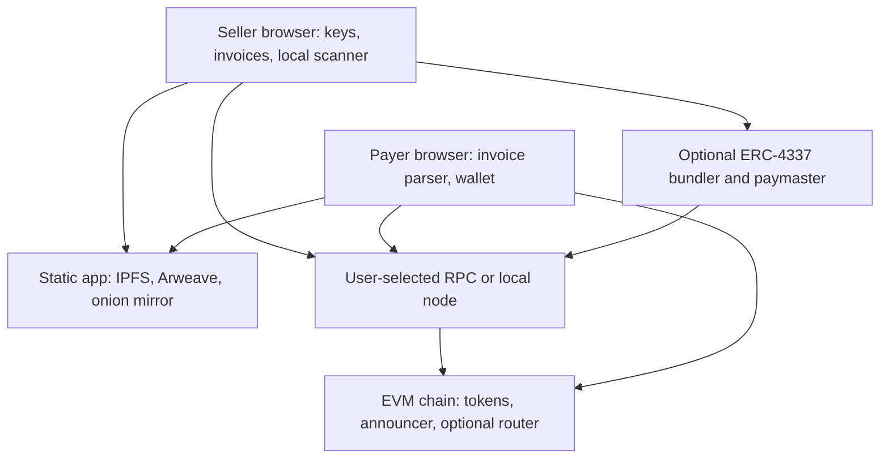

# GhostPay: Master Blueprint

> **Update 2026-10-21:** Superseded where it conflicts with [SPEC_REVIEW.md](SPEC_REVIEW.md), [CONTRACTS_SPEC.md](CONTRACTS_SPEC.md) and [FEE_SCHEDULE.md](FEE_SCHEDULE.md) (no on-chain `invoiceId`, exact signatures, fee model, owner-wallet handling).

> **Project status:** Concept and architecture baseline. No production protocol or security guarantees are implemented yet.
>
> GhostPay explores private invoice creation and stealth-address settlement on EVM chains. “Zero-server,” “zero-knowledge,” and “unlinkable” are design goals that must be evaluated per component; they are not automatic properties of EIP-5564, EIP-6538, ERC-4337, or static hosting.

## Project purpose

GhostPay aims to let a seller issue a shareable invoice whose payment is directed to a fresh stealth destination rather than a repeatedly used public wallet. A browser-based client should create invoice state, derive stealth destinations, perform local chain scanning, and protect invoice details. Public blockchain transactions remain public: GhostPay can reduce direct address reuse and selected metadata exposure, but cannot hide all transaction facts or guarantee that counterparties cannot correlate payments.

### Design principles

- **Client-side first:** key generation, derivation, invoice parsing, metadata decryption, and scan state stay in the browser where practical.
- **Non-custodial:** GhostPay contracts should not hold user funds longer than the atomic settlement operation requires.
- **Explicit privacy boundaries:** distinguish address privacy, transaction confidentiality, network anonymity, and commercial metadata privacy.
- **Standards-based interoperability:** use EIP-5564 stealth-address conventions and EIP-6538 meta-address registry conventions where they fit the supported chain.
- **Small, reviewable contracts:** keep fee and settlement code minimal, immutable after deployment where feasible, and independently audited.
- **Progressive delivery:** start with a testnet prototype and clear threat model before building relayers, proving systems, or censorship-resistant hosting.

## 1. High-level system architecture and technical stack

### Component map



Static hosting serves application assets. It should not receive invoice secrets in HTTP paths or query strings. The payer and seller still contact an RPC endpoint (or their own node) to read chain data and submit transactions. A hosted RPC, bundler, paymaster, price feed, or indexer is an external service and may observe IP addresses, request timing, and queried addresses unless users choose a privacy-preserving route.

### Proposed stack

| Layer | Initial choice | Role and boundary |
|---|---|---|
| Browser app | TypeScript, React, Vite; static output | Invoice UI, fragment parsing, key handling, wallet connection, local event scanning |
| Curve operations | `@noble/curves` secp256k1 | ECDH and public-key operations; follow the exact selected stealth scheme and test against published vectors |
| Key derivation | Web Crypto plus reviewed HKDF implementation | Domain-separated derivation from shared secrets; never use ad hoc hashing as a KDF |
| Metadata encryption | Authenticated encryption (e.g. AES-GCM or XChaCha20-Poly1305 from a reviewed library) | Encrypt invoice details; version and authenticate the envelope |
| Contracts | Solidity, Foundry | EIP-5564-compatible announcer integration, optional payment/fee router, tests and deployment scripts |
| Wallet interface | EIP-1193; optional EIP-6963 discovery | Connect to payer wallet and request explicit chain, token, amount, and transaction approval |
| Account abstraction | ERC-4337 only for a later sweep design | Smart-account execution via EntryPoint, bundler, and paymaster; it does not itself provide privacy |
| ZK | To be selected after a concrete statement and threat model exist | Prove only a narrowly specified property; do not claim a SNARK hides transaction linkage by itself |
| Chain data | User-configurable RPC, local node, or optional community indexer | Read announcement logs and token transfers; RPC choice affects privacy and reliability |
| Static distribution | IPFS content addressing; optional Arweave and Tor v3 mirror | Deliver immutable app builds; pin and verify identical release artifacts |

### Standards and cryptographic building blocks

- **EIP-5564 (Stealth Addresses):** defines a scheme registry, announcement event/interface, and stealth-address generation conventions. The standard gives recipients a way to detect and spend stealth payments; it does not make the chain private.
- **EIP-6538 (Stealth Meta-Address Registry):** defines a registry convention for publishing and resolving stealth meta-addresses. Publishing a meta-address associates it with whatever identifier or registry entry is used; that association must be considered public.
- **secp256k1 ECDH:** the selected curve operation for deriving a shared secret from a sender ephemeral key and the recipient viewing public key, consistent with the chosen EIP-5564 scheme. Use canonical point validation, scalar range checks, domain separation, and test vectors.
- **View tags:** a small tag derived by the selected scheme lets a scanner cheaply reject most announcements before doing more work. For a uniformly distributed one-byte tag, an unrelated announcement matches with probability about 1/256. This reduces expensive checks; it does not reduce the number of logs or RPC data downloaded by 99.6%.
- **`@noble/curves`:** candidate audited JavaScript curve implementation for secp256k1 operations. Pin versions, review the exact APIs and side-channel assumptions, and verify output against standards vectors and independent implementations.
- **ERC-4337:** account-abstraction flow using smart accounts, UserOperations, an EntryPoint, bundlers, and paymasters. Sponsorship changes who pays gas; it does not automatically obscure who is paying, which account is being swept, or the economic relationship.
- **ZK proofs:** not required for the initial stealth-address invoice. A proof is meaningful only once the private witness, public statement, verifier, replay protection, and linkage it is intended to hide are specified.
- **Price data:** Chainlink feeds and/or a Uniswap TWAP can inform a quote. A feed update is not guaranteed to match execution-time market price, and each chain/feed has different availability and freshness properties. Quote expiry, slippage bounds, feed validation, and fallback behavior are required.

### Invoice and URL-state model

A GhostPay invoice link should carry a versioned, bounded payload in the URL fragment, for example `https://app.example/#gpi=<base64url-envelope>`. Browsers do not include the fragment in the HTTP request, so ordinary static hosts do not receive it. However, the fragment is visible to the payer, browser extensions, page JavaScript, and any analytics or third-party scripts on the page. The app should ship without third-party analytics, avoid logging fragments, apply a strict content-security policy, and clear sensitive form state when appropriate.

Separate the envelope into:

1. **Public payment parameters:** chain ID, asset address, fiat currency and amount, expiry, pricing policy, seller stealth meta-address, invoice nonce/version.
2. **Encrypted invoice details:** line items, tax breakdown, seller contact data, and optional payer notes. Use authenticated encryption and a versioned schema.
3. **Integrity/authentication:** seller signature over canonical public parameters and ciphertext, so the payer can detect tampering and display the signer identity/address as a claim rather than a privacy guarantee.
4. **Limits:** maximum fragment size, safe parser, strict schema validation, expiry checks, and no executable HTML or script content.

The fragment is shareable, not secret from its recipient. If invoice details are encrypted under a seller-controlled key, choose a well-reviewed envelope construction and document who can decrypt it. Never put spending keys, seed phrases, or spend-authorizing secrets in a link.

### Settlement and fee design

EIP-5564 announcements and token transfers are separate public-chain effects. The standard announcer signals a stealth payment; it does not force a payer to use a GhostPay fee router. A router can atomically receive payer funds, validate payment parameters, split the protocol fee, transfer the remainder to the stealth destination, and emit/forward the announcement, but this adds contract risk and may make all GhostPay payments easier to identify.

An initial fee model must specify:

- Whether the 0.25% fee is charged by an optional payment wrapper or is merely suggested by the client.
- Supported tokens, decimals, fee rounding, minimum/maximum fee, and behavior for fee-on-transfer or rebasing tokens.
- The fee recipient mechanism and the public observability of fee flows.
- Whether invoices can be paid without the wrapper (which means the fee is not enforceable).
- A non-upgradeable deployment, constructor-set immutable parameters, and explicit handling of accidental transfers.

“Uncensorable” and “un-linkable developer revenue” are not properties that can be promised by a fee split. A public contract and public chain records may permit analysts to identify the fee path.

## 2. End-to-end user flows

### Seller

1. **Create keys locally.** Generate independent spending and viewing key pairs using secure browser randomness. Keep the spending secret offline or in a protected wallet when possible; a viewing secret is less powerful but still sensitive.
2. **Publish a meta-address.** Export the required public keys in the EIP-5564 scheme format. Optionally register through EIP-6538. Explain that a public registry entry may associate the seller with the meta-address.
3. **Build an invoice.** Add line items, tax, fiat denomination, asset, chain, quote policy, expiry, and nonce. Fetch a quote from the selected feed source and display source, timestamp, and slippage bounds.
4. **Encrypt and sign.** Create the metadata envelope and seller signature locally; put the versioned envelope in the URL fragment. Keep sensitive content out of query parameters and HTTP paths.
5. **Share the link.** Send by a chosen channel. The channel itself can reveal parties and timing.
6. **Scan announcements.** Fetch logs by chain and scheme, filter view tags locally, perform the standard derivation checks, then persist only derived scan cursor/state locally. Remote RPC queries can expose queried ranges and user IP.
7. **Verify receipt.** Check token contract, chain, amount, confirmations/finality policy, invoice nonce, and relevant announcement. Do not rely solely on client-reported success.
8. **Sweep.** Use the stealth spending key to sign a transfer. Initially support direct funding of gas or a separately documented relayer flow. A relayer can sponsor gas or collect reimbursement, but that linkage must be measured and described.

### Payer

1. Open the invoice link in a compatible wallet/browser. The app parses the fragment locally and validates the schema.
2. Verify the seller signature and show the network, token contract, fiat target, quote time, slippage/expiry conditions, fee, and final crypto amount.
3. Generate a fresh ephemeral key and derive the one-time stealth destination using the selected EIP-5564 scheme and seller meta-address.
4. Prepare the payment transaction. For an ERC-20, approve or use a supported permit/atomic transfer design; approval transactions can add cost and observable links.
5. If using an optional router, inspect the exact call and fee split. The router transfers the net payment and announces the stealth metadata atomically where possible.
6. Confirm using the connected wallet. The wallet, RPC, bundler, or provider may observe the transaction request and network metadata.
7. After inclusion, show transaction hash and confirmation state. The payer's funding address and transaction remain public.

### Protocol and hosting

- Static hosts serve identical build assets; no invoice database or account service is required for basic operation.
- An optional indexer can improve scanning, but it is a backend and can observe queries. Offer local scanning and document the data retained by any hosted indexer.
- Public chain announcements are permissionless and globally observable.
- Optional relayer/bundler/paymaster services can improve UX but are not passive: they receive requests and can retain metadata. They need a privacy policy, rate limiting, abuse controls, monitoring, and an exit path to alternate providers.
- IPFS pinning, ENS records, Tor mirrors, and CI/CD each add operational dependencies. Publish reproducible build hashes and deployment verification instructions.

## 3. Cryptographic security and threat model

### Assets and adversaries

**Protect:** seller spending key, seller viewing key, invoice line items and private contact data, payer/seller relationship, user IP-to-RPC activity, and correctness of token/amount/fee settlement.

**Consider:** public-chain analysts, malicious or compromised RPC providers, compromised static hosts or dependencies, browser extensions, malicious invoice links, dishonest token contracts, compromised wallet software, relayer/bundler operators, price-feed failures, and traffic correlation across channels.

### Mitigations and their limits

| Threat | Intended mitigation | Remaining exposure |
|---|---|---|
| Reused seller address links receipts | Derive a fresh stealth destination per payment; scan using viewing key and standard view-tag procedure | Transaction graph, timing, amounts, token behavior, sweep timing, and registry data can still correlate activity |
| Metadata sent to web server | Put invoice envelope in URL fragment; avoid analytics and third-party scripts | Browser extensions, app JavaScript, clipboard/share apps, screenshots, history sync, and phishing pages can read it |
| RPC logs IP and chain queries | Support self-hosted RPC, Tor-routed RPC, privacy proxy, or multiple providers; batch and pad scans where feasible | Tor exit/provider and timing correlation remain; multiple RPC calls can still fingerprint a user |
| Fresh address has no native gas | Optional ERC-4337 smart-account / paymaster path, or token-denominated reimbursement | Public sponsorship/reimbursement events may link sweep and receipt; paymaster/bundler can log requests; token support and paymaster rules constrain behavior |
| Public invoice amount clusters payers | Fresh destinations, optional amount obfuscation where payment semantics allow, randomized payment timing by user choice | Exact fiat amounts, common denominations, invoice-specific values, and public ERC-20 transfer amounts remain visible |
| Malicious/misleading invoice | Seller signature, canonical encoding, safe parsing, token allowlist metadata, wallet confirmation with exact call details | Signature proves control of a key, not identity, legitimacy, or performance of the invoice |
| Price manipulation/stale data | Feed freshness/round bounds, TWAP window, expiry, max slippage, and payer review | Manipulation, low liquidity, oracle delay, chain congestion, and feed outages remain |
| Malicious dependency or frontend | Minimal dependency set, lockfile, reproducible builds, CSP, pinned release artifacts, independent review | A compromised release can steal keys or alter payment calls; static hosting alone does not solve supply-chain risk |
| Announcer or router bugs | Minimal Solidity, invariant/fuzz tests, audited libraries, no arbitrary calls, independent audit | Immutable bugs cannot be patched; upgradeable designs create admin trust if used |

### Important protocol constraints

- **No absolute unlinkability:** EIP-5564 addresses conceal the recipient address relationship at the address layer; they do not encrypt amounts, token transfers, transaction senders, or time.
- **View-tag savings are bounded:** a one-byte tag is a probabilistic prefilter. The scanner still needs access to announcements and must perform full checks on matches. Do not describe it as eliminating chain scans or reducing total work by a fixed 99.6%.
- **Gas sponsorship is not a ZK mixer:** ERC-4337 can alter transaction execution and fee payment. It does not provide a cryptographic unlinkability guarantee. A proof only helps if it hides a clearly defined link from the relevant observers and is deployed with a privacy-preserving transaction path.
- **A ZK proof does not hide public inputs:** if the sweep transaction spends from the stealth address and sends to a known seller address, the link remains. A proof that merely proves solvency or authorization does not break that graph.
- **Fixed amounts can fingerprint:** invoice-specific exact values and near-immediate sweeps can correlate invoice and payment. Quotes should use short validity windows and explicit bounds; UX may permit payer-selected overpayment/refund rules, but refunds introduce their own link.
- **Network anonymity is separate:** Tor-routed RPC may reduce direct IP exposure to an RPC operator, but browser fingerprinting, DNS/bootstrap, wallet traffic, CDN calls, and transaction timing remain.
- **Fragment confidentiality is local transport hygiene, not end-to-end secrecy:** the fragment avoids normal HTTP transmission, but every script executing on the page can read it. Treat all loaded frontend code as part of the trusted computing base.

### Security requirements before mainnet

- Threat model and protocol choices reviewed before implementation expands.
- Published test vectors and differential tests for key derivation, view tags, and stealth-address calculation.
- Fuzzing and invariant tests for fee math, token decimals, replay protection, expiration, and atomic settlement.
- Browser checks for accidental logging, third-party requests, fragment handling, and secure randomness.
- Reproducible builds, locked dependencies, dependency review, static analysis, and external smart-contract audit.
- Explicit supported-chain, token, oracle, and wallet matrix; no claim of privacy for unsupported combinations.
- Incident process for compromised frontend releases and immutable-contract bugs.

## 4. Master implementation plan

### Phase 0 — Decisions and threat model

- Specify supported EVM chain(s), stealth scheme identifiers, token list, and deployment assumptions.
- Decide whether payment routing is direct-to-stealth or through an optional wrapper.
- Specify canonical invoice format, metadata key/envelope design, signature scheme, expiry, quote policy, and seller key backup/recovery.
- Define privacy claims with a table of what each observer can see.
- **Exit gate:** reviewed architecture decision records; no vague “ZK relayer” requirement without an exact proof statement.

### Phase 1 — Core cryptography and contract prototype

- Implement EIP-5564 scheme-compatible key derivation and announcement parsing in a small package.
- Use `@noble/curves` or another reviewed implementation; pin version and verify against vectors.
- Add property and differential tests for public/private derivation equivalence, invalid points, scalar boundaries, view tags, and serialization.
- Prototype the least complex EIP-5564 announcer integration; reuse a standard implementation where appropriate.
- Prototype an optional payment/fee router with a clearly stated 0.25% fee formula, token constraints, replay controls, and atomic transfer/announcement flow.
- **Exit gate:** Foundry tests, fuzzing, static analysis, explicit unsupported-token behavior, and independent review before real funds.

### Phase 2 — Client app and invoice URL parser

- Build React/Vite static app with seller invoice creation, payer review, and wallet connection.
- Define versioned fragment schema, safe base64url parser, input-size limits, authenticated metadata encryption, seller signing, and no-logging policy.
- Add quote display with feed source/timestamp, freshness check, slippage limit, and expiry; never imply a quote guarantees exact execution price.
- Implement local stealth destination derivation and view-tag scanning UI.
- Add CSP, remove analytics/third-party scripts, and test the production build for accidental fragment requests.
- **Exit gate:** browser and wallet tests on testnet, scanner cross-checks, and usable error handling for unsupported wallets/chains.

### Phase 3 — Off-chain scanning and optional sweep sponsorship

- Make local scanning the reference implementation; store cursor and derived matches locally.
- Define an optional indexer API only if needed; document observable query data and allow alternate providers.
- Prototype sweep using direct gas first, then compare ERC-4337 smart-account and paymaster options.
- Specify precisely how the relayer is reimbursed, what logs it can see, anti-replay protections, allowlists, limits, and failure recovery.
- Explore ZK only for a specified privacy goal, with a written public statement/witness, circuit, verifier, and transaction graph analysis.
- **Exit gate:** demonstrate the privacy properties and residual links on a public testnet with an independent review.

### Phase 4 — Censorship-resistant distribution and release operations

- Publish deterministic static artifacts to IPFS and optionally Arweave; pin identical content and verify CID/build hashes.
- Configure a Tor v3 static mirror; avoid secret-dependent server routes and minimize access logging.
- Use ENS only as a convenience pointer to content-addressed releases; publish verification instructions and signing keys.
- Build a reproducible CI pipeline with protected releases, dependency attestations, artifact hashes, and a documented air-gapped verification procedure.
- Publish deployment addresses, source verification, audits, supported networks, and known limitations.
- **Exit gate:** independent reproducibility check, host failover test, and release-signing verification.

## Initial repository structure

```text
/
├── README.md
├── docs/
│   ├── MASTER_BLUEPRINT.md
│   ├── threat-model/
│   ├── adr/
│   └── specs/
├── packages/
│   └── stealth-crypto/
├── apps/
│   └── web/
├── contracts/
├── test-vectors/
└── audits/
```

> **Annotation 2026-10-21 (stale structure).** The tree above was the initial plan and is not the current layout. Actual top level: `packages/{core-crypto,invoice-schema,chain-adapters,btc-silent-payments,contracts}`, `apps/{web,relayer}`, `deployments/`, `test-vectors/`, `scripts/`, `docs/` (including `docs/audits/`, `docs/user/`, `docs/operators/`, `docs/reviews/`). There is no `packages/stealth-crypto` (it became `core-crypto`), no root `contracts/` (it is `packages/contracts`), and no root `audits/` directory (self-run reviews are in `docs/audits/`; **no independent external audit exists**). See the README package map.

Start with this blueprint and decision records. The crypto package, contracts, and UI should be implemented only after their interfaces and test vectors are specified.

## Primary references

- [EIP-5564: Stealth Addresses](https://eips.ethereum.org/EIPS/eip-5564)
- [EIP-6538: Stealth Meta-Address Registry](https://eips.ethereum.org/EIPS/eip-6538)
- [ERC-4337: Account Abstraction Using Alt Mempool](https://eips.ethereum.org/EIPS/eip-4337)
- [EIP-1193: Ethereum Provider JavaScript API](https://eips.ethereum.org/EIPS/eip-1193)
- [EIP-6963: Multi Injected Provider Discovery](https://eips.ethereum.org/EIPS/eip-6963)
- [`@noble/curves`](https://github.com/paulmillr/noble-curves)
- [Chainlink Data Feeds documentation](https://docs.chain.link/data-feeds)
- [Uniswap v3 Oracle documentation](https://docs.uniswap.org/concepts/protocol/oracle)
