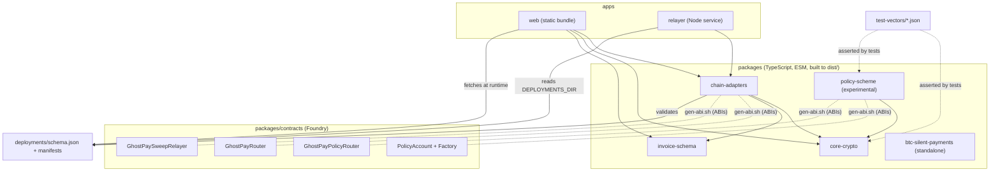
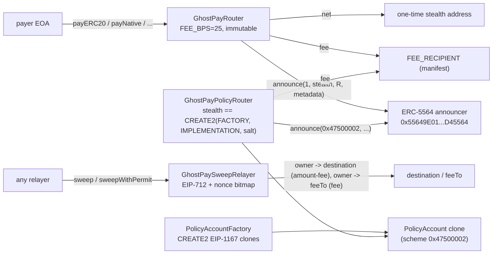
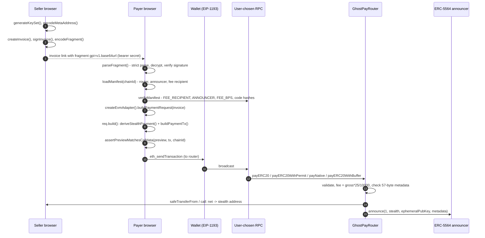
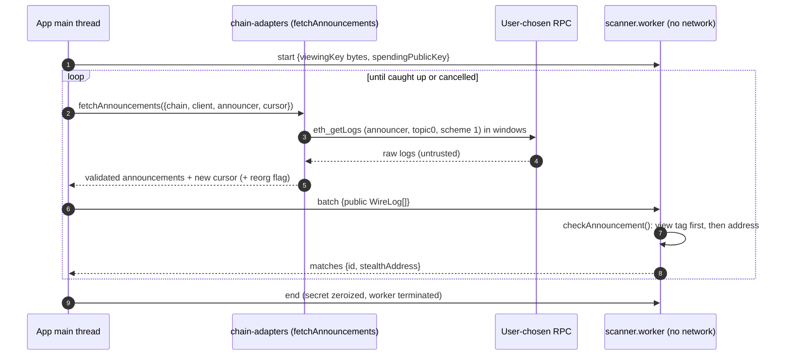
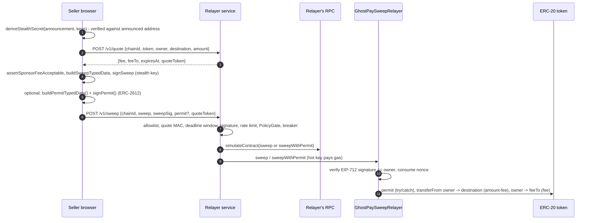
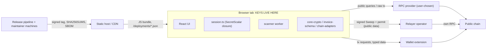
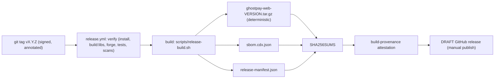

# Architecture

Sources: root `README.md`, `docs/DEVELOPER_SPECIFICATION.md` (with its 2026-10-21 annotation), `docs/CONTRACTS_SPEC.md`,
`docs/MULTICHAIN_SPEC.md`, `docs/threat-model/THREAT_MODEL.md`, each package's `package.json` and `src/`.

GhostPay is a client-first EVM invoice and stealth-payment project (ERC-5564 scheme 1). A seller publishes one
meta-address; each payment goes to a fresh one-time address only the seller can recognise and spend from. Everything
that touches key material runs in the browser; the on-chain part is a thin set of immutable contracts; the relayer
is optional and only ever sees signed, public data.

## 1. Module map

| Module | Responsibility | Depends on (workspace) | Key external deps |
|---|---|---|---|
| `@ghostpay/core-crypto` | scheme-1 key generation, meta-address codec, sender derivation, view-tag scan check, stealth key derivation, redacting `SecretScalar`, 57-byte router metadata | none | `@noble/curves` 2.4.0, `@noble/hashes` 2.4.0, `viem` 2.57.7 (address helpers only) |
| `@ghostpay/invoice-schema` | v1 invoice object, strict JSON, canonical form, ECDSA signing, AES-GCM envelope, `#gpi=v1.` fragment, expiry | none | `@noble/curves`, `@noble/hashes`, Web Crypto |
| `@ghostpay/chain-adapters` | chain and token allowlists, fee maths, manifest validation, verified RPC client, paginated reorg-safe log fetch, router and sweep builders, calldata decoder/preview check, Chainlink quote reader, `ChainAdapter` interface | core-crypto, invoice-schema | `viem` |
| `@ghostpay/policy-scheme` | scheme `0x47500002` client: policy hash, limits Merkle tree, CREATE2 prediction, scanner, EIP-712, calldata, policy-router builders (experimental) | core-crypto | `viem`, noble |
| `@ghostpay/btc-silent-payments` | BIP-352 Silent Payments, scanning over a `TweakSource`, key-path spends, Bitcoin adapter | none | noble, `@scure/base`, `@scure/btc-signer` |
| `@ghostpay/web` | the static app: keystore, invoice create/pay, scan worker, sweep, settings | chain-adapters, core-crypto, invoice-schema | React 19, Vite 8, `qrcode-generator` |
| `@ghostpay/relayer` | gas-sponsorship HTTP service for `GhostPaySweepRelayer` | chain-adapters | `viem`, `node:http` |
| `packages/contracts` | Solidity 0.8.28, Foundry; no `package.json`, not an npm workspace member | (ABIs flow out via `gen-abi.sh`) | OpenZeppelin 5.6.1 (vendored in `lib/`), forge-std |
| `deployments/` | `schema.json` and format notes; the only source of router/relayer/announcer/fee-recipient addresses | | |
| `test-vectors/` | `scheme1.json`, `policy-scheme.json` and their generators | | `@scopelift/stealth-address-sdk` (generators and tests only) |

Not in the repository although the original plan listed them: `packages/relayer-adapter` (the client is
`apps/web/src/lib/relayerClient.ts`), `apps/indexer` (none; scanning uses the user's RPC).
`packages/btc-silent-payments` is not imported by any other workspace.

### Dependency graph

Solid arrows are `package.json` dependencies. Dotted lines are generation or test-time relations. Workspaces resolve
each other through `dist/` (`main`/`types` in each `package.json`), so libraries must be built first
(`npm run build:libs`; see [local-setup.md](local-setup.md)). Vitest configs alias `@ghostpay/*` to `src/` for
`chain-adapters`, `policy-scheme` and `relayer`, so tests run against sources.

### Contract relationships

All contracts: no owner, no proxy, no pause, no `delegatecall`, no arbitrary external call, immutable configuration
(`docs/CONTRACTS_SPEC.md`). The router and relayer never hold balances between transactions.

## 2. Data flows

### 2.1 Create, share, pay

Facts that matter when changing this flow:

- The router address, announcer and fee recipient come **only** from the deployment manifest
  (`loadDeployment`/`validateManifest`); there is no wallet address in source (ADR-0007).
- `req.build()` derives a fresh ephemeral key on every call. Calling it twice yields two different stealth addresses.
- `assertPreviewMatchesCalldata` is the guard between what the UI shows and what the wallet signs; the fee
  recipient is not in calldata (router immutable), so it must be displayed from the manifest.
- The manifest's `signature` is **not verified** (audit S3-01). The app does read the manifest back from the chain with the user's RPC (`verifyManifest`: router getters and runtime code hashes) and keeps payments disabled until that passes; with one provider this proves consistency with that RPC, not authenticity.

### 2.2 Scan

Source: `apps/web/src/lib/scanClient.ts` (`runScan`), `scannerCore.ts` (`ScanSession`, `ScanProtocol`),
`packages/chain-adapters/src/logs.ts`. The viewing scalar is posted to the worker **once**, as raw bytes, then
zeroized on both sides; this is a deliberate exception to "never `postMessage` a secret" (see
[security-model.md](security-model.md#3-secrets-and-the-scanner-worker)). Network calls happen in `runScan`, never in the
worker; a test reads the worker sources and fails if they mention `fetch`, `WebSocket`, `XMLHttpRequest`, etc.

`createEvmAdapter(...).scan(range, keys, signal)` is the library-level equivalent that does everything on the calling
thread as an `AsyncIterable<DetectedPayment>`.

### 2.3 Sweep (direct or relayed)

Without a relayer the seller can use the **direct sweep** (`apps/web/src/lib/sweep.ts`, `directSweep`): the stealth key
signs a plain transfer and the stealth address pays gas (it must hold native coin, which links it to the funder; see
`docs/user/sweep-and-gas-privacy.md`). The relayer cannot change destination, amount or fee: they are inside the
EIP-712 signature and enforced by the contract. It can only decline, delay, or observe.

### 2.4 Scheme `0x47500002` (experimental)

Payer: `deriveScheme2Payment(metaAddress, deployment)` (owner by scheme-1 maths, account by CREATE2) then
`buildPolicyPaymentTx` to `GhostPayPolicyRouter`, which takes the per-payment CREATE2 `salt = keccak256(abi.encode(owner,
policyHash))`, requires `stealth` to be the factory's clone address for that salt, and announces scheme `0x47500002`. Seller: `checkScheme2Announcement` -> `deriveScheme2OwnerKey` ->
`encodeDeployAccount` (anyone may deploy) -> `buildWithdrawTypedData` + `signPolicyTypedData` -> `encodeRequestWithdraw`
-> after the delay `encodeExecuteWithdraw`. No UI, no relayer support (ADR-0014).

## 3. Trust boundaries

What crosses each boundary:

| Boundary | May cross | Must never cross |
|---|---|---|
| tab -> host | asset requests (IP, UA, timing) | URL fragment (not sent by browsers), keys, invoice contents |
| tab -> RPC | block ranges, addresses queried, signed transactions | viewing/spending keys, invoice plaintext |
| tab -> wallet | transaction requests, EIP-712 typed data to sign | stealth or seller keys |
| tab -> relayer | EIP-712 `Sweep` order + signature, optional permit, quote token | keys, viewing key, invoice data |
| host -> tab | code, manifest | anything that should be trusted without verification: a compromised host can replace both (ADR-0015, audit S3-01/S3-04) |
| main thread -> worker | public `WireLog`s; the viewing scalar once at `start` | the spending secret, any network capability |

Observer table (who learns what): `docs/threat-model/THREAT_MODEL.md` section 2. Short version: the chain shows
payer, token, amounts, fee flow and timing; the payer can follow funds from the one-time address; the relayer sees
owner, destination, amount and timing; the RPC provider sees IP and the addresses/ranges queried.

Enforcement points in the code:

- **CSP and headers**: `apps/web/public/_headers` (real policy: `default-src 'self'; script-src 'self'; connect-src 'self' https: wss:; worker-src 'self'`,
  `frame-ancestors 'none'`, `Referrer-Policy: no-referrer`, `Permissions-Policy` denying most features) and the meta CSP in `apps/web/index.html`
  (same minus `frame-ancestors`). GitHub Pages cannot apply `_headers`.
- **Bundle scan**: `apps/web/scripts/scan-bundle.mjs` runs as `postbuild` and fails on `eval`, `new Function`, string timers,
  `document.write`, unexpected URLs, source maps, inline script/style, network APIs in the worker, etc.
- **Lint bans**: `Math.random`, `eval`, `new Function`, `innerHTML`/`outerHTML` assignment, `dangerouslySetInnerHTML`
  (`eslint.config.js`).
- **Fail-closed parsing** at every edge: invoice fragment, manifest, RPC responses, logs, relayer request bodies.

## 4. Build and release topology

Hosting is intentionally not configured (ADR-0015); the workflow ends at a draft release. Details:
[release-and-repro.md](release-and-repro.md).
