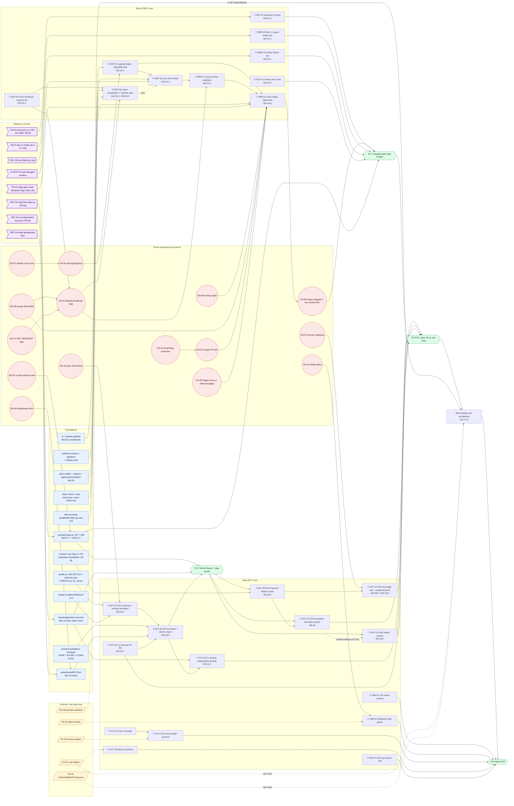
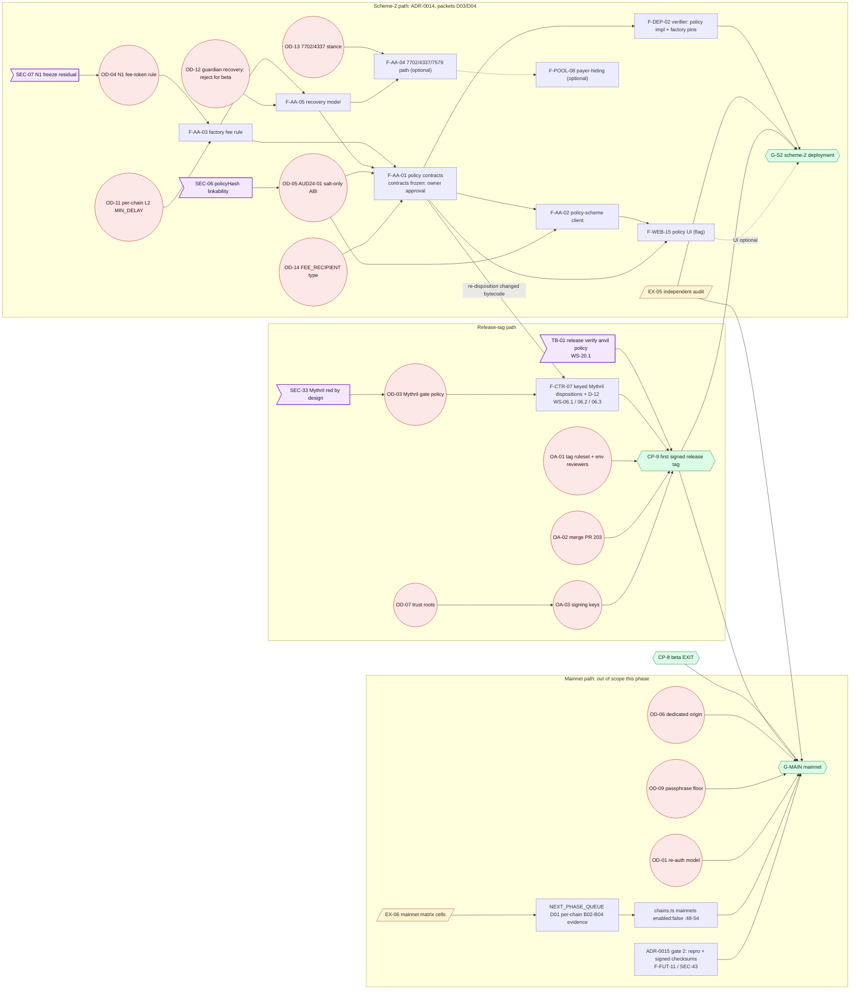

# GhostPay feature dependency graph (post-consolidation, 2026-11-18)

Team G-A. Audited source: product source `7a620ff19ecf4e43ec568896c34188f5b2dcd3fc` (PR #203 candidate; head `71abc7e5` = + docs). Inputs: [`completion_strategy.json`](completion_strategy.json) (151 unfinished distinct features, this team), [`ws_registry.json`](ws_registry.json) (Team G-B: WS-00..WS-25, WS-90, checkpoints CP-0..CP-9), `$SP/final/BLOCKERS_AND_DECISIONS.md` (canonical OD-01..OD-22, OA-01..OA-07, EX-01..EX-07, TB-01..TB-10; OD-20..22 added by coordinator 2026-11-18), `$SP/final/security_findings.json` (SEC-01..SEC-49), `docs/handoffs/consolidation-20261118/NEXT_PHASE_QUEUE.md` @7a620ff1 (K01-K06, KC, B01-B06, D01-D07).

Tags: VERIFIED = read/ran at 7a620ff1 by G-A; INFERRED = reasoned from evidence; UNVERIFIED = claim only. All day figures are ESTIMATE engineer-days before parallelism and exclude owner/external latency.

## 0. Legend and gate IDs

| Symbol | Meaning |
|---|---|
| rectangle | feature row (F-…) or engineering item (WS-nn.m from G-B) |
| double circle | owner decision (OD) or owner action (OA): fail-closed default applies until recorded |
| parallelogram | external dependency (EX): blocks ONLY the external-verification gate of the row it points to |
| flag | confirmed/technical defect node (SEC/TB/G-NOTE) that must be fixed first |
| hexagon | gate / checkpoint |
| `-->` hard dependency; `-.->` soft (uses something that already exists, or blocks only one sub-requirement) |  |

| Gate | Definition (G-B checkpoints) |
|---|---|
| CP-2 | Spec 18 format freeze (K01/K02) + step-up API (WS-07.2) + shared foundations (independent tool, CI wiring/speed) |
| CP-4 | Browser beta engineering-ready (waves 5-6): strict verifier, dual readback, rehearsal, smoke, shell hardening |
| CP-5 | KC: spec 18 K01-K06 acceptance on one exact integrated SHA (+ independent recovery proof) |
| CP-6 | Wave 8 optional advanced merged (never blocks CP-7/CP-8) |
| CP-7 | Sepolia static beta START qualification (owner-gated: OD-06/07/08, OA-01..06) |
| CP-8 | Beta EXIT qualification: CP-5 + B06 acceptance incl. 3q export + independent recovery on Sepolia |
| CP-9 | Release-tag qualification (owner-gated: OD-03, OD-07/OA-03 keys, OA-01 tag ruleset); mainnet out of scope |
| order | CP-1 needs CP-0; CP-2 needs CP-1; CP-3 needs CP-2; CP-4 needs CP-1; CP-5 needs CP-2; CP-6 needs CP-5; CP-7 needs CP-4; CP-8 needs CP-5+CP-7; CP-9 needs CP-7 (G-B) |
| G-S2 | scheme-2 (policy account) production deployment: not in this phase (ADR-0014) |
| G-MAIN | any mainnet enablement: out of scope this phase (chains.ts:48-54 mainnets `enabled: false`, VERIFIED) |

## 1. Graph A: foundations -> beta features -> beta gates

Not drawn (non-gating beta rows, all unblocked): F-PROTO-03 (records-only, see §12), F-WEB-06 (disposition doc), F-WEB-09 (harness fix, TB-06), F-WEB-26 (payeeTrust record), F-CTR-04 (registry codehash pin, after F-DEP-03), F-DEP-05 (doc drift + measurement script). Beta-start engineering items without a feature row (G-B): WS-01.1 (TB-02), WS-04.1 (TB-03), WS-04.2 (SEC-24), WS-04.4 (TB-07 docs), WS-04.5 (SEC-46 smoke), WS-06.1 (Mythril report-only), WS-07.1 (SEC-03 refuse default), WS-24.1 (SEC-14).

## 2. Graph B: release-tag, scheme-2 and mainnet paths

## 3. Owner-decision and owner-action nodes

Rule (BLOCKERS §0): implement every decision-independent part now; ship the fail-closed default; silence is never approval.

| ID | Decision / action | Fail-closed default until recorded | Gates | Feature rows blocked or shaped (count) |
|---|---|---|---|---|
| OA-01 | branch protection / tag ruleset / env reviewers | unsafe promotion; release blocked | CP-7, CP-9 | F-CTR-07, F-WEB-21 (2) |
| OA-02 | merge #203 (merge commit or FF) | release.yml cannot verify tags (verifier not on main) | CP-7, CP-9 | F-CTR-07, F-WEB-21 (2) |
| OA-03 | add release signing keys | allowed_signers empty: release fails closed | CP-7, CP-9 | F-CTR-07, F-DEP-01, F-WEB-17, F-WEB-21 (4) |
| OA-04 | authentic Sepolia broadcast + verify + sign (B02/B03) | no deployment of record | CP-7 | F-DEP-02, F-DEP-03, F-DEP-04, F-WEB-17, F-CLI-05, F-CTR-04, F-DOC-03, F-OPS-01 (8) |
| OA-05 | Pages source = Actions; retire stale gh-pages | stale prototype may stay live (SEC-08) | CP-7 | F-WEB-21 (1) |
| OA-06 | Pages deploy dispatch + live smoke (B05) | no public beta | CP-7 | F-WEB-21 (1) |
| OA-07 | CodeQL/Dependabot/secret-scanning inventories | SEC-48 stays MISSING-COVERAGE | none | — (0) |
| OD-01 | re-auth for vault-less sessions | secret export refuses in vault-less sessions; sweep warned | CP-5, G-MAIN | F-KEY-09, F-KEY-10, F-KEY-12, F-KEY-05 (4) |
| OD-02 | raw-key clipboard; BTC/SOL/TRON reveal parity | no clipboard path for any new secret export | CP-5 | F-KEY-09, F-KEY-10, F-BTC-01, F-SOL-01, F-TRX-01, F-SOL-02, F-TRX-02 (7) |
| OD-03 | Mythril 11-record release policy | release tags stay blocked | CP-9 | F-CTR-07, F-AA-01, F-AA-03, F-WEB-15 (4) |
| OD-04 | N1 fee-token freeze residual | scheme 2 undeployed | G-S2 | F-AA-01, F-AA-03, F-WEB-15 (3) |
| OD-05 | AUD24-01 policy-hash linkability | scheme 2 undeployed | G-S2 | F-AA-01, F-AA-02, F-AA-04, F-WEB-15 (4) |
| OD-06 | static-beta hosting origin | build refuses manifests on a shared origin; origin gate hardened (TB-03) | CP-7, G-MAIN | F-WEB-17, F-WEB-21, F-HOST-03, F-FUT-07 (4) |
| OD-07 | release trust roots (tag + manifest keys) | payments disabled in default build; release fails closed | CP-7, CP-9 | F-DEP-01, F-WEB-17, F-WEB-21, F-HOST-03, F-WEB-18, F-FUT-11 (6) |
| OD-08 | accept ADR-0029 | Pages deploy dispatch-only, unexercised | CP-7 | F-DEP-04, F-WEB-21 (2) |
| OD-09 | passphrase floor for master/raw exports | new spec 18 exports use the stricter floor | CP-5, G-MAIN | F-KEY-08, F-KEY-12, F-POOL-03, F-KEY-14 (4) |
| OD-10 | spec 18 open wording | engineering applies the recommendation, recorded for sign-off | CP-2/CP-5 | F-KEY-07, F-KEY-08, F-KEY-09, F-KEY-10, F-KEY-11, F-KEY-12 (6) |
| OD-11 | per-chain L2 MIN_DELAY | scheme 2 undeployed | G-S2 | F-AA-01, F-AA-03 (2) |
| OD-12 | ADR-0028 guardian recovery | no guardian code paths | G-S2 | F-AA-01, F-AA-04, F-AA-05, F-WEB-15 (4) |
| OD-13 | 7702 delegate clearing / 4337 paymaster | AA paths experimental | G-S2 (AA only) | F-AA-04, F-POOL-08, F-RLY-05, F-WEB-15 (4) |
| OD-14 | FEE_RECIPIENT account type | deployment checklist requires the choice | CP-7 (B02), G-S2 | F-DEP-04, F-AA-01 (2) |
| OD-15 | PR #204 scope/merge order | port only as a separate commit | CP-0 tooling | — (0) |
| OD-16 | locale policy | keep today's labelled selector (no trim; `apps/web/src/i18n/LanguagePicker.tsx:19-23`) | CP-8 (F-I18N-02) | F-DOC-04, F-DOC-01, F-I18N-02, F-I18N-03 (4) |
| OD-17 | Shopify / merchant plugins | no marketing as supported | none | F-INT-03 (1) |
| OD-18 | major dependency upgrades | minor/patch only | none | — (0) |
| OD-19 | branch retirement plan | nothing deleted or closed | none | — (0) |
| OD-20 | product scope beyond static EVM beta (BTC/SOL/TRON, merchant, SDK, wiki/docs, locales) | stays deferred/experimental | CP-6 promotions | F-DOC-04, F-BTC-01, F-DOC-01, F-DOC-02, F-I18N-02, F-I18N-03, F-MER-01, F-MER-02, F-BTC-03, F-INT-01, F-INT-02, F-MER-04, F-PROTO-12, F-SOL-01 … (+79) (93) |
| OD-21 | optional operator-run services stay optional | never required by lean; experimental | CP-6 promotions | F-BTC-03, F-POOL-04, F-PROTO-11, F-BTC-05, F-NET-03, F-POOL-05, F-POOL-06, F-POOL-07, F-POOL-08, F-POOL-09, F-PRIV-05, F-RLY-05, F-FUT-04, F-FUT-08 … (+3) (17) |
| OD-22 | distribution channels beyond Pages (onion, IPFS, kit mirrors) | not published | CP-6 promotions | F-HOST-03, F-HOST-04, F-HOST-02, F-FUT-07 (4) |

## 4. Foundational components

All file:line refs VERIFIED by G-A @7a620ff1 unless marked. "Frozen" = G-B `frozen_paths` (owner approval + re-review to change).

| Component | Where (file:line) | State | Consumers (unfinished rows) | Change rule |
|---|---|---|---|---|
| Stealth derivation (EIP-5564 scheme 1) | `packages/core-crypto/src/stealth.ts` deriveStealthPayment :120, checkAnnouncement :157, deriveStealthSecret :212; `test-vectors/scheme1.json`; `packages/core-crypto/src/vectors.test.ts` | F-PROTO-01 VERIFIED_COMPLETE; independently re-derived 6/6 vectors (SEC-38, `docs/handoffs/post-consolidation-20261118/evidence/teams/D/scripts/indep-vectors.cjs`) | F-KEY-07, F-KEY-10, F-KEY-12, F-WEB-06, WS-19 | frozen; reuse unchanged, never weaken checks |
| Address correspondence | `packages/chain-adapters/src/sweep.ts` addressOfSecret :175; `apps/web/src/lib/sweep.ts` deriveVerifiedSweepKey :49 | exists, tested | F-KEY-07, F-KEY-10 | reuse |
| Keystore v1 portable envelope | `packages/ux-vault/src/keystore-portable.ts` DEFAULT_SCRYPT :49, ceilings :54-60, derive :74-82, aad :84-86 (closure-private inside createKeystoreApi :42), encryptKeystore :313, validateKeystoreEnvelope :368, decryptKeystore :391; `tag-archive-portable.ts`; CLI binding `packages/cli/src/backup-data.ts:10` | exists; derive/aad not exported (VERIFIED) | F-KEY-03, F-KEY-08 (shared-primitive refactor), F-KEY-11, F-KEY-12, F-CLI-03, F-POOL-03 (SEC-16), F-KEY-14 | v1 bytes byte-identical (golden vector first, WS-03.2) |
| Step-up re-authentication | `apps/web/src/lib/keyVault.ts` authorizeKeyExport :257 (returns undefined with no vault :264), authorizeEncryptedVault :328; `apps/web/src/lib/session.ts` withSessionSecrets :312, captureSessionVersionGuard :344, captureSessionGuard :352 | DEFECT SEC-03 (Medium CONFIRMED); fix WS-07.1 refuse default, WS-07.2 requireStepUp API (CP-2) | F-KEY-05, F-KEY-09, F-KEY-10, F-KEY-11, F-KEY-12 | OD-01; default refuse |
| Passphrase / KDF floor | estimator inside keystore-portable.ts (G-B: :182-216) -> new passphrase-policy (WS-18) | DEFECT SEC-05 (Medium CONFIRMED) | F-KEY-08, F-KEY-12, F-POOL-03, F-KEY-14 | OD-09; stricter floor for new exports |
| Independent recovery tool (new) | `tools/independent-recovery/**` (WS-19; zero @ghostpay imports, zero npm deps per G-B); seeds `$SP/final/evidence/teams/D/scripts/indep-vectors.cjs`, `indep-keystore-recovery.mjs` | absent (SEC-04 Medium, TB-05) | F-KEY-03, F-KEY-07, F-KEY-08, F-KEY-10, F-KEY-11, F-KEY-12, F-CLI-03 | clean-room author != WS-03/08/09 author |
| Deployment manifest + release keys | `packages/chain-adapters/src/deploymentsSignature.ts`; `apps/web/src/lib/releaseKeys.ts` (RELEASE_PUBLIC_KEYS empty); `apps/web/scripts/validate-deployments.mjs`; `apps/web/src/lib/bundledManifests.ts`; `.github/release-signers/allowed_signers` (0 keys) | SEC-32 trust roots empty; README:37 names missing npm script (VERIFIED) | F-DEP-01, F-DEP-04, F-WEB-17, F-WEB-21, F-WEB-18, F-CTR-07 | OD-07 / OA-03; unsigned manifest must keep failing build |
| On-chain deployment verifier | `packages/chain-adapters/src/verify.ts:184-235` verifyDeployment (canonical announcer, 25 bps, optional secondary) vs `deploymentsVerify.ts:44-70` verifyManifestOnChain (web Pay/Sweep/Scan via `apps/web/src/lib/manifest.ts:107-127`; policy impl+factory) | G-NOTE-01 two divergent verifiers (VERIFIED) | F-DEP-02, F-WEB-17, F-CTR-04; CLI payment-context.ts:156; relayer | one strict verifier = union of checks (WS-24.2) |
| Chain matrix + pins | `packages/chain-adapters/config/matrix.json`, `scripts/lib/chain-matrix.mjs`, `scripts/check-chain-matrix.mjs`; `packages/chain-adapters/src/config/chains.ts:41-54` | 7 testnets enabled, mainnets disabled; 73 cells unverified (EX-06) | F-DEP-03, F-DEP-04, F-DEP-05, F-CTR-04, F-EVMX-01 | never auto-promote cells to verified |
| Scanner core | `packages/chain-adapters/src/logs.ts` fetchAnnouncements :279 (canonical block check :438-460); `apps/web/src/lib/scanClient.ts` ScanMatch :30-45; `apps/web/src/lib/scanMatches.ts` paymentKeyOf :8 | exists, tested (logs/scanHardening 70/70 pass, G-A run) | F-PROTO-03, F-WEB-06, F-PROTO-05, F-KEY-09, F-KEY-11 | reuse; dedupe identity = paymentKeyOf |
| Lean bundle boundary | `apps/web/scripts/localBuildProfile.mjs:118-123` (deferred-package regex), `apps/web/scripts/scan-bundle.mjs`, `apps/web/src/AppLean.tsx` (CORE_ORDER), `scripts/qualify-lean.sh` | exists; regex omits ux-*, privacy-*, payer-sponsor, confidential-* (VERIFIED; all unimported today) | F-WEB-21 + every keep-separate criterion; spec 18 lean boundary (OD-10) | single exported exclusion list (WS-04.2) |
| CI / release pipeline | `.github/workflows/{ci,pages,release,contract-analysis,nightly,beta-acceptance,integration}.yml` | ci.yml 24/24 green on 7a620ff1 (run 44242366118); Mythril red by design; TB-01, TB-09 | all rows (B-RQ-1); C-03/C-06/C-07/C-08 additions | coordinator-owned; WS-20 executes; workers send coord-request commits |
| i18n catalogs | `apps/web/locales/{en,es,ar,ja}.json`; `scripts/i18n/check.mjs`; `apps/web/src/i18n/languages.ts:19-43`, `LanguagePicker.tsx:17-23` | 24 languages listed, 4 catalogs, unshipped labelled (VERIFIED) | every UI-touching row | coordinator-owned; keys allocated centrally |
| Route/view tables | `apps/web/src/AppShell.tsx` view switch :44-62 + CORE_ORDER; `apps/web/src/App.tsx` (full); `apps/web/src/AppLean.tsx` | exists | F-KEY-09 (Payment details entry), F-KEY-12 (master backup entry), F-WEB-15 (full) | coordinator-owned |

## 5. Blocking defects

Confirmed or suspected defects that gate a checkpoint, with the fixing WS item (G-B) or owner node. Severity/status from `security_findings.json`.

| Defect | Sev / status | Gates | Rows affected | Fix |
|---|---|---|---|---|
| SEC-01 shared github.io origin (E-01) | High CONFIRMED | CP-7 (public beta) | F-WEB-21, F-KEY-02/03, F-WEB-08/20 | OD-06 (a) dedicated origin; default: build refuses shared-origin manifests |
| SEC-02 deploy trust boundary (E-04, R-07) | High UNVERIFIED | CP-7, CP-9 | F-WEB-21, F-CTR-07 | OA-01; WS-20.5 provenance |
| SEC-03 vault-less step-up (D-01, R-15) / TB-04 | Medium CONFIRMED | CP-7 (WS-07.1 gate start), CP-5 | F-KEY-09/10/12, F-KEY-05; also rows scored VERIFIED_COMPLETE (F-KEY-01/02/04, F-WEB-11 …) | WS-07.1 refuse default + WS-07.2 API; OD-01 |
| SEC-04 no independent recovery (D-02) / TB-05 | Medium CONFIRMED | CP-5, CP-8 | F-KEY-07..12, F-CLI-03, F-KEY-03 | WS-19 + spec 18 K01-K06 |
| SEC-05 passphrase floor (D-03) | Medium CONFIRMED | CP-5, G-MAIN | F-KEY-08, F-KEY-12, F-KEY-05, F-KEY-14 | WS-18; OD-09 |
| SEC-06 AUD24-01 policy-hash linkability (D-04) | Medium CONFIRMED | G-S2 | F-AA-01, F-AA-02, F-WEB-15, F-POOL-08 | OD-05 (a) salt-only ABI (reference 50881e47, ancestor, later regressed) |
| SEC-07 N1 fee-token freeze (D-05, R-11) | Medium CONFIRMED | G-S2 | F-AA-01, F-AA-03 | OD-04 |
| SEC-08 stale gh-pages prototype live (E-02) | Medium SUSPECTED | CP-7 | F-WEB-21 | OA-05 |
| SEC-09 origin gate trusts declared origin (E-03) / TB-03 | Medium CONFIRMED | CP-7 | F-WEB-21 | WS-04.1 (+ pages.yml assertion via coord-request; C-08) |
| SEC-10 local-proxy mode unusable under CSP (E-05) / TB-02 | Medium CONFIRMED | CP-7 (honesty) | F-NET-01, F-WEB-07/18/22 | WS-01.1 |
| G-NOTE-01 divergent on-chain verifiers | CONFIRMED (G-A re-verified) | CP-4 -> CP-7 | F-DEP-02, F-WEB-17, F-CTR-04 | WS-24.2 |
| TB-07 lean offers v1 payer buffer; docs say none | CONFIRMED (G-A) | CP-7 (honesty) | F-WEB-05 | WS-04.4 docs + WS-10.1 lean test (keep buffer) |
| SEC-28 overclaiming copy (E-17) | Low CONFIRMED | CP-7 (honesty) | F-WEB-23, F-DOC-01/04, F-I18N-02 | WS-02.1 privacy-claims test |
| TB-06 reconciliation harness signature + README script drift | CONFIRMED (G-A) | CP-1 | F-WEB-09, F-DEP-01 | WS-02.4, WS-05.1 |
| SEC-32 empty release trust roots (D-15) | Info CONFIRMED | CP-7, CP-9 | F-DEP-01/02/04, F-WEB-17, F-CTR-07 | OD-07 + OA-03 |
| SEC-33 Mythril red by design (D-16) | Info CONFIRMED | CP-9 only (Pages beta does not need a tag) | F-CTR-07 | OD-03 + WS-06 |
| TB-01 release verify REQUIRE_ANVIL monolith | INFERRED (reproduced locally) | CP-9 | F-CTR-07 | WS-20.1 |
| TB-08 SOL/TRON meta-address format split | CONFIRMED (G-A) | CP-6 promotion only | F-SOL-01/02, F-TRX-01/02 | WS-14.1 / WS-14.2 |
| SEC-13 BTC/SOL/TRON raw seed reveal + clipboard (D-08) | Low CONFIRMED | CP-6 promotion only | F-BTC-01, F-SOL-01, F-TRX-01 | WS-14.3; OD-02 |
| SEC-12 L2 MIN_DELAY below forced inclusion (D-07) | Low CONFIRMED | G-S2 | F-AA-01, F-AA-03 | OD-11 |
| SEC-16 pool-sdk weak seed backup (D-11) | Low CONFIRMED | none (experimental) | F-POOL-03 | WS-16.1 |
| F-WEB-02 OP-stack fiat quote skips sequencer guard (pay.ts:192-196) | Low CONFIRMED (G-A) | none (full profile) | F-WEB-02 | WS-10.4 |
| SEC-18 / SEC-42 framing + root error logging | Low/Info CONFIRMED | CP-4 | (shell) | WS-21 |
| SEC-22 / SEC-23 linkable storage ids, no erase-all | Low CONFIRMED | CP-5 | (local data) | WS-23 |
| TB-09 suites never run in PR CI | VERIFIED (F) | CP-2 (wiring) | F-POOL-01/06/07, F-RLY-05, F-AA-05, F-INT-04, F-AA-06 | WS-20.2 |

Scoring inconsistency (report only): SEC-03 (Medium, open) affects rows the matrix scores VERIFIED_COMPLETE (F-KEY-01, F-KEY-02, F-KEY-04, F-WEB-07/08/11/12/16); the rubric requires "no open Medium+ defects" for VERIFIED_COMPLETE. The matrix carries D-01 under the spec 18 rows instead; WS-07 must close it before CP-5 either way.

## 6. Shared libraries

Packages reused by more than one unfinished row (counted from `reuse` paths in completion_strategy.json). Frozen = no WS owns it (G-B).

| Package | Rows | Consumers | Rule |
|---|---:|---|---|
| `apps/web` | 68 | F-A11Y-01, F-A11Y-02, F-A11Y-03, F-AA-02, F-BTC-01, F-BTC-03, F-CTR-06, F-DEP-01, F-DEP-02, F-DOC-02, F-DOC-04, F-I18N-01, F-I18N-02, F-I18N-03, F-KEY-03, F-KEY-05, F-KEY-07, F-KEY-09, F-KEY-11, F-KEY-12, F-NET-01, F-PRIV-03, F-PROTO-03, F-PROTO-05, F-SOL-01, F-TRX-01, F-WEB-02, F-WEB-04, F-WEB-05, F-WEB-09, F-WEB-15, F-WEB-17, F-WEB-18, F-WEB-21, F-WEB-23, F-WEB-26 | views split by WS owned_paths; AppShell/App/AppLean/locales/playwright config coordinator-owned |
| `packages/chain-adapters` | 19 | F-CTR-04, F-CTR-06, F-DEP-01, F-DEP-02, F-DEP-03, F-DEP-05, F-EVMX-01, F-KEY-07, F-KEY-10, F-PROTO-03, F-WEB-02, F-WEB-06 | verifier/manifest = WS-24; matrix/deploy tooling = WS-05; logs.ts = WS-11 (records only) |
| `packages/contracts` | 15 | F-AA-01, F-AA-03, F-CTR-06, F-CTR-07, F-DEP-04 | frozen src (beb525dd) |
| `packages/ux-vault` | 10 | F-KEY-03, F-KEY-08, F-KEY-11, F-KEY-12, F-KEY-14, F-MER-02, F-WEB-09 | keystore-portable.ts handed over WS-03 -> WS-09; barrels portable.ts/index.ts coordinator-owned |
| `packages/cli` | 5 | F-CLI-01, F-CLI-03, F-CLI-05, F-CLI-06 | WS-11 (backup decode), WS-14 (chain commands), WS-15 (merchant) |
| `packages/core-crypto` | 4 | F-KEY-07, F-KEY-12, F-KEY-13, F-WEB-06 | frozen (scheme-1 derivation) |
| `packages/btc-silent-payments` | 3 | F-BTC-01, F-BTC-03, F-BTC-04 | reuse; owner per ws_registry owned_paths |
| `packages/solana-stealth` | 3 | F-SOL-01, F-SOL-02 | reuse; owner per ws_registry owned_paths |
| `packages/secret-box` | 2 | F-KEY-08, F-KEY-13 | reuse; F-KEY-13 re-base deferred |
| `infra/proxy` | 2 | F-HOST-01, F-HOST-04 | reuse; owner per ws_registry owned_paths |
| `packages/ux-i18n` | 2 | F-I18N-03, F-UX-15 | reuse; owner per ws_registry owned_paths |
| `apps/relayer` | 2 | F-HOST-01, F-RLY-01 | reuse; owner per ws_registry owned_paths |
| `packages/scan-source` | 2 | F-NET-03, F-PROTO-11 | reuse; owner per ws_registry owned_paths |
| `packages/sdk` | 2 | F-PROTO-12 | reuse; owner per ws_registry owned_paths |
| `packages/tron-adapter` | 2 | F-TRX-01, F-TRX-02 | reuse; owner per ws_registry owned_paths |
| `packages/payer-sponsor` | 2 | F-AA-04, F-RLY-05 | reuse; owner per ws_registry owned_paths |
| `packages/ux-connect` | 2 | F-AA-04, F-UX-01 | reuse; owner per ws_registry owned_paths |
| `packages/pool-contracts` | 2 | F-POOL-02 | reuse; owner per ws_registry owned_paths |
| `packages/payer-hiding-contracts` | 2 | F-POOL-08 | reuse; owner per ws_registry owned_paths |
| `packages/ux-privacy` | 2 | F-PRIV-02, F-UX-12 | reuse; owner per ws_registry owned_paths |
| `packages/chain-solana` | 2 | F-SOL-02 | reuse; owner per ws_registry owned_paths |
| `packages/chain-tron` | 2 | F-TRX-02 | reuse; owner per ws_registry owned_paths |

## 7. Integration bottlenecks

| Bottleneck | Rows that touch it (curated from row criteria + G-B owned_paths) | Serialization rule |
|---|---|---|
| `package-lock.json` / root `package.json` | none of the 64 rows needs a new dependency (G-A check of row criteria); non-row: WS-19 tool, WS-22 refresh (OD-18 default), any experimental package first imported by apps/web (new apps/web/package.json edge) | Coordinator only (G-B). Keep `tools/independent-recovery` a plain node tool (zero deps, not a workspace) or the coordinator lands its workspace entry once; never in a worker commit. |
| App route/view tables `apps/web/src/AppShell.tsx`, `App.tsx`, `AppLean.tsx` | F-KEY-09 (Payment details entry from the Scan row), F-KEY-11 (archive panel mount), F-KEY-12 (master-backup entry), F-WEB-15 (full only, deferred); non-row WS-21 (frame guard), WS-23 (erase-all) | Coordinator-owned. K03 Payment details = `apps/web/src/views/PaymentDetails.tsx` reached from the Scan row (G-B WS-08); a new top-level view needs a coord-request and a lean-guard test. |
| i18n catalogs `apps/web/locales/{en,es,ar,ja}.json` | F-KEY-09, F-KEY-10, F-KEY-11, F-KEY-12, F-KEY-05, F-PROTO-05, F-WEB-23 (E-17 strings), F-I18N-01 (literal extraction), F-I18N-02, F-NET-01 (Tor copy), F-WEB-02, F-WEB-17 (provider count), F-A11Y-03 (aria-live), F-DOC-04; non-row WS-07.1, WS-18, WS-23 | Coordinator allocates keys per WS in one append-only commit per checkpoint; `node scripts/i18n/check.mjs` 0 errors after every merge; es/ar/ja stay machine-drafted (OD-16, EX-04). |
| `.github/workflows/*.yml` (ci, pages, nightly, release, contract-analysis) | F-KEY-03 + F-WEB-09 (C-03), F-KEY-08/09/10/12 + F-A11Y-01 + F-WEB-26 (C-06), F-KEY-10 + F-DEP-03 + F-DEP-04 + F-HOST-04 + F-AA-05 (C-07), F-WEB-21 (C-08), F-CTR-07 (keyed Mythril gate), F-CLI-01 (cli-operator dispatch), F-WEB-18 (signed release notes); non-row TB-01, TB-09 | Coordinator (WS-20). Requests batched per checkpoint; PR #204 conflicts in ci.yml (OD-15). |
| Lean exclusion list `apps/web/scripts/localBuildProfile.mjs:118-123` | F-WEB-21 (WS-04.2 single exported list); every experimental promotion; spec 18 modules must pass it (OD-10 lean boundary) | WS-04 owns it (G-B); other WS edit only via coord-request with a test case. |
| Playwright config `apps/web/playwright.config.ts` | C-06 users: F-KEY-08, F-KEY-09, F-KEY-10, F-KEY-12, F-A11Y-01, F-WEB-26; device projects: F-A11Y-02 | Coordinator-owned; Firefox/WebKit installed in CI only. |
| `scripts/tests/` (node --test) | F-CTR-07 (mythril-dispositions.test.mjs), F-DEP-01 (README/script parity), F-DEP-03 (chain-matrix tests), F-WEB-23 + F-DOC-01 (privacy-claims.test.mjs) | New files per WS are disjoint; workflow tests owned by WS-20. |
| `docs/specs/18-stealth-keypair-export.md` | F-KEY-07 records OD-10; F-KEY-08..12 reference | Single editor WS-03 (G-B owned path). |
| ux-vault barrels `packages/ux-vault/src/portable.ts`, `index.ts` | F-KEY-07, F-KEY-08 (shared KDF/AEAD primitive export), F-KEY-11, F-KEY-12, F-POOL-03 (SEC-16 parity) | Coordinator-owned (G-B); exports land through coord-request. |
| `packages/chain-adapters/src/index.ts` exports | F-DEP-02 (one strict verifier), F-WEB-17, F-CTR-04 | WS-24 requests the export change once (coord-request if not owned). |

## 8. Critical paths

Engineering serial length = sum of ESTIMATE item days on the longest dependency chain (G-B item estimates where an item exists, else row `total_days`). Owner/external waits are listed separately and are unbounded.

### (a) Sepolia static beta START (CP-7)

1. Chain A1 (verifier): WS-05.1 F-DEP-01 -> WS-24.2 F-DEP-02 -> WS-24.3 F-WEB-17 = **6-11 d** -> CP-4.
2. Chain A2 (deploy tooling, parallel): WS-05.1 -> WS-05.2 F-DEP-04 -> WS-05.3 F-DEP-03 = 5.75-10.5 d -> CP-4.
3. Owner gate: OD-06 + OD-07/OA-03 + OD-08 + OD-14 + OA-01 -> OA-02 -> OA-04 (B02 broadcast) -> OA-05.
4. After owner: WS-05.4 (ingest B02-B04 evidence, signed manifest bundled, B03) -> OA-06 dispatch -> WS-04.6 F-WEB-21 live smoke = 2.5-5 d -> **CP-7**.
5. Serial engineering total ≈ **8.5-16 d** (A1 + post-owner). Parallel W1 items that must also be done (gate start): WS-01.1/01.2 (TB-02, F-NET-01), WS-02.1/02.2 (F-WEB-23, F-DOC-01), WS-04.1/04.2/04.5 (TB-03, SEC-24, SEC-46), WS-07.1 (SEC-03), WS-10.1 (TB-07), WS-06.1 (report-only Mythril checker).
6. External: EX-06 Sepolia cell evidence (B04) blocks only the F-DEP-03 evidence rows; EX-01/EX-02 do not block CP-7 (they belong to B06).

### (b) Beta EXIT (spec 18 K01-K06 + KC -> CP-8)

1. Chain B1 (critical): WS-03.1 K01 F-KEY-07 -> WS-03.2 K02 F-KEY-08 -> WS-19.2 vector decode -> **CP-2** -> WS-08.1 K03 F-KEY-09 -> WS-08.2 K04 F-KEY-10 -> WS-19.5 cast/anvil proof = **19.75-31.5 d**.
2. Parallel after CP-2: K05 WS-25.1 -> WS-25.2 -> WS-08.3 -> WS-19.3 = 3.75-5.25 d (WS-25.2 also waits WS-08.1); K06 WS-09.1 -> WS-19.4 = 7.25-10.75 d.
3. CP-2 side prerequisites (parallel with K01/K02): WS-07.2 step-up API 1.7-3.5 d, WS-19.1 tool v1 3-5 d, WS-18.1 floor 1.75-3.5 d (OD-09 default).
4. KC (CP-5): every spec 18 acceptance test on one SHA, lean/full guards, Chromium + Firefox/WebKit (C-06), two independent Tier S secret-flow reviewers. ESTIMATE 1-2 d review.
5. CP-8 = CP-5 + CP-7 + B06 (WS-17.3 0.5-1 d) with real wallet/device/screen-reader rows recorded (EX-01/02/03: own rows only). Other exit rows (parallel, W2-W4): F-I18N-01/02, F-A11Y-01/03, F-A11Y-02, F-PROTO-05, F-KEY-03, F-CLI-03.
6. Serial engineering total ≈ **20.75-34.5 d** (B1 + KC + B06). Owner nodes on the path: OD-10 (applied by default), OD-01 (default refuse), OD-02 (default no clipboard), OD-09 (default stricter floor): none blocks engineering because each has a fail-closed default.

### (c) Scheme-2 deployment (G-S2): not this phase

1. Owner first: OD-05 (salt-only ABI), OD-04 (fee rule), OD-11 (L2 delays), OD-12 (guardian: recommend reject), OD-14, OD-03, plus owner approval to unfreeze `packages/contracts/src/**`.
2. Chain C1: F-AA-03 -> F-AA-01 -> WS-06.2 analyzer re-disposition on changed bytecode -> F-AA-02 client = 10.5-22 d (+ F-WEB-15 UI 10-20 d if the deployment ships UI; F-AA-05 model only if OD-12 accepts: 15-30 d).
3. Then EX-05 independent audit -> CP-9 signed release (F-CTR-07, OD-03, OA-01/02/03, TB-01) -> owner broadcast + signed manifest with policy pins (F-DEP-02 union verifier) -> G-S2.

### (d) Mainnet (G-MAIN): out of scope this phase

CP-8 + CP-9 + EX-05 (contracts AND client key handling) + OD-06 option (a) dedicated origin + OD-09/OD-01 recorded + per chain NEXT_PHASE_QUEUE D01 (B02-B04 evidence, EX-06 cells; ≈ F-DEP-04 + F-DEP-03 effort per chain) + `chains.ts:48-54` enablement + ADR-0015 gate 2 (repro-check on a second machine, signed SHA256SUMS; F-FUT-11, SEC-43).

## 9. Independent sets (runnable concurrently)

Derived from the hard-edge DAG (no edge inside a set except the listed intra-WS order) and G-B exclusive `owned_paths` per checkpoint window; bottleneck files (§7) go through the coordinator.

- **S1  CP-0 -> CP-1**: F-NET-01, F-WEB-23, F-DOC-01, F-WEB-09, F-DEP-05, F-DEP-01, F-KEY-05. Intra-set hard edges: none. plus non-row items WS-01.1, WS-04.1-04.4, WS-07.1, WS-18.1, WS-20.1, WS-24.1, WS-12.1, WS-22; F-KEY-05 = WS-07.2 (lands CP-2).
- **S2  CP-1 -> CP-2**: F-KEY-07, F-KEY-08, F-WEB-06, F-AA-05. Intra-set hard edges: F-KEY-08->F-KEY-07. K01 -> K02 sequential inside WS-03; WS-19.1/WS-19.2, WS-20.2/20.3 parallel; F-AA-05 = CI wiring of its model tests only (WS-20.2).
- **S3  CP-2 -> CP-3**: F-WEB-05, F-PROTO-05, F-WEB-26, F-WEB-02, F-CTR-06, F-PROTO-03, F-RLY-01, F-CLI-01, F-CLI-03, F-A11Y-01, F-I18N-02, F-I18N-01, F-A11Y-03, F-KEY-03, F-DOC-02. Intra-set hard edges: F-CTR-06->F-WEB-05, F-A11Y-03->F-A11Y-01. WS-10 rows serialized (all touch Pay.tsx/pay.ts); WS-11 and WS-12 rows serialized inside their WS.
- **S4  CP-1 -> CP-4 (parallel to S2/S3; G-B checkpoint_order CP-4 needs only CP-1)**: F-DEP-02, F-WEB-17, F-CTR-04, F-DEP-04, F-DEP-03, F-CTR-07. Intra-set hard edges: F-WEB-17->F-DEP-02, F-CTR-04->F-DEP-03, F-DEP-03->F-DEP-04. WS-24 chain F-DEP-02 -> F-WEB-17 -> F-CTR-04; WS-05 chain F-DEP-04 -> F-DEP-03; WS-06.1, WS-21, WS-04.5 parallel.
- **S5  CP-2 -> CP-5**: F-KEY-09, F-KEY-10, F-KEY-11, F-KEY-12. Intra-set hard edges: F-KEY-10->F-KEY-09, F-KEY-11->F-KEY-09. K03 -> K04 (WS-08); K05 (WS-25) after the K03 panel; K06 (WS-09) parallel to K03-K05 (NEXT_PHASE_QUEUE); WS-19.3/WS-19.4/WS-19.5 and WS-23 parallel; session.ts/SellerKeys.tsx handed over per G-B.
- **S6  CP-6 (never blocks CP-7/CP-8)**: F-HOST-01, F-HOST-02, F-HOST-04, F-HOST-03, F-SOL-01, F-SOL-02, F-TRX-01, F-TRX-02, F-BTC-01, F-BTC-03, F-CLI-06, F-MER-02, F-INT-01, F-INT-02, F-MER-01, F-MER-04, F-PROTO-12, F-POOL-03, F-RLY-04, F-OPS-03, F-PROTO-11, F-POOL-04, F-KEY-13, F-WEB-04, F-I18N-03, F-DOC-04. Intra-set hard edges: F-SOL-01->F-SOL-02, F-TRX-01->F-TRX-02, F-BTC-03->F-BTC-01, F-CLI-06->F-MER-01, F-CLI-06->F-MER-04, F-POOL-04->F-POOL-03. WS-13, WS-14, WS-15, WS-16 mutually independent; scope-gated rows (OD-20/OD-21) stay deferred.
- **S7  owner-gated (CP-7/CP-8/CP-9)**: F-WEB-21, F-DOC-03, F-OPS-01, F-CLI-05, F-A11Y-02, F-WEB-18. Intra-set hard edges: none. start only after the named OA/OD; WS-05.4, WS-06.3, WS-20.5/WS-20.6, WS-17.3 alongside.
- **S0 WS-90 (parked)**: 83 experimental/future rows; no work this phase except the defect fixes routed to WS-14/WS-16/WS-20.
- Rows outside S1-S7 and not WS-90: none.

## 10. Adjacency table (all 151 unfinished rows)

`~` marks a soft dependency (see `soft_dependencies`). Findings list blocking/related defects (SEC/TB/G-NOTE). Unblocks = rows that hard-depend on this row. Gate = checkpoint from G-B items, else from beta track.

| ID | Tier | Track | Chosen | WS (items) | Gate | Depends on rows | Findings | OD/OA | EX | Unblocks |
|---|---|---|---|---|---|---|---|---|---|---|
| F-CLI-03 | beta-core | B-EXIT | implement | WS-11 (WS-11.4) | CP-3 | F-KEY-08 | TB-05, SEC-04 | — | — | — |
| F-CTR-07 | beta-core | POST-BETA | refactor | WS-06 (WS-06.1, WS-06.2, WS-06.3) | CP-4, CP-6, CP-9 | — | TB-01, SEC-33, SEC-17 | OD-03, OA-01, OA-02, OA-03 | EX-05 | — |
| F-DEP-01 | beta-core | B-START | repair | WS-05 (WS-05.1) | CP-1 | — | SEC-32, SEC-44 | OD-07, OA-03 | — | F-DEP-02, F-MER-07, F-WEB-21 |
| F-DEP-02 | beta-core | B-START | refactor | WS-24 (WS-24.2) | CP-4 | F-DEP-01, ~F-DEP-03 | G-NOTE-01 | OA-04 | EX-06 | F-WEB-17 |
| F-DEP-03 | beta-core | B-START | implement | WS-05 (WS-05.3) | CP-4 | F-DEP-04 | — | OA-04 | EX-06 | F-CTR-04, F-EVMX-01 |
| F-DEP-04 | beta-core | B-START | implement | WS-05 (WS-05.2) | CP-4 | — | SEC-36 | OA-04, OD-08, OD-14 | EX-06 | F-CLI-05, F-DEP-03, F-DOC-03, F-EVMX-01, F-OPS-01 |
| F-DOC-04 | beta-core | POST-BETA | defer | WS-12 (WS-12.7) | CP-6 | F-I18N-02 | — | OD-20, OD-16 | EX-04 | — |
| F-I18N-01 | beta-core | B-EXIT | repair | WS-12 (WS-12.4) | CP-3 | — | — | — | — | — |
| F-KEY-03 | beta-core | B-EXIT | recover | WS-02 (WS-02.7) | CP-3 | — | TB-05, SEC-15 | — | EX-02 | F-KEY-08, F-KEY-12 |
| F-KEY-07 | beta-core | B-EXIT | implement | WS-03 (WS-03.1, WS-19.2) | CP-2 | ~F-PROTO-01 | SEC-04, SEC-38 | OD-10 | — | F-KEY-08, F-KEY-12 |
| F-KEY-08 | beta-core | B-EXIT | implement | WS-03 (WS-03.2, WS-19.2) | CP-2 | F-KEY-07, F-KEY-03, ~F-KEY-13 | SEC-05, SEC-37 | OD-09, OD-10 | EX-02 | F-CLI-03, F-FUT-02, F-KEY-09, F-KEY-11, F-KEY-12 |
| F-KEY-09 | beta-core | B-EXIT | implement | WS-08 (WS-08.1) | CP-5 | F-KEY-08, ~F-KEY-04, F-WEB-06 | TB-04, SEC-03 | OD-01, OD-02, OD-10 | EX-02 | F-KEY-10, F-KEY-11 |
| F-KEY-10 | beta-core | B-EXIT | implement | WS-08 (WS-08.2, WS-19.5) | CP-5 | F-KEY-09 | SEC-03, SEC-13 | OD-02, OD-01, OD-10 | EX-01 | — |
| F-KEY-11 | beta-core | B-EXIT | implement | WS-25 (WS-08.3, WS-19.3, WS-25.1, WS-25.2) | CP-5 | F-KEY-08, F-KEY-09 | — | OD-10 | — | — |
| F-KEY-12 | beta-core | B-EXIT | implement | WS-09 (WS-09.1, WS-19.4) | CP-5 | F-KEY-07, F-KEY-08, F-KEY-03, ~F-KEY-09, ~F-KEY-10, ~F-KEY-11 | TB-05, SEC-04, SEC-15 | OD-01, OD-09, OD-10 | EX-01, EX-02 | F-FUT-17, F-FUT-33 |
| F-KEY-13 | beta-core | POST-BETA | defer | WS-03 (WS-03.3) | CP-6 | — | SEC-37 | — | — | F-FUT-02 |
| F-PROTO-03 | beta-core | B-NONGATING | repair | WS-11 (WS-11.1) | CP-3 | ~F-WEB-06 | — | — | EX-06 | — |
| F-WEB-04 | beta-core | POST-BETA | defer | WS-10 (WS-10.6) | CP-6 | — | — | — | EX-01 | — |
| F-WEB-06 | beta-core | B-NONGATING | defer | WS-02 (WS-02.6) | CP-3 | — | — | — | EX-06 | F-KEY-09 |
| F-WEB-09 | beta-core | B-NONGATING | repair | WS-02 (WS-02.4) | CP-1 | — | TB-06 | — | — | F-MER-02 |
| F-WEB-17 | beta-core | B-START | repair | WS-24 (WS-24.3) | CP-4 | F-DEP-02, ~F-WEB-08 | G-NOTE-01 | OD-07, OD-06, OA-04, OA-03 | — | F-WEB-21 |
| F-WEB-21 | beta-core | B-START | defer | WS-04 (WS-04.6) | CP-7 | F-DEP-01, F-WEB-17 | TB-03, SEC-01, SEC-08, SEC-09, SEC-02, SEC-46 | OD-08, OD-06, OD-07, OA-01, OA-05, OA-06, OA-02, OA-03 | — | F-FUT-07, F-FUT-11, F-FUT-39 |
| F-WEB-26 | beta-core | B-NONGATING | repair | WS-10 (WS-10.3) | CP-3 | — | — | — | — | — |
| F-A11Y-01 | beta-supporting | B-EXIT | repair | WS-12 (WS-12.2) | CP-3 | — | — | — | EX-03 | F-A11Y-03 |
| F-A11Y-02 | beta-supporting | B-EXIT | defer | WS-17 (WS-17.2) | CP-8 | — | SEC-41 | — | EX-02 | — |
| F-A11Y-03 | beta-supporting | B-EXIT | implement | WS-12 (WS-12.5) | CP-3 | F-A11Y-01 | — | — | EX-03 | — |
| F-BTC-01 | beta-supporting | POST-BETA | defer | WS-14 (WS-14.4) | CP-6 | — | SEC-13 | OD-20, OD-02 | EX-02, EX-07 | F-BTC-03, F-BTC-04, F-BTC-05 |
| F-CLI-01 | beta-supporting | POST-BETA | repair | WS-11 (WS-11.3) | CP-3 | — | — | — | — | — |
| F-CLI-05 | beta-supporting | POST-BETA | defer | WS-17 (WS-17.1) | CP-7 | F-DEP-04 | — | OA-04 | EX-06 | — |
| F-CLI-06 | beta-supporting | POST-BETA | defer | WS-15 (WS-15.1) | CP-6 | F-MER-01, F-MER-04 | — | — | — | — |
| F-CTR-04 | beta-supporting | B-NONGATING | repair | WS-24 (WS-24.4) | CP-4 | F-DEP-03 | — | OA-04 | EX-06 | — |
| F-CTR-06 | beta-supporting | POST-BETA | implement | WS-10 (WS-10.5) | CP-3 | F-WEB-05 | — | — | EX-01 | — |
| F-DEP-05 | beta-supporting | B-NONGATING | repair | WS-02 (WS-02.5) | CP-1 | — | — | — | EX-06 | F-EVMX-01 |
| F-DOC-01 | beta-supporting | B-START | defer | WS-02 (WS-02.2) | CP-1 | ~F-I18N-02 | SEC-21, SEC-28 | OD-20, OD-16 | EX-04 | — |
| F-DOC-02 | beta-supporting | POST-BETA | repair | WS-02 (WS-02.8) | CP-3 | — | — | OD-20 | — | — |
| F-HOST-03 | beta-supporting | POST-BETA | defer | WS-13 (WS-13.4) | CP-6 | — | — | OD-07, OD-22, OD-06 | — | — |
| F-HOST-04 | beta-supporting | POST-BETA | repair | WS-13 (WS-13.3) | CP-6 | — | SEC-26 | OD-22 | EX-07 | — |
| F-I18N-02 | beta-supporting | B-EXIT | repair | WS-12 (WS-12.3) | CP-3 | — | — | OD-20, OD-16 | EX-04 | F-DOC-04 |
| F-I18N-03 | beta-supporting | POST-BETA | consolidate | WS-12 (WS-12.6) | CP-6 | — | — | OD-20, OD-16 | — | F-UX-15 |
| F-MER-01 | beta-supporting | POST-BETA | defer | WS-15 (WS-15.5) | CP-6 | — | — | OD-20 | — | F-CLI-06, F-FUT-13 |
| F-MER-02 | beta-supporting | POST-BETA | consolidate | WS-15 (WS-15.2) | CP-6 | F-WEB-09 | — | OD-20 | — | F-FUT-15 |
| F-NET-01 | beta-supporting | B-START | repair | WS-01 (WS-01.2) | CP-1 | F-WEB-07 | TB-02, SEC-10, SEC-19, SEC-27 | — | EX-02, EX-07 | F-FUT-04, F-FUT-26, F-FUT-34 |
| F-OPS-03 | beta-supporting | POST-BETA | defer | WS-16 (WS-16.3) | CP-6 | — | — | — | — | F-UX-15 |
| F-PROTO-05 | beta-supporting | B-EXIT | implement | WS-10 (WS-10.2) | CP-3 | — | — | — | EX-06 | F-FUT-31 |
| F-WEB-05 | beta-supporting | B-START | repair | WS-10 (WS-10.1) | CP-3 | ~F-WEB-25 | TB-07 | — | EX-01 | F-CTR-06 |
| F-WEB-23 | beta-supporting | B-START | repair | WS-02 (WS-02.1) | CP-1 | — | SEC-28, SEC-21 | — | — | F-FUT-38 |
| F-BTC-03 | full-profile | POST-BETA | defer | WS-14 (WS-14.5) | CP-6 | F-BTC-01 | — | OD-20, OD-21 | EX-02, EX-07 | F-FUT-41 |
| F-DOC-03 | full-profile | POST-BETA | defer | WS-13 (WS-13.5) | CP-9 | F-DEP-04 | — | OA-04 | EX-07 | — |
| F-HOST-01 | full-profile | POST-BETA | repair | WS-13 (WS-13.1) | CP-6 | — | SEC-26 | — | EX-07 | — |
| F-HOST-02 | full-profile | POST-BETA | repair | WS-13 (WS-13.2) | CP-6 | — | SEC-41, SEC-26 | OD-22 | EX-02, EX-07 | F-FUT-07 |
| F-INT-01 | full-profile | POST-BETA | defer | WS-15 (WS-15.3) | CP-6 | — | — | OD-20 | EX-07 | — |
| F-INT-02 | full-profile | POST-BETA | defer | WS-15 (WS-15.4) | CP-6 | — | — | OD-20 | EX-07 | — |
| F-KEY-05 | full-profile | POST-BETA | repair | WS-07 (WS-07.2) | CP-2 | F-KEY-04 | TB-04, SEC-03 | OD-01 | — | — |
| F-MER-04 | full-profile | POST-BETA | defer | WS-15 (WS-15.6) | CP-6 | — | — | OD-20 | — | F-CLI-06, F-FUT-18, F-FUT-22 |
| F-OPS-01 | full-profile | POST-BETA | defer | WS-13 (WS-13.6) | CP-9 | F-DEP-04 | — | OA-04 | EX-07 | — |
| F-POOL-04 | full-profile | POST-BETA | defer | WS-16 (WS-16.5) | CP-6 | F-POOL-02, F-POOL-03 | SEC-17 | OD-21 | — | — |
| F-PROTO-11 | full-profile | POST-BETA | defer | WS-16 (WS-16.4) | CP-6 | F-NET-03 | SEC-27 | OD-21 | — | F-FUT-04 |
| F-PROTO-12 | full-profile | POST-BETA | defer | WS-15 (WS-15.7) | CP-6 | ~F-PROTO-06, ~F-PROTO-07 | — | OD-20 | — | — |
| F-RLY-01 | full-profile | POST-BETA | repair | WS-11 (WS-11.2) | CP-3 | — | SEC-34 | — | EX-07 | F-FUT-37, F-RLY-04 |
| F-RLY-04 | full-profile | POST-BETA | defer | WS-16 (WS-16.2) | CP-6 | F-RLY-01 | — | — | EX-07 | F-FUT-08 |
| F-SOL-01 | full-profile | POST-BETA | consolidate | WS-14 (WS-14.1) | CP-6 | F-SOL-02 | TB-08, SEC-13 | OD-20, OD-02 | — | F-FUT-25 |
| F-TRX-01 | full-profile | POST-BETA | consolidate | WS-14 (WS-14.2) | CP-6 | F-TRX-02 | TB-08, SEC-13 | OD-20, OD-02 | — | F-FUT-25 |
| F-WEB-02 | full-profile | POST-BETA | repair | WS-10 (WS-10.4) | CP-3 | — | — | — | EX-06 | F-FUT-24 |
| F-WEB-18 | full-profile | POST-BETA | defer | WS-01 (WS-01.3) | CP-9 | — | SEC-43 | OD-07 | EX-02, EX-07 | — |
| F-AA-01 | experimental | SEPARATE | defer | WS-90 | none (WS-90) | F-AA-03, F-AA-05 | SEC-06, SEC-07, SEC-11, SEC-12, SEC-31, SEC-36, SEC-17 | OD-05, OD-04, OD-11, OD-12, OD-14, OD-03 | EX-05 | F-AA-02, F-AA-04, F-AA-06, F-WEB-15 |
| F-AA-02 | experimental | SEPARATE | defer | WS-90 | none (WS-90) | F-AA-01 | SEC-06, SEC-11 | OD-05, OD-20 | EX-01 | F-FUT-19, F-WEB-15 |
| F-AA-03 | experimental | SEPARATE | defer | WS-90 | none (WS-90) | — | SEC-07, SEC-12, SEC-33 | OD-04, OD-03, OD-11 | EX-05 | F-AA-01, F-AA-05, F-WEB-15 |
| F-AA-04 | experimental | SEPARATE | defer | WS-90 | none (WS-90) | F-AA-05, F-AA-01 | SEC-35 | OD-13, OD-12, OD-05 | EX-05 | F-POOL-08 |
| F-AA-05 | experimental | SEPARATE | defer | WS-20 (WS-20.2) | CP-2 | F-AA-03 | SEC-31, TB-09 | OD-12 | EX-05 | F-AA-01, F-AA-04, F-WEB-15 |
| F-BTC-04 | experimental | SEPARATE | defer | WS-90 | none (WS-90) | F-BTC-01 | — | OD-20 | EX-07 | — |
| F-BTC-05 | experimental | SEPARATE | defer | WS-90 | none (WS-90) | F-BTC-01 | — | OD-21, OD-20 | EX-07 | — |
| F-EVMX-01 | experimental | SEPARATE | defer | WS-90 | none (WS-90) | F-DEP-03, F-DEP-05, F-DEP-04 | — | OD-20 | EX-06 | F-FUT-25 |
| F-INT-04 | experimental | SEPARATE | defer | WS-90 | none (WS-90) | — | TB-09 | OD-20 | — | — |
| F-MER-07 | experimental | SEPARATE | defer | WS-90 | none (WS-90) | F-DEP-01 | — | OD-20 | — | F-FUT-12 |
| F-NET-03 | experimental | SEPARATE | defer | WS-90 | none (WS-90) | — | SEC-27 | OD-21 | EX-07 | F-FUT-04, F-FUT-26, F-PROTO-11 |
| F-OPS-02 | experimental | SEPARATE | defer | WS-90 | none (WS-90) | F-PRIV-05 | — | OD-20 | EX-05 | F-FUT-03, F-FUT-05, F-FUT-28, F-FUT-30 |
| F-POOL-01 | experimental | SEPARATE | defer | WS-90 | none (WS-90) | — | TB-09 | OD-20 | EX-05 | F-POOL-02, F-POOL-03 |
| F-POOL-02 | experimental | SEPARATE | defer | WS-90 | none (WS-90) | F-POOL-01 | SEC-17 | OD-20 | EX-05 | F-POOL-03, F-POOL-04 |
| F-POOL-03 | experimental | SEPARATE | defer | WS-16 (WS-16.1) | CP-6 | F-POOL-01, F-POOL-02 | SEC-16 | OD-20, OD-09 | — | F-POOL-04 |
| F-POOL-05 | experimental | SEPARATE | defer | WS-90 | none (WS-90) | — | — | OD-20, OD-21 | EX-07 | F-FUT-09, F-POOL-06, F-POOL-07, F-PRIV-01 |
| F-POOL-06 | experimental | SEPARATE | defer | WS-90 | none (WS-90) | F-POOL-05 | TB-09 | OD-21, OD-20 | EX-07 | — |
| F-POOL-07 | experimental | SEPARATE | defer | WS-90 | none (WS-90) | F-POOL-05 | TB-09 | OD-21, OD-20 | EX-07 | — |
| F-POOL-08 | experimental | SEPARATE | defer | WS-90 | none (WS-90) | F-AA-04 | SEC-35, SEC-17, SEC-06 | OD-13, OD-21 | EX-05 | F-RLY-05 |
| F-POOL-09 | experimental | SEPARATE | defer | WS-90 | none (WS-90) | — | SEC-17 | OD-21, OD-20 | EX-07 | F-FUT-10 |
| F-PRIV-01 | experimental | SEPARATE | defer | WS-90 | none (WS-90) | F-PRIV-02, F-PRIV-03, F-PRIV-04, F-PRIV-05, F-POOL-05 | — | OD-20 | — | F-FUT-09 |
| F-PRIV-02 | experimental | SEPARATE | defer | WS-90 | none (WS-90) | F-UX-12 | — | OD-20 | — | F-FUT-29, F-PRIV-01 |
| F-PRIV-03 | experimental | SEPARATE | defer | WS-90 | none (WS-90) | — | — | OD-20 | — | F-FUT-06, F-PRIV-01 |
| F-PRIV-04 | experimental | SEPARATE | defer | WS-90 | none (WS-90) | — | SEC-28 | OD-20 | — | F-PRIV-01 |
| F-PRIV-05 | experimental | SEPARATE | defer | WS-90 | none (WS-90) | — | — | OD-21, OD-20 | — | F-FUT-05, F-OPS-02, F-PRIV-01 |
| F-RLY-05 | experimental | SEPARATE | defer | WS-90 | none (WS-90) | F-POOL-08 | TB-09, SEC-35 | OD-13, OD-21 | — | F-FUT-08 |
| F-SOL-02 | experimental | SEPARATE | consolidate | WS-14 (WS-14.1) | CP-6 | — | TB-08, SEC-13 | OD-20, OD-02 | — | F-SOL-01 |
| F-TRX-02 | experimental | SEPARATE | consolidate | WS-14 (WS-14.2) | CP-6 | — | TB-08, SEC-13 | OD-20, OD-02 | — | F-TRX-01 |
| F-UX-01 | experimental | SEPARATE | defer | WS-90 | none (WS-90) | — | — | OD-20 | — | — |
| F-UX-02 | experimental | SEPARATE | defer | WS-90 | none (WS-90) | — | — | OD-20 | — | — |
| F-UX-03 | experimental | SEPARATE | defer | WS-90 | none (WS-90) | — | — | OD-20 | — | — |
| F-UX-04 | experimental | SEPARATE | defer | WS-90 | none (WS-90) | — | — | OD-20 | — | — |
| F-UX-05 | experimental | SEPARATE | defer | WS-90 | none (WS-90) | — | — | OD-20 | — | F-FUT-24 |
| F-UX-06 | experimental | SEPARATE | defer | WS-90 | none (WS-90) | — | — | OD-20 | — | F-FUT-20 |
| F-UX-07 | experimental | SEPARATE | defer | WS-90 | none (WS-90) | — | — | OD-20 | — | — |
| F-UX-08 | experimental | SEPARATE | defer | WS-90 | none (WS-90) | — | — | OD-20 | — | — |
| F-UX-09 | experimental | SEPARATE | defer | WS-90 | none (WS-90) | — | — | OD-20 | — | F-FUT-14 |
| F-UX-10 | experimental | SEPARATE | defer | WS-90 | none (WS-90) | — | — | OD-20 | — | — |
| F-UX-11 | experimental | SEPARATE | defer | WS-90 | none (WS-90) | — | — | OD-20 | — | — |
| F-UX-12 | experimental | SEPARATE | defer | WS-90 | none (WS-90) | — | — | OD-20 | — | F-FUT-29, F-PRIV-02 |
| F-UX-13 | experimental | SEPARATE | defer | WS-90 | none (WS-90) | — | — | OD-20 | — | F-FUT-16, F-FUT-36 |
| F-UX-14 | experimental | SEPARATE | defer | WS-90 | none (WS-90) | — | — | OD-20 | — | F-FUT-21 |
| F-UX-15 | experimental | SEPARATE | defer | WS-90 | none (WS-90) | F-I18N-03, F-OPS-03 | — | — | — | — |
| F-WEB-15 | experimental | SEPARATE | defer | WS-90 | none (WS-90) | F-AA-01, F-AA-02, F-AA-03, F-AA-05 | SEC-06, SEC-11 | OD-05, OD-12, OD-04, OD-03, OD-13 | — | — |
| F-AA-06 | future | SEPARATE | defer | WS-90 | none (WS-90) | F-AA-01 | TB-09 | OD-20 | EX-05 | — |
| F-FUT-01 | future | SEPARATE | defer | WS-90 | none (WS-90) | F-WEB-22 | — | OD-20 | — | — |
| F-FUT-02 | future | SEPARATE | defer | WS-90 | none (WS-90) | F-KEY-13, F-KEY-08 | — | OD-20 | — | — |
| F-FUT-03 | future | SEPARATE | defer | WS-90 | none (WS-90) | F-PROTO-01, F-OPS-02 | — | OD-20 | — | — |
| F-FUT-04 | future | SEPARATE | defer | WS-90 | none (WS-90) | F-NET-01, F-PROTO-11, F-NET-03 | TB-02 | OD-20, OD-21 | — | — |
| F-FUT-05 | future | SEPARATE | defer | WS-90 | none (WS-90) | F-OPS-02, F-PRIV-05 | — | OD-20 | — | — |
| F-FUT-06 | future | SEPARATE | defer | WS-90 | none (WS-90) | F-PRIV-03 | — | OD-20 | — | — |
| F-FUT-07 | future | SEPARATE | defer | WS-90 | none (WS-90) | F-HOST-02, F-WEB-21 | — | OD-20, OD-06, OD-22 | — | — |
| F-FUT-08 | future | SEPARATE | defer | WS-90 | none (WS-90) | F-RLY-05, F-RLY-04 | — | OD-20, OD-21 | — | — |
| F-FUT-09 | future | SEPARATE | defer | WS-90 | none (WS-90) | F-POOL-05, F-PRIV-01 | — | OD-20 | — | — |
| F-FUT-10 | future | SEPARATE | defer | WS-90 | none (WS-90) | F-POOL-09 | — | OD-20 | — | — |
| F-FUT-11 | future | SEPARATE | defer | WS-90 | none (WS-90) | F-WEB-21 | SEC-25, SEC-43 | OD-20, OD-07 | — | — |
| F-FUT-12 | future | SEPARATE | defer | WS-90 | none (WS-90) | F-MER-07 | — | OD-20 | — | — |
| F-FUT-13 | future | SEPARATE | defer | WS-90 | none (WS-90) | F-MER-01 | — | OD-20 | — | — |
| F-FUT-14 | future | SEPARATE | defer | WS-90 | none (WS-90) | F-UX-09 | — | OD-20 | — | — |
| F-FUT-15 | future | SEPARATE | defer | WS-90 | none (WS-90) | F-MER-02 | — | OD-20 | — | — |
| F-FUT-16 | future | SEPARATE | defer | WS-90 | none (WS-90) | F-UX-13 | — | OD-20 | — | — |
| F-FUT-17 | future | SEPARATE | defer | WS-90 | none (WS-90) | F-KEY-12 | — | OD-20 | — | — |
| F-FUT-18 | future | SEPARATE | defer | WS-90 | none (WS-90) | F-MER-04 | — | OD-20 | — | — |
| F-FUT-19 | future | SEPARATE | defer | WS-90 | none (WS-90) | F-AA-02 | — | OD-20 | — | — |
| F-FUT-20 | future | SEPARATE | defer | WS-90 | none (WS-90) | F-UX-06 | — | OD-20 | — | — |
| F-FUT-21 | future | SEPARATE | defer | WS-90 | none (WS-90) | F-UX-14 | — | OD-20 | — | — |
| F-FUT-22 | future | SEPARATE | defer | WS-90 | none (WS-90) | F-MER-04 | — | OD-20 | — | — |
| F-FUT-23 | future | SEPARATE | defer | WS-90 | none (WS-90) | — | — | OD-20 | — | — |
| F-FUT-24 | future | SEPARATE | defer | WS-90 | none (WS-90) | F-UX-05, F-WEB-02 | — | OD-20 | — | — |
| F-FUT-25 | future | SEPARATE | defer | WS-90 | none (WS-90) | F-SOL-01, F-TRX-01, F-EVMX-01 | — | OD-20 | — | — |
| F-FUT-26 | future | SEPARATE | defer | WS-90 | none (WS-90) | F-NET-01, F-NET-03 | TB-02 | OD-20, OD-21 | — | — |
| F-FUT-27 | future | SEPARATE | defer | WS-90 | none (WS-90) | F-FUT-32 | — | OD-20 | — | — |
| F-FUT-28 | future | SEPARATE | defer | WS-90 | none (WS-90) | F-OPS-02, F-KEY-14 | — | OD-20 | — | — |
| F-FUT-29 | future | SEPARATE | defer | WS-90 | none (WS-90) | F-PRIV-02, F-UX-12 | — | OD-20 | — | — |
| F-FUT-30 | future | SEPARATE | defer | WS-90 | none (WS-90) | F-OPS-02 | — | OD-20 | — | — |
| F-FUT-31 | future | SEPARATE | defer | WS-90 | none (WS-90) | F-PROTO-05 | — | OD-20 | — | — |
| F-FUT-32 | future | SEPARATE | defer | WS-90 | none (WS-90) | — | — | OD-20 | — | F-FUT-27 |
| F-FUT-33 | future | SEPARATE | defer | WS-90 | none (WS-90) | F-KEY-12 | — | OD-20 | — | — |
| F-FUT-34 | future | SEPARATE | defer | WS-90 | none (WS-90) | F-NET-01 | TB-02 | OD-20 | — | — |
| F-FUT-35 | future | SEPARATE | defer | WS-90 | none (WS-90) | — | — | OD-20 | — | — |
| F-FUT-36 | future | SEPARATE | defer | WS-90 | none (WS-90) | F-UX-13 | — | OD-20 | — | — |
| F-FUT-37 | future | SEPARATE | defer | WS-90 | none (WS-90) | F-RLY-01 | — | OD-20, OD-21 | — | — |
| F-FUT-38 | future | SEPARATE | defer | WS-90 | none (WS-90) | F-WEB-23 | — | OD-20 | — | — |
| F-FUT-39 | future | SEPARATE | defer | WS-90 | none (WS-90) | F-WEB-21 | — | OD-20 | — | — |
| F-FUT-41 | future | SEPARATE | defer | WS-90 | none (WS-90) | F-BTC-03 | — | OD-21, OD-20 | — | — |
| F-INT-03 | future | SEPARATE | defer | WS-90 | none (WS-90) | — | — | OD-17, OD-20 | — | — |
| F-KEY-14 | future | SEPARATE | defer | WS-90 | none (WS-90) | — | SEC-05 | OD-20, OD-09 | — | F-FUT-28 |

## 11. Graph hygiene applied to the registry

- Cycles removed (registry listed consumers as dependencies): F-DEP-02 no longer depends on F-WEB-17 (F-WEB-17 consumes the verifier); F-I18N-03 no longer depends on F-UX-15 (shim retirement follows the ADR). Pairs F-SOL-01/F-SOL-02 and F-TRX-01/F-TRX-02 are one work item each (edge kept on the full-profile row; `paired_with` on the CLI row). Scheme-2 chain ordered F-AA-03 -> F-AA-05 -> F-AA-01 -> F-AA-02 -> F-WEB-15; F-NET-03 has no back-edge to F-PROTO-11. A DFS cycle check runs in `work_ga/build_cs.py`.
- Soft edges (excluded from critical-path math): F-DEP-02 ~ F-DEP-03; F-KEY-07 ~ F-PROTO-01; F-KEY-08 ~ F-KEY-13; F-KEY-09 ~ F-KEY-04; F-KEY-12 ~ F-KEY-09, F-KEY-10, F-KEY-11; F-PROTO-03 ~ F-WEB-06; F-WEB-17 ~ F-WEB-08; F-DOC-01 ~ F-I18N-02; F-WEB-05 ~ F-WEB-25; F-PROTO-12 ~ F-PROTO-06, F-PROTO-07.
- Owner IDs: lost-team OD numbering remapped to canonical per coordinator table; TB IDs moved from owner decisions to findings; lost OD-16 on F-WEB-04, F-WEB-06, F-WEB-26, F-CLI-06, F-KEY-05 = owner-ack (owner accepts a documented limitation; no canonical ID, field `owner_ack`); TB-07 only on F-WEB-05; F-DEP-05 lost OD-09 replaced by EX-06 (see row `notes`). Same treatment as G-B `ws_registry.json` meta.id_policy.

## 12. Correction that changes the graph

- **F-PROTO-03 is effectively complete** (VERIFIED G-A): the "missing" per-log canonical block-hash check already exists in `packages/chain-adapters/src/logs.ts:438-460` (separate 1,000-read cap `MAX_CANONICAL_BLOCK_READS` :90), tested by `logs.test.ts:132-148` and `scanHardening.test.ts:82`; `cd packages/chain-adapters && npx vitest run src/logs.test.ts src/scanHardening.test.ts` -> 2 files, 70 tests passed. Only the matrix row needs rescoring. G-B item WS-11.1 ("Per-log blockHash cross-check, fail closed", 0.7-1.5 d) should become a records-only item (~0.1 d).

## 13. Coordinator addendum (after generation)

- **Five additional unfinished rows (security holds):** F-KEY-01, F-WEB-11, F-WEB-12 → depend on SEC-03 → WS-07.1 (OD-01
  default); F-KEY-02 → SEC-05 → WS-18.1 (OD-09 for existing flows); F-WEB-07 → SEC-10 → WS-01.1 (TB-02). All three items
  are wave 1 and already on the beta-start and beta-exit paths (BR-06, BR-07, BX-03, BX-04), so no critical path changes.
- **F-PROTO-03 resolved** (VERIFIED_COMPLETE; see FEATURE_ACCEPTANCE_CRITERIA §8); remove it from the unfinished set.
  The adjacency table above therefore lists 151 rows; after the H1 rescoring (F-WEB-09 -> VERIFIED_COMPLETE; F-KEY-03 held by SEC-05/SEC-03; F-WEB-07 scored 90/90 instead of held) the current unfinished set is 154 (151 − 2 + 5).
