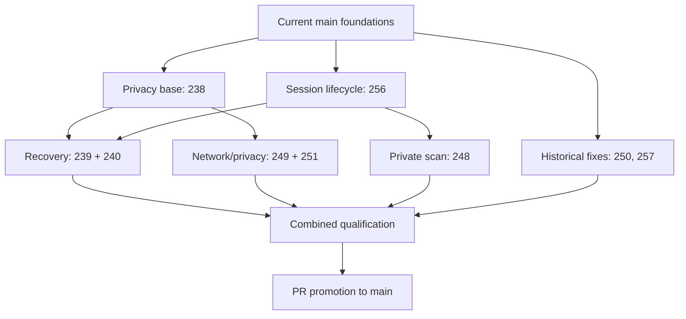

# GhostPay consolidation plan

## Integration rules

`main` is the final source target. Every source owner keeps their branch. A separate integration branch owns
conflict resolution; current source and target heads are rechecked before promotion. Preserve source ancestry
where applicable, and record selective ports when preserving a whole branch would reintroduce obsolete behavior.
Use the ordinary PR merge API with an expected head SHA. Never force-push, bypass required approvals, delete
unreviewed branches or weaken failing tests. Main branch-protection details returned HTTP 403 to this integration;
no assertion of absent protection is made. The accessible ruleset collection was empty.

Pages publishing is manual: `.github/workflows/pages.yml` requires `workflow_dispatch`, `deploy=true` and main.
None of this task's merges authorizes a dispatch or changes the deployment target.

## Dependency-aware queue

| Group | Sources / target | Dependency and order | Required next evidence |
| --- | --- | --- | --- |
| Historical audit | #214 | Completed first; merge `ffd982a7aea2856c186b40ef236a39720a1b81f5` | Verify resulting main contains exactly the ledger addition |
| Documentation recovery | #215/#216 plus missing #139/#140/#153 history | Independent isolated recovery branch; preserve dated evidence and correct live guidance | Review source pins, local links, exact-head documentation checks |
| Historical adapter repairs | #250 | #242 already in main; no runtime overlap with #256/#257 | Full CI/browser/native gates at exact head, not only preliminary jobs |
| Historical security safeguards | #245/#247 and SOCKS portion of #253 into #257 | Keep #87/#253 major dependencies separate; preserve raw circuit boundary assertion | Source review plus scanner/SOCKS/pool checks and applicable hosted qualification |
| Session lifecycle | #256; previous #227 already in main | Before or after independent historical fixes; reconcile AppShell with recovery work | Session/custody/clock regressions and both browser profiles |
| Recovery portability | #213/#229/#239/#240; base #238 | Reconcile #239 atomic import/KDF synchronization with #240 BOM and beforeunload safeguards | Focused package/UI suites, lean/full build guards, browser recovery, no-secret-flow review |
| Invoice signer | #243; foundation #234 already in main | Stacked on #238; integrate only current selected-pin validation delta | Current-chain and stale-session browser tests |
| Private seller scanning | #248; foundation #235 already in main | Reconcile with session authority from #256 and #238 privacy state | Encrypted crash/cancel/reorg checkpoint and discovery tests |
| Privacy/network policy | #222/#228/#230/#233 into #238; #249/#251 follow-on | Transport foundation #241 already in main. One policy generation/cancellation model must govern all consumers | Explicit-consent, cancellation, stale-plan, no-fallback and browser egress checks |
| Sweep balance consent | #231 into repaired #252 | Reconcile with privacy/network policy before combining with #238 | Disclosure, failed/late result, account/chain/session-change tests |
| Bitcoin scan | #219/#244 into #254 | Full-profile optional work; never import into lean Pages | Local spentness, inclusion/header validation, reorg and opt-in provider checks |
| Security closure | #212/#217/#220/#225 into #255 | Independent security owner; retain stricter fee acknowledgment when combining #246 | Complete current-source Mythril evidence, explicit finding dispositions and unchanged strict gate |
| Remaining completion | #209/#211/#218/#224/#226 into #238/#246 | Recover selected missing fixes; do not merge the entire stale source tree | Exact combined CI and independent source review |
| Dependency train | #87/#210/#253 and #207 | Isolated dependency lane; do not mix with runtime repairs or hide lockfile failures | Install/dependency-tree correctness, native/browser/full regression matrix |

## Critical conflict decisions

- Recovery's event-time `beforeunload` protection must cover every loaded sole-copy session, including suspended sessions.
  Do not retain only #256's suspended-session registration when integrating the broader recovery safeguard.
- Keep #239's atomic session installation, failed-download retry path and real-promise KDF/barrier tests.
  Port #240's raw-byte BOM refusal without restoring its polling-based flaky tests.
- #255 binds the fee-token acknowledgment to chain/token runtime/fee/recipient configuration.
  #246's older token-only #217 recovery must not overwrite that stricter policy. The fee-recipient decision remains deferred.
- All candidate branches append worker claims. Preserve every claim when `docs/ai/ACTIVE_WORK.md` conflicts.
- A whole historical or dependency branch can contain already-recovered code, unique useful fixes and obsolete architecture together.
  Selective recovery is preferable when current behavior has diverged.

## Graph

This graph is an integration dependency sketch, not a substitute for exact Git ancestry in `branch-audit.json`.
Security #255 remains an independent gate; no queued/failing analyzer result is relabeled as success.

## Current publication and handoff

Documentation recovery is PR #259; focused recovery reconciliation is PR #260, deliberately based on #239.
Before any main merge, reread the integration lease at `automation/ghostpay-integration-lock:integration-lock.json`.
Do not override the observed other owner. Do not merge the metadata branch. #216 was independently merged
during this task; main is `a36f48da` at the later census. #249, #210 and #256 have newer heads than their initial
review snapshots. Re-review each delta and discard stale qualification claims before consolidation.
