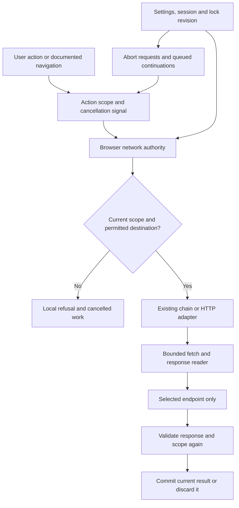

# Browser network isolation

GhostPay authorizes application-controlled network requests for a particular action, selected endpoint, network and live session. The browser client refuses an unscoped request, an obsolete authorization, a prohibited destination or a redirect. Local invoice signing, key generation, QR processing and backup-file handling do not need an RPC connection. Recovery or export flows that verify on-chain proofs use the separately authorized proof/RPC path.

This document describes the combined candidate that retains [PR #241](https://github.com/djshellshoxxx/GhostPay/pull/241) and integrates the privacy and Pages work in [PR #238](https://github.com/djshellshoxxx/GhostPay/pull/238). It is an implementation description, not a release approval. The [acceptance and independent-review ledger](network-isolation-acceptance.md) records exact dependencies, observed defects, tests and remaining qualification. The [37-surface inventory](network-egress-inventory.json) records individual destinations, payloads, authorization, cancellation, limits and referenced tests. Historical #241 results remain in its [source-pinned handoff](../handoffs/BROWSER_NETWORK_ISOLATION_2026-11-18.md).

## What the controls mean

Configure an endpoint in Settings, then initiate the operation that needs it. Saving an endpoint does not issue a reusable grant. Settings **Test** authorizes a connection check against the entered endpoint; it does not enable scanning, balance queries or sending. Pay opening performs its existing invoice preflight against the selected endpoint. After cancellation or a network-settings change, Pay pauses until **Review network access for this invoice** is selected.

The **Cancel network activity** control revokes the current page's grants and cancels application-owned work. Changing endpoint, network, privacy preferences or seller identity also invalidates affected work. Locking cancels network authority even when recovery rules retain the only copy of seller keys in memory. Cancelling never deletes recovery material or a transaction-attempt journal.

| Choice | Application behavior | Limit of the claim |
|---|---|---|
| Direct with no required private path | An initiated operation may contact its selected endpoint. | The provider sees the request and ordinary network metadata. |
| Require private path + Direct | Network actions are refused, except a documented explicit one-action disclosure in Sweep or merchant profile loading. | This is a refusal rule; it does not create a private route. |
| Require private path + local proxy | The selected destination must be literal loopback. | Page JavaScript cannot verify how that local service forwards traffic. |
| Tor Browser profile | Nondefault selection requires acknowledgement. Requests retain their selected destination and use the browser's routing. | The page cannot detect, prove or start Tor. A Tor preference selected in an ordinary browser does not route traffic through Tor. |
| Own-node RPC mode | RPC and indexer endpoints must be literal `localhost`, `127.0.0.1`, `[::1]`, or a valid v3 onion hostname. The check applies again before dispatch and retry. | This verifies an address category, not node ownership or independent chain verification. Relayers and explicitly selected merchant resources are separate categories. |

Remote endpoints require HTTPS. Literal loopback HTTP is accepted by the relevant adapters. The default Pages CSP permits HTTPS and same-origin connections, so a cross-origin plain-HTTP loopback node is blocked by that hosting policy; use an HTTPS loopback endpoint or a separately reviewed same-origin local deployment. Browser local-network, certificate and CORS rules still apply. This task does not broaden CSP. Own-node onion RPC URLs retain the existing HTTPS requirement. URL userinfo and fragments are refused. Prefix transports also refuse a base query string because appending API paths would be ambiguous; supported exact-URL adapters may use a deliberately supplied query. Stored WebSocket settings do not create a browser WebSocket transport: unsupported transport requests fail instead of switching to HTTP or another provider.

## Authorization architecture

`lib/networkAuthorization.ts` is the shared browser boundary. `defaultServices` owns one authority and gives production callers no unrestricted `fetchFn`. `Services.createRpc` requires an opaque context issued by that same authority; a fabricated context or one from another authority is rejected. Every RPC transport invocation checks the context before the existing client can retry. A cached client therefore cannot acquire permission merely because its URL was once configured.

A grant contains an immutable action, category, network and normalized endpoint, together with an operation signal and captured revisions. Exact matching is used for EVM and Solana RPC and individual resource/relayer requests. Esplora, TRON, indexer and selected Bitcoin oracle transports use an origin and path-boundary prefix, with their existing API/path validation underneath. A prefix for `/api` does not authorize `/api-other`, another origin or a redirect. Worker bridge traffic is matched to the finite endpoints explicitly chosen for that Bitcoin action.

The authority rereads the raw settings, scan privacy, scan-lane and network-profile records at dispatch and response-read boundaries. A present malformed record, unavailable storage, unacknowledged nondefault profile, changed endpoint or changed revision causes refusal. If a record observed by the page disappears, that page does not interpret its deletion as a new permissive installation; an explicit valid replacement repairs the state. A fresh page with no saved preferences starts with the documented defaults, and never restores an old action grant.

Relevant storage events revoke grants in other tabs. AppShell refreshes persisted settings, clears obsolete session-only endpoints and discards cached clients. Open Settings forms resynchronize and compare their original storage revision before saving, so a stale form cannot overwrite a newer endpoint. Per-dispatch raw-record comparison also covers the interval before the storage event is delivered.

Grants are kept in memory only. They expire after ten minutes without use, and wall-clock checks reject backward time changes or expired requests after browser sleep. They do not persist an invoice, balance address, destination or consent token to localStorage. Scope labels are never transmitted.

## Actions and request permissions

| Flow | Current action scope | Additional boundary |
|---|---|---|
| Settings Test | `settings-check` | Unsaved entered URL may be checked; edit, replacement test or unmount aborts it. |
| EVM scan / secondary cross-check / indexer | `scan` | Selected scan plan and endpoints; no direct fallback if the required plan fails. Window, jitter and indexer calls carry cancellation. |
| Pay preflight, gas-buffer reads and submission readback | `payment-preflight` | Invoice, settings and network revision; cancellation pauses preflight and stops delayed preparation. Wallet submission remains separate. |
| Sweep balance | `sweep-balance` | Exact owner and asset; only the chain check plus that native balance or token `balanceOf` call is permitted. |
| Sweep quote / preparation reads | `sweep-quote` | The current payment/action, selected RPC and exact configured relayer quote route. |
| Sweep send / replacement | `sweep-submit` | New explicit action; selected RPC or relayer sweep route. Only this EVM scope may send a raw signed transaction. |
| Sweep verification | `sweep-status` | Current attempt and endpoint; a failed lookup does not prove no broadcast occurred. |
| Registry lookup / publication preflight and readback | `registry-read` | View/input/session/network scope; wallet continuation checks captured authority. |
| Experimental policy accounts | `policy` | Verified deployment scope and signal; changes invalidate review, deferred lock callbacks and readback. |
| Bitcoin scan / spend | `btc-scan` / `btc-sweep` | Selected network and Esplora/oracle prefixes; scan scope cannot broadcast. |
| Solana scan / spend | `solana-scan` / `solana-sweep` | Selected network and exact node URL; scan cannot send a transaction. |
| TRON scan / spend | `tron-scan` / `tron-sweep` | Selected network and node prefix; scan cannot use broadcast routes. |
| Explicit merchant profile Load | `merchant-profile` | Exact displayed URL, abortable loading and independent signer pinning. |
| Home release hash | `release-hash` | Same-origin entry-script fetch initiated by Home navigation, with no endpoint alternative. |

The exported action type also reserves more-specific names for future wiring; the table describes names actually used by this candidate. Ordinary EVM actions are restricted to an allowlist of read methods. The application boundary never grants `eth_sendTransaction` or wallet-signing methods. Transaction construction, simulation, signature validation and broadcast-attempt journals continue to enforce their existing separate requirements.

Supported network references match the existing browser features: enabled EVM chain configurations plus the explicit local test chain, Bitcoin testnet/testnet4/signet/regtest, Solana devnet/testnet/localnet, and TRON Nile/Shasta/local. This does not enable new production chains or override adapter genesis/network verification.

## Sweep consent and disclosure

Opening or reentering Sweep does not automatically read the stealth balance. **Read balance from the Settings RPC** authorizes the displayed payment, asset and endpoint for that balance read. It does not authorize a quote, transaction preparation, signing or submission. Quote, review/send, replacement and status actions have separate contexts and the existing transaction consent and backup gates.

A deliberate Sweep action can permit the disclosed direct request when a required scan-private path would otherwise refuse it. The exception is scoped to that action and endpoint, is never persisted, and never overrides own-node restrictions. Changing payment, asset, chain, endpoint, destination, mode, factory/deployment or seller session invalidates the affected work. Late balances and quotes are discarded. No consent checkbox, saved URL or completed previous action turns into blanket future permission.

The UI shows the selected RPC or relayer endpoint and explains that the chosen service receives the action's request. A provider may link an exact balance query to interest in that address. Relayer submission may reveal the destination, amount, authorization and transaction relationship. Private scan transport does not hide a later direct balance query or public-chain transaction.

## Cancellation, bounds and failures

Cancellation is independently enforced around asynchronous fetch and response reads. It does not rely only on an injected implementation honoring `AbortSignal`. Already-aborted operations dispatch nothing. Timers race stalled fetches and readers, late responses are discarded, and cancellation/release cleanup is not awaited indefinitely. Wall-time checks refuse a response whose deadline elapsed while the browser was suspended. Synchronous CPU execution and a suspended JavaScript event loop are not preempted by a timer.

The shared authority has a 30-second request deadline. Existing adapter deadlines and per-route byte limits remain additional constraints. EVM uses the reviewed `@ghostpay/net-transport` implementation from #241. Solana retains a 20-second default and 8 MiB cap; TRON retains 15 seconds and 8 MiB. Browser relayer requests use 15 seconds and 16 KiB. Esplora retains its 30-second default and route-specific limits, including 16 MiB per block-transaction page and the existing 64 MiB cumulative block-JSON allowance across pages. Indexer requests retain the scan source's supplied timeout and body budget. Release hashing retains its separate 15-second/8 MiB bound. The effective limit is the smallest applicable authority/adapter/route limit; test overrides do not alter production defaults.

Every application fetch sets redirect refusal, omitted credentials, no referrer and no-store. Required application content-type/accept headers are permitted; existing gRPC-Web and explicit TRON API-key support remain constrained to their adapters. There is no cookie/authorization-header forwarding. The browser may still send its required `Origin` header or perform a CORS preflight. Final response URLs and redirect metadata are checked as well as the initial target.

Errors use local categories and translated messages. Endpoint URLs, queries, bodies, remote exception objects, abort reasons and response text are not copied into network failure messages or causes. Recognized relayer error fields are allowlisted. A declined, malformed, unreachable or oversized response does not select another provider. Existing finite retry logic must recheck the same live grant. The relayer's single legacy unpadded compatibility retry uses the same action signal and does not acquire a new exception.

Cancelling after dispatch cannot make sent bytes disappear. Cancelling a wallet request cannot recall a transaction from an independent wallet or the network. Unknown broadcast outcomes retain their journaled hash/state and must not become automatic retry permission. View changes, session changes and new invoices prevent late results from changing the current flow. A scan's optional timer is synchronously disarmed on revocation; Pay and policy continuations cannot mint a replacement grant merely because an old timer or browser lock resumes.

## Offline work and boundaries outside page control

After the static application has loaded, key generation, plain key import, encrypted backup-file handling, invoice signing/parsing, QR encoding/decoding, local camera processing and preference editing remain local. Recovery and Spec 18 exports that require chain proofs or `eth_getCode` use the separately authorized read client; they are not represented as wholly offline. Default deployment manifests are compiled into the bundle. A retired manual remote-manifest helper remains listed as retired in the inventory so its removal is auditable. Verification against chain state, scan/proof/balance queries, fees, relayer access and transaction status require their documented external service.

Static HTML/module/CSS/worker loading follows the user's navigation and browser resource policy before application authorization runs. Home's same-origin release hash is an explicit navigation exception that remains available when private preference storage is broken. No remote fonts, mandatory analytics, updater, service worker or fallback CDN is introduced. Wallet icons are bounded data URIs. Network-free workers use constrained main-thread bridges instead of arbitrary worker fetches.

External wallets, intentional links, parent-window messages and independent browser/extension traffic are separately inventoried. Wallet discovery and transaction prompts keep their existing consent/session checks, but page JavaScript cannot govern a wallet's own RPC provider, DNS, cookies or telemetry. Merchant messages retain exact origin/source validation; a merchant can transmit what it receives independently.

HTTPS and Tor transport protect different parts of a request's path. Neither prevents the selected server from observing the data it receives, and neither erases public-chain amount, timing or relationship data. Application isolation cannot hide the user's IP from a direct provider, prove DNS routing, control TLS/SNI outside the browser's routing, remove browser history or attest a compromised host. The in-app hash helps compare assets; it is not an independent proof that the served source is trustworthy. GitHub Pages static CSP cannot supply every server-header protection.

## Adding or changing a network action

1. Identify the user interaction, payload and permitted endpoint. Choose the narrowest existing action/category and exact URL where possible. A stored endpoint alone is not an action.
2. Create a per-operation cancellation signal and obtain a context through `services.network.authorize`, or use `app.getRpc(chainId, { action, signal, ...scope })`. Production code must not call `globalThis.fetch` directly or reuse the unscoped service fetch.
3. Pass the context fetch into the existing bounded adapter. Preserve its parser, byte limits, deadline, finite retry and ambiguous-broadcast rules. Do not acquire a new context inside automatic retry or a delayed continuation.
4. Capture session, input and network revision before asynchronous work; assert them before later dispatch and state commit. Abort on replacement/unmount. Dispose a finite resource-load grant after reading its body. Existing read clients retained for scan proof exports remain subject to revocation and idle expiry.
5. Update the matching inventory row, request-reference snapshot and actual traffic regressions. A new surface requires review; refreshing counts cannot automatically add ownership.

Run `node --test scripts/tests/network-egress-inventory.test.mjs` and retain the existing `privacyInvariants`, bundle, package, full/lean browser, Pages, typecheck, lint and secret/security gates. The inventory checks new network references in known modules as well as newly added modules, but it cannot prove absence of dynamically constructed APIs or arbitrary third-party behavior. Unit and native HTTP tests, browser request observations and independent source review provide different evidence; record each honestly against its tested source.
