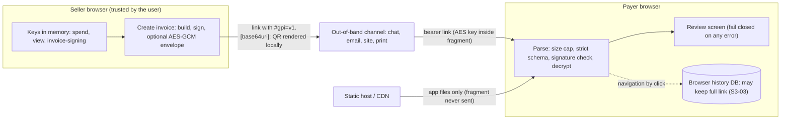
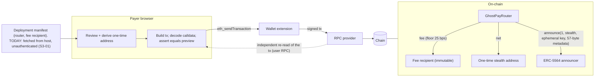
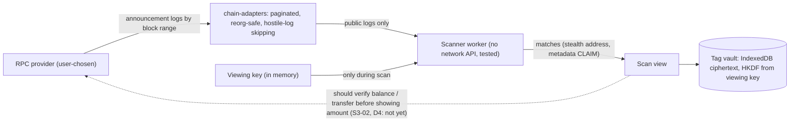
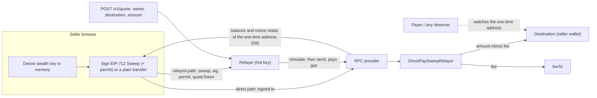
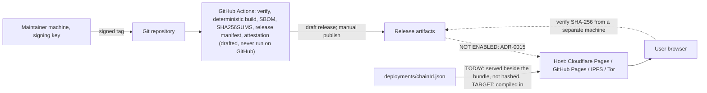

# GhostPay Threat Model (v2)

Status: **pre-audit, nothing deployed.** This document replaces the 29-line baseline. It complements the matrices in MASTER_BLUEPRINT.md section 3 and DEVELOPER_SPECIFICATION Section 3, and the revenue-path threats introduced by FEE_SCHEDULE.md. It is a design-level model written from the code and the audits; it is not a test result and not a guarantee. Evidence sources: [audit 01](../audits/01-completeness-audit.md), [02 (contracts)](../audits/02-security-review-contracts.md), [03 (client and relayer)](../audits/03-security-review-client-relayer.md), [04 (design)](../audits/04-independent-design-analysis.md), [Slither triage](../audits/00-slither-triage.md).

Status vocabulary used below: **Open** (no fix in the tree), **In progress** (another contributor is changing code or docs for it; not verified by this document), **Mitigated** (control exists and is tested; residual risk named), **Accepted** (inherent, disclosed), **Owner** (business or legal decision).

## 1. Scope, assets and assumptions

Assets, in order of harm if lost: (1) seller spending keys (funds in every one-time address); (2) payer funds in flight; (3) seller viewing key and local tags (payment history); (4) the integrity of the addresses a payer is told to pay (router, fee recipient, one-time address); (5) invoice contents (bearer link); (6) fee revenue; (7) relayer hot-key balance and availability.

Assumptions (if any is false, much of this model is void): the user's browser, OS and wallet are not compromised; noble, viem and OpenZeppelin releases are authentic and correct (note: two noble majors are installed, see [THIRD_PARTY.md](../../THIRD_PARTY.md) section 1); the canonical ERC-5564 announcer is deployed at the stated address; token contracts behave per the allowlist; the host serves the released files unmodified (this is exactly what is **not** guaranteed today).

Trust boundaries: browser tab (keys live here) | wallet extension | static host/CDN | user-chosen RPC provider | relayer operator | public chain | release pipeline and maintainers' machines.

## 2. Observer table: who learns what

(Kept from the baseline; extended with the payer and invoice-link holders, matching the in-app table.)

| Observer | Learns | Does not learn |
|---|---|---|
| Public chain analyst | Payer address, token, gross/net amounts, fee flow to `FEE_RECIPIENT`, router use, announcement (stealth address, ephemeral key, view tag), timing, sweep source/destination if swept in the clear | Seller identity from the stealth address alone, invoice contents |
| **The payer** | The one-time address they paid, so they can follow it to wherever it is swept (D1) | Seller keys |
| Static host / CDN | Client IP, user agent, which app assets were fetched, timing | The URL fragment, keys, invoice contents |
| RPC provider | Client IP, queried block ranges and addresses (including a one-time address checked before sweeping, D8), submitted transactions | Viewing/spending keys (never sent), invoice contents |
| Relayer operator | IP (hashed), owner stealth address, destination, token, amount, fee, timing; can censor or delay | Keys |
| Wallet provider | Transaction requests, chain, addresses connected | Keys of the stealth wallet |
| Anyone holding the invoice link | Entire invoice (bearer link) | Seller keys |
| Anyone holding two invoices of one seller | They share a seller (stable meta-address, D3) | Keys |
| Fee recipient (project owner) | Aggregate fees on-chain only | Payer or seller identity beyond public chain data |
| Browser profile / device owner | The invoice link, if the browser's history database stored it (S3-03); settings and RPC URLs in `localStorage` | Keys, unless the browser/OS is compromised |

## 3. Data-flow diagrams

Diagrams show trust boundaries as subgraphs and name the data on each edge. They describe the designed system; flows that are not built are marked.

### 3.1 Invoice link flow (seller creates, payer opens)



Trust boundaries crossed: the link leaves the seller's browser through an untrusted channel; the host sees only file requests. The fragment is invisible to the server but visible to page scripts, extensions, history and clipboard managers.

### 3.2 Payment flow



The payer may instead transfer to the stealth address directly (no router, no fee, no metadata checks).

### 3.3 Scan flow



Everything in an announcement except the match itself is attacker-controlled when the announcement did not come through the router.

### 3.4 Sweep and relayer flow



The relayer cannot change destination, amount, fee or `feeTo` (enforced on-chain by the signature). It sees all of them and the timing. The dotted edge is D1: the payer can follow the funds.

### 3.5 Release and hosting flow



## 4. STRIDE per flow

Legend: S spoofing, T tampering, R repudiation, I information disclosure, D denial of service, E elevation of privilege.

### 4.1 Invoice link flow

| | Threat | Control today | Residual / status |
|---|---|---|---|
| S | Attacker sends a link of their own that looks like the seller's | Signature shows consistency only; "trusted seller" requires a pinned signer key (ADR-0002) | A bare link authenticates nobody; payers must know the seller out of band. Accepted, UI wording enforced |
| T | Link edited in transit (amount, destination) | Strict parser, size cap 16 KiB, signature over the full canonical invoice, AES-GCM with AAD (chain, signer) | An attacker who re-signs with their own key produces a valid link for their own meta-address. Same as S |
| R | Seller denies issuing an invoice | Signature by invoice-signing key | Only meaningful if the key was pinned |
| I | Link read by a third party | AES-GCM envelope option; key in fragment; "bearer link" label | Anyone with the link reads it. Persisted in browser history DB (S3-03, **Open**), clipboard managers, messengers' link previews |
| I | Same meta-address in every invoice | None | D3 **Open** (per-client meta-address is backlog) |
| D | Oversized or hostile payload | 16 KiB cap, depth limit, no duplicate keys, fail closed, fuzz tests; invoice and quote times capped at 9999-12-31T23:59:59Z, so a validly signed link with a huge time is rejected instead of crashing the review render (G1-01); total time formatting in the web app | Mitigated. A view-level `ErrorBoundary` component exists; wrapping the view switch in `App.tsx` with it (so any other render error shows an error panel, not a blank app) is pending integration |
| E | Hostile text becomes script (XSS) | React text rendering, no `innerHTML`, CSP `script-src 'self'`, lint bans, bundle scan, e2e "hostile text is rendered inert" | Bidi/zero-width characters accepted in text fields (S3-12, Low, Open) |

### 4.2 Payment flow

| | Threat | Control today | Residual / status |
|---|---|---|---|
| S | Poisoned manifest names an attacker router and recipient | Manifest validator (format only); preview-equals-calldata compares against the same manifest | **S3-01 High, In progress**: no signature verification, no on-chain read-back, manifest not in the hashed bundle. Until done, a one-file host change redirects all payments |
| S | Malicious wallet or provider alters the tx | App decodes final calldata; independent re-read through the user RPC; refuses on mismatch (tests) | Needs a user RPC to verify; a provider lying about everything with no second path is undetectable |
| T | Payer-controlled metadata or view tag | Router enforces 57-byte layout, 33-byte key; cannot verify tag or key | D4 / contracts L-02: undetectable payment possible. **Open** |
| T | Fee-on-transfer, rebasing, reentrant tokens | Balance-delta checks, reentrancy guard, mocks and invariants | Mitigated; tokens with blacklists can still revert payments |
| R | Payer denies paying | Chain record; seller can verify a claimed hash in one step | Mitigated |
| I | Payment details public by design | Disclosed in app ("What becomes public") | Accepted. Router is a fingerprint (D2) |
| I | Gas buffer links payer to stealth address | Off by default; notice | Accepted |
| D | Fee recipient blacklisted or rejects ETH | None on-chain (immutable) | D5 / M-01 **Open**; runbook, monitoring, migration only |
| D | Expired or stale quote | Deadline in the router; client expiry checks | Mitigated |
| E | Token approval left open | Approval limited to the gross amount | Approval is sent before the final preview and stays after an abort (S3-19, Low, Open) |

### 4.3 Scan flow

| | Threat | Control today | Residual / status |
|---|---|---|---|
| S | Forged announcement with attacker-chosen amount/token | Match is key-based only | **S3-02 Medium, In progress**: seller UI shows claimed amounts for non-router announcements. Check balances |
| S | Malicious RPC injects, drops or reorders logs | Chain-id check, hostile-log skipping, reorg cursor | Single-provider trust; fallback reconciliation unused (S3-14, G-21). **Open** |
| T | Tag vault records spliced | AES-GCM with chain id in AAD, tamper detection tests | Record ciphertexts can be swapped between ids (S3-16, Low, Open) |
| I | RPC learns IP and queried ranges | Own node / Tor guidance | D8; the app has no Tor mode |
| I | Viewing key leakage | Worker has no network API (test + bundle scan), secrets non-serialisable | Redaction wrappers are guardrails not a boundary (S3-08). A compromised page defeats it |
| D | Log flooding, spam announcements | Pagination, caps, view-tag fast path | Cost grows with announcement volume |
| E | Tag vault XSS while unlocked | Lock on idle/tab close; caveat in UI | No XSS-while-locked test (F4 gap) |

### 4.4 Sweep and relayer flow

| | Threat | Control today | Residual / status |
|---|---|---|---|
| S | Relayer impersonates the signer | EIP-712 signature checked on-chain (ECDSA, low-s), nonce bitmap, domain binds chain and contract | Mitigated |
| T | Relayer changes destination, amount, fee | Impossible on-chain (inside signature) | Mitigated (Slither `arbitrary-send-erc20` triaged as by design) |
| T | Front-run permit | Permit in `try/catch`; sweep still succeeds | Mitigated |
| T | Direct sweep to attacker-chosen contract / uncapped fee fields | Destination validation | S3-09 (Low, Open) |
| R | Dispute about a sweep | On-chain event `Swept` | Mitigated |
| I | **Sweep links one-time address to destination; payer can follow** | Generic linkability notice in UI | **D1 High, In progress**: sharper copy, destination-history warning; fresh destination is the user's job |
| I | Relayer sees owner, destination, amount, timing, IP | Hashed IP, no persistence, no bodies in logs (PRIVACY.md) | Inherent. D8 |
| D | Relayer censors, delays, runs out of gas funds | Deadline <= 30 min; direct path exists | Availability only |
| D | Griefing: reverted sweeps, breaker poisoning, XFF spoofing | Simulation before send, budgets, breaker, limits | S3-05 (stuck half-open), S3-06, S3-07: **In progress**; see [relayer runbook](../operators/relayer-runbook.md) |
| E | Hot-key theft | Low balance, file mode 600, systemd sandbox | Bounded by balance; contracts never hold user funds |
| E | Silent sweep signed by a compromised page | No wallet confirmation on the sweep path | D7: total compromise |

### 4.5 Release and hosting flow

| | Threat | Control today | Residual / status |
|---|---|---|---|
| S | Fake site or mirror | None; no official host exists | Do not trust any host (ADR-0015) |
| T | Host or CDN serves modified bundle | Static hash widget (same origin), CSP | **S3-04 Medium**: widget cannot detect the threat. Real check is external (SHA256SUMS from a separate machine) once signed releases exist |
| T | Compromised dependency / CI | Exact pins, lockfile, `npm ci --ignore-scripts`, SHA-pinned actions, `npm audit` | Two noble majors installed (THIRD_PARTY.md); CI never observed running on GitHub (S3-17); no provenance verification by users yet |
| T | Poisoned manifest | See 4.2 | **In progress** |
| R | Who released what | Signed tag requirement drafted (presence check only in CI) | Key and fingerprint do not exist |
| I | Host logs IP / user agent | Disclosure in privacy table | Accepted |
| D | Host takedown / DNS or account compromise | IPFS/Tor mirrors planned | Not built |
| E | Maintainer account takeover | Required reviewers on the `release` environment (to be configured) | Owner action |

## 5. LINDDUN privacy view

| Category | Where it appears | Status |
|---|---|---|
| **Linking** | Sweep links one-time address to destination (D1); same meta-address across invoices (D3); router traffic is enumerable by fee recipient (D2); gas buffer links payer to stealth address; RPC joins IP with address (D8) | D1 In progress, D2 Accepted (disclosed), D3 Open, D8 Open |
| **Identifying** | Registry publication ties meta-address to a wallet (not built, warned); link-holder reads invoice | Open |
| **Non-repudiation** (unwanted) | Invoice signature proves the key signed it; chain records everything | Accepted |
| **Detecting** | Observer can tell GhostPay payments by `caller == router` and fixed metadata shape | Accepted (D2) |
| **Data disclosure** | Bearer links in history DB, clipboards; `localStorage` holds RPC URLs in plain text | S3-03 Open; settings caveat shown |
| **Unawareness** | Users may not realise payer can follow sweeps; docs now say so | [Sweep guide](../user/sweep-and-gas-privacy.md); app copy In progress |
| **Non-compliance** | Operator duties for relayer and fee collection (sanctions, money transmission, GDPR-style notices) | Owner (D10, ADR-0006) |

## 6. Attack trees

Text trees: `OR` = any child suffices, `AND` = all required. Leaves carry the current control or gap.

### 6.1 Compromised frontend (goal: steal keys or redirect funds)

```
Steal seller keys or redirect payer funds via the frontend
OR 1. Serve a malicious bundle
   OR 1.1 Compromise the host account / CDN / DNS                     gap: no signed release, no mirror comparison (S3-04, ADR-0015)
   OR 1.2 Malicious mirror or lookalike domain                         gap: no official host; users cannot tell
   OR 1.3 Compromise the build: CI, maintainer, dependency            ctl: exact pins, ignore-scripts, SHA-pinned actions, bundle scan; gap: CI unobserved, two noble majors, no provenance check by users
   OR 1.4 Browser extension injects script into the page               ctl: none possible from the app; D7
 2. AND the malicious code acts
   OR 2.1 Derive attacker stealth addresses for payers                 effect: payments go to the attacker
   OR 2.2 Sign sweeps to attacker destination                          effect: no wallet prompt on this path
   OR 2.3 Exfiltrate viewing/spending keys                            ctl: worker has no network; gap: page itself can fetch (CSP connect-src https: wss:)
   OR 2.4 Swap the manifest                                           gap: S3-01
   OR 2.5 Strip protections (fail-open parser, fake "verified")      ctl: tests; gap: attacker controls the tests' subject
Mitigations to build: signed releases + external verification, manifest compiled in + on-chain read-back, optional offline signer/hardware path for sweeps, narrower connect-src when the RPC set is known.
```

### 6.2 Poisoned manifest (goal: payers send to an attacker router/recipient)

```
Make the app pay an attacker contract
OR 1. Alter deployments/<chainId>.json at the host                    gap: S3-01 (served no-store, outside the hash)
OR 2. Poison a mirror or CDN edge with a stale/modified copy         gap: no mirror comparison
OR 3. Submit a reviewed-looking PR that changes one address           ctl: review; gap: no CI check comparing addresses with the chain
OR 4. Substitute a lookalike deployment on the right chain           gap: bytecode hash is format-checked only
AND, in all cases, the app's checks still pass because preview and calldata are compared with the same manifest value.
Target controls (in progress): manifest in the hashed bundle; read-back of FEE_RECIPIENT(), FEE_BPS(), ANNOUNCER() and code hash from two RPCs; show on-chain values; detached signature with an out-of-band key.
Residual after those: a user on a compromised device/RPC pair; users who never update from an old build.
```

### 6.3 Relayer abuse (goal: drain the operator or deny service)

```
Harm the relayer or its users
OR 1. Drain gas funds
   OR 1.1 Front-run own signed sweep so the relayer's tx reverts       gap: S3-06; ctl: simulation, daily budget, gas caps
   OR 1.2 Mint many owner addresses to dodge per-owner limits          gap: S3-06 (in progress: per-destination/owner failure caps)
   OR 1.3 Exploit an under-priced quote (stale nativeUsdPrice)         ctl: operator-set numbers; gap: no oracle (G-26)
 2. Deny service
   OR 2.1 Open the breaker with induced failures                       gap: S3-06
   OR 2.2 Leave it latched in half_open while /healthz says ok         gap: S3-05 (fix in progress)
   OR 2.3 Spoof X-Forwarded-For / IPv6 /64 rotation to evade limits   gap: S3-07
   OR 2.4 Flood /v1/quote (unauthenticated, RPC call per request)      gap: IP limit only
 3. Surveil users
   OR 3.1 Operator logs bodies/IPs                                     ctl: logger cannot emit them; gap: operator can modify the code or proxy
   OR 3.2 RPC provider sees simulations                                inherent
 4. Steal user funds                                                    blocked on-chain: destination, amount, fee, feeTo are signed
```

### 6.4 Oracle failure (goal: payer overpays/underpays, or payment blocked)

```
Price is wrong or unavailable
OR 1. Stale answer accepted                                            ctl: maxAge check, round integrity; FEEDS empty so unused today
OR 2. Zero/negative/oversized answer                                   ctl: rejected, fail closed
OR 3. Wrong feed address or decimals configured                        ctl: FEEDS table reviewed; gap: no verified addresses (ADR-0012), so fiat is disabled
OR 4. L2 sequencer down or just restarted                              gap: no sequencer-uptime check designed yet
OR 5. Feed paused / deprecated                                         result: payment blocked (fail closed)
OR 6. Manipulated source (TWAP not built; Chainlink only)              n/a today
OR 7. Relayer uses an operator constant, not an oracle                 gap: price risk on gas; USD stables only mitigates the token side
Policy: fiat-priced invoices stay disabled until feeds are verified per chain (ADR-0012).
```

## 7. Named risks D1-D10 (design analysis) with status

Ratings are those of [audit 04](../audits/04-independent-design-analysis.md). "Status" is the state of the repository when this document was written; nothing here has been retested.

| ID | Risk | Severity | User-facing statement | Status |
|---|---|---|---|---|
| D1 | Sweep destroys the privacy the product sells: payer follows stealth address to the destination | High | Use a fresh destination; payer can follow; relayer sees X; gasless is not unlinkable ([guide](../user/sweep-and-gas-privacy.md)) | Docs done. App: generic notice exists; sharper copy and destination-history warning **In progress** |
| D2 | Single-router anonymity set and fingerprint | Medium | GhostPay payments are enumerable; anonymity set is GhostPay users | Accepted; now in the user privacy page |
| D3 | Seller meta-address is a stable public identifier | Medium | Two invoices prove one seller; registry makes it public | Open; documented; per-client mode is backlog |
| D4 | Payer-controlled view tag lets a payment go undetected | Medium | Payer can hide a payment from a tag-filtered scan; ask for a tx hash | Open; deep-scan mode and proof flow not built |
| D5 | Immutable fee recipient vs token blacklist / non-payable recipient | Medium | Checkout for an asset can stop until a new router ships | Open; operator requirements and migration written ([runbook](../operators/deployment-runbook.md), ADR-0013) |
| D6 | Policy account: stolen-key resistance is bounded, no recovery | Medium | Do not market as theft-proof; destination becomes public | Open; ADR-0014 marks it experimental, contracts only |
| D7 | Frontend compromise is total compromise | High (inherent) | Verify releases from a separate machine; no official host | Open; release pipeline drafted; signing, manifest pinning **In progress**; hosting gated (ADR-0015) |
| D8 | RPC and relayer metadata joins | Medium | Public RPC sees your IP and the address you check; relayer sees everything | Open; guidance in [local scanner and RPC](../operators/local-scanner-and-rpc.md); on-screen warnings In progress |
| D9 | Revenue-path integrity: one recipient per chain; fees avoidable | Low-Medium | Fee bypassed by direct payment; recipient key loss loses revenue not user funds | Accepted; hardware/multisig requirement documented |
| D10 | Compliance and operator exposure | Business | Operators may have legal duties | Owner action; relayer `PolicyGate` hook only |

Other audit findings that change user-facing statements: S3-01 (manifest unauthenticated, High), S3-02 (forged scanner amounts), S3-03 (history DB), S3-04 (hash widget), S3-05/06/07 (relayer availability), contracts M-01/M-02/M-03 (recipient bricking, scheme id, factory fee-token freeze).

## 8. Revenue-path threats (carried over and updated)

| Threat | Mitigation | Residual |
|---|---|---|
| Fee recipient key compromise (attacker redirects nothing, but receives all future fees; owner loses revenue) | Recipient is a multisig/hardware address; immutable per deployment; monitoring | Replacing it requires a redeploy and a new release |
| Fee recipient blacklisted or unable to receive ETH | Requirements and migration in the deployment runbook | Payments of the affected asset revert until migration (D5) |
| Router abused as a laundering/mixing front | Fee path is public; no custody; compliance gating belongs to hosted frontend/relayer (ADR-0006) | Owner carries operator obligations |
| Malicious frontend swaps recipient/fee | Preview-equals-calldata check; **manifest authentication and external release verification are not done yet** (the earlier version of this table listed release hash verification and manifest signature as mitigations; they were not effective, S3-01, S3-04) | Compromised release remains full compromise |
| Relayer quote tampering | Fee, feeTo, destination inside the stealth key's EIP-712 signature | Relayer can refuse service |
| Relayer drain via griefing | Simulation before send, per-owner and per-IP quotas, daily budget, gas cap, circuit breaker | Reverted-sweep griefing and breaker poisoning (S3-05/06) **In progress**; sustained spam degrades availability |
| Client-side fee stripped by a fork | Not preventable; contract-level fee only on routed payments | Disclosed in FEE_SCHEDULE.md and ADR-0013 |
| Direct payment bypasses fee | Not preventable | Disclosed |

## 9. What this model does not cover

Post-quantum assumptions; side channels in the user's device; legal analysis; the Bitcoin tier (`packages/btc-silent-payments` is not integrated); Feature 3 escrow (not built); Feature 5 beyond local scanning (not built); anything in code that changed after the audited commits; any real-world measurement of what each observer actually sees on a public testnet (not performed, audit D-13).
